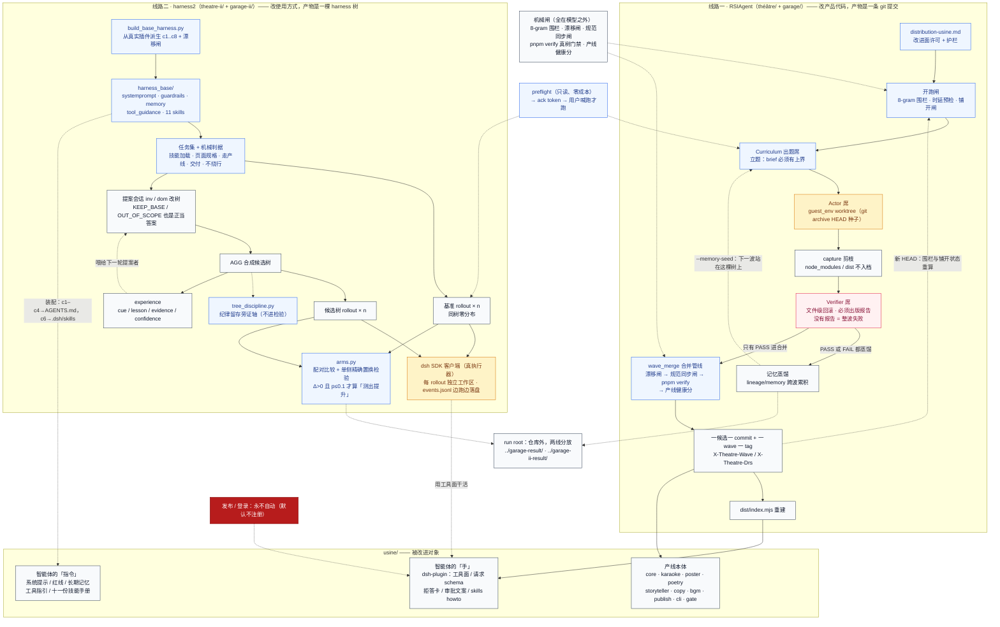

# explorateur

> 一个工作区仓库：一台多语种视频生产机器（`usine/`），加两条互相独立的 RSI 自进化线路，各自用**不同引擎改不同东西**。

本仓库是**工作区**，不是单体工程。根目录只放六样东西：产线（`usine/`）、两条 RSI 线路（引擎 + 适配层各一对）、跨线路共享配置（`config/`），以及 `AGENTS.md` 与 `README.md` 两份文件。两个独立应用 `humming` 与 `reading` 在**仓库外**同级目录 [`app/`](../app/)，各自维护、各自版本化，本仓不覆盖其文档与测试。

改代码前直接进对应子项目读它自己的文档；本文件只做索引。

---

## 目录结构

```
explorateur/
├── usine/            feuille —— 多语种视频生产与发布可复用层（TS pnpm monorepo，12 包 / 3.1 万行）
├── théâtre/          RSIAgent 引擎（vendored fork）  ┐ 第一条 RSI 线路：改「记忆」
├── garage/           该线路的适配层                 ┘
├── theatre-ii/       harness2 引擎（vendored fork） ┐ 第二条 RSI 线路：改「harness 本身」
├── garage-ii/        该线路的桥接层                 ┘
├── config/           跨线路共享配置（env.sample 入库；.env 本地、永不入库）
├── docs/             入门读物（`self-evolution.md`：自我进化怎么实现的，写给新手）
├── AGENTS.md         工作区级约束（agent 先读这个）
└── README.md         本文件
```

**第一次接触这个仓库？先读 [docs/self-evolution.md](docs/self-evolution.md)。** 它用零基础的语言把两条线路从头讲一遍：模型改的到底是什么、产物长什么样、哪几道闸会把它拒掉、以及**怎么才能相信"改完真的变好了"**（这一节比前面所有节都重要）。本文件与各子项目文档都假定你已经知道那些概念。

**运行产物不在仓库里。** 两条线路各落一个仓库外目录（与本仓库同级）：`../garage-result/`（RSIAgent 线）、`../garage-ii-result/`（harness2 线）。原因与机检位置见 [AGENTS.md](AGENTS.md)「运行产物落位」。

---

## 一、`usine/` —— 产线

feuille（法语：叶 / 一页）：课件与素材 → 多语种短视频，再发到四个平台。

| 维度 | 事实 |
|---|---|
| 是什么 | TTS / 渲字 / 合成 / 封面 / 发布 / 发布后核对，工作流 ①–⑬ 全覆盖 |
| 栈 | TS pnpm monorepo，Node ≥24、pnpm 11（锁在 `packageManager`） |
| 规模 | 12 个包（10 个业务/基础设施 + `gate` 门禁 + `eval` 健康分）、约 3.1 万行 TS |
| 数据层 | `languages/`（14 语种 manifest）、`personas/`（28 人班底）、`lessons/`、`themes/` |
| 门禁 | `pnpm verify` = typecheck + 全部 vitest 套件（含反向验证：坏数据必须 FAIL） |
| 入口 | [README](usine/README.md) · [**AGENTS.md**](usine/AGENTS.md)（22 条纪律，权威）· [docs/](usine/docs/) |

`usine/skills/` 下 11 个自建 SKILL 是本工程的内容能力入口，路由表见 [usine/skills/README.md](usine/skills/README.md)。**内容产物只允许落两处**：`usine/skills/<skill>/assets/`（可复用资产，入库）与 `usine/examples/<项目名>/`（内容产物，不入库）——机检在 `usine/packages/gate/test/layout.test.ts`。

```bash
cd usine && pnpm install && pnpm verify     # 全量门禁
pnpm feuille <组> <命令>                     # CLI（表驱动路由，未知命令退出码 2）
```

---

## 二、两条 RSI 线路

`usine` 除了人工演进，还由两台**自进化引擎**改进。两条线路都只对 `usine` 做单向安全改进，都不构成子项目间依赖，**改的东西不一样**。

### 原理图

图例沿用 [docs/self-evolution.md](docs/self-evolution.md) 的颜色语义：蓝＝编排控制面，琥珀＝沙箱内受限执行体，红＝隔离域，深红＝封禁路径，灰＝中性容器；虚线＝逻辑/反馈边，不是进程调用。



读图要点：

- **两条线改的是同一个智能体的两个部位**：线路一改「手」（工具面、schema、拒答卡、howto），线路二改「指令」（系统提示、红线、记忆、技能手册）。这就是它们不能互相替代、也不能直接比高低的原因。
- **只有线路一有「合并」这一步**，产物是可逐字复查的 git 提交；线路二的产物是一棵树，验收必须让智能体把活真干一遍再判分，所以实际耗时差一个量级（一次成功波次约 12–13 分钟，一轮 sweep 约 85 分钟）。
- **反馈边不同**：线路一靠 `--memory-seed` 把上一波蒸馏出的记忆喂给下一波的出题席；线路二靠 `experience` 记录把上一轮的教训喂给下一轮的提案者。累积物不复位，跨轮才有「进化」可言。
- **所有机械判定都在模型之外**：围栏、漂移闸、规范同步闸、真树门禁、健康分都会直接作废候选，不靠模型自述；发布路径在工具面上根本不存在，不是靠提示词劝阻。纪律留存轴是唯一只看不拦的一条——它报出「演化顺手删了纪律」，但不参与判决。
- **两边的起点都不是手抄的**：线路一的种子是 `git archive HEAD`，线路二的基准树从 `usine/packages/dsh-plugin` 派生并带双向漂移闸——基准一漂，读数就没有意义。

这些机械判定各自拦什么、失败时长什么样：

| 闸 | 拦什么 | 失败表现 |
|---|---|---|
| 8-gram 围栏 | 改进方向与受审计面出现逐字重叠 | 改 `distribution-usine.md` 的措辞，不改围栏 |
| 时延 / 时间预算 | 单次自进化超出时间上限或历史时延过高 | 默认拒跑；超时为独立终态、退出码 3 |
| 漂移闸（CRLF 折叠） | 工作树既不等于基线也不等于候选 | 整条候选 `drift` 跳过 |
| 规范同步闸 | 改了被规范的代码却没同批更新规范 | `spec_sync_rejected`，点名两侧路径 |
| 真树门禁 | `pnpm verify` 红 | `gate_rejected`，整案丢弃（假的 PASS 进不了仓库） |
| 产线健康分 | 任一 `packages/eval` 指标变坏 | `health_rejected`，工具自己坏了只记 notice |
| 纪律留存轴 | 演化顺手删掉或改写纪律条目 | 旁证轴报出差异；**产物判据看不见这类退化** |
| 发布红线 | 任何发布 / 登录路径 | 工具面默认不注册，VM 门面在执行前拒绝 |

| | 第一条 | 第二条 |
|---|---|---|
| 引擎 | [`théâtre/`](théâtre/) —— vendored [RSIAgent](https://github.com/AetherLabsAI/RSIAgent) @ `4d7ef43` | [`theatre-ii/`](theatre-ii/) —— vendored [harness2](https://github.com/google-research/harness2) @ `1cfe254`（Apache-2.0） |
| 适配层 | [`garage/`](garage/) | [`garage-ii/`](garage-ii/) |
| **改什么** | **记忆**——无 schema 的 Markdown 语料库，跨波次累积 | **harness 本身**——系统提示 / 红线 / 长期记忆 / 工具指引 / 技能路由 |
| 产物形态 | 一条 git 提交（源码 + 测试 + 审计） | 一棵可 diff 的 harness 树（落盘在 run root） |
| 验收 | 验证席判 PASS + 真树 `pnpm verify` 退出码 | 让智能体在候选 harness 下真跑任务，按机械判据判分，再与基准臂做单侧精确置换检验 |
| 运行产物 | `../garage-result/` | `../garage-ii-result/` |

第一条线路的入口：[docs/self-evolution.md](docs/self-evolution.md) §2、§8.2（机制与运行手册）· [théâtre/PROVENANCE.md](théâtre/PROVENANCE.md)（fork 纪律）· [théâtre/ADAPTATION.md](théâtre/ADAPTATION.md)。

第二条线路的入口：[docs/self-evolution.md](docs/self-evolution.md) §3–§8.3（机制、测量协议与运行手册）· [theatre-ii/PROVENANCE.md](theatre-ii/PROVENANCE.md)（零补丁声明）· [docs/self-evolution.md](docs/self-evolution.md) §12（跨轮次方法论偏差）。

### 共有红线

- **发布 / 登录永不自动**——要发布只有用户当次明确指令。
- **自检先行、执行需 ack token**：`garage/run_usine.py --preflight`（只读）与 `garage-ii/run_usine_h2.py --phase preflight` 一律先跑；真波次**用户喊跑才跑**。
- **运行产物落仓库外**，两线分开放（理由不是洁癖：dsh 的 project root 是「最近的含 `.git` 的祖先」，run root 落进仓库会让 `.dsh/skills` 判到仓库根、候选技能一个都扫不到，而且**不报错**）。
- **基准 harness 与被改进对象同源**（`garage-ii/build_base_harness.py` 派生，带漂移闸）；判据失败是 `None` 不是零分；判据不进 harness 树。

### 读数字之前的纪律

读数纪律只有一份，在 [AGENTS.md 第九节](AGENTS.md)（20 条顶层条目，其中 18 条是粗体的「读数纪律」，每条都带实测出处）。这里不复述——**两份纪律必然漂移，而漂移的那份没人核对**。

最要紧的三条，先记住再翻原文：

1. **先看「阶段回退」再看分数**——提案阶段失败时引擎退回基准树继续跑，这一轮「看起来跑完了」，而分数量的是**没改过的基准**。
2. **没有同树零分布，就没有「提升」这个说法**——四棵逐字相同的臂树实测跑出 80% / 100% / 100% / 100%。
3. **换过工作区 / 题面 / 判据之后，旧读数一律作废**——基准工作区少装一个 `assets/` 就能让分数塌到基线。

完整的踩坑实录（每轮的命令、数字、判决与「测不到什么」）在 [garage-ii/BENCH-APPENDIX-2026-10.md](garage-ii/BENCH-APPENDIX-2026-10.md)。

---

## 三、前置依赖

| 用途 | 需要 |
|---|---|
| `usine/`（产线、门禁） | Node ≥24、pnpm 11 |
| `théâtre/`、`theatre-ii/`（引擎） | Python 3.12（`théâtre/.python-version` = 3.12；`theatre-ii` 要求 `>=3.12,<3.14`） |
| `garage/`、`garage-ii/`（适配层） | 同上 + PATH 上有 `node`；`garage-ii` 走 dsh SDK 客户端 |
| 渲字 / 合成 | Chromium 系浏览器（headless）、`ffmpeg` / `ffprobe`、`magick` |

**配置只有一处**：`config/.env`（样例 [config/env.sample](config/env.sample)，环境变量优先于文件）。两条 RSI 线路与 usine 流水线都只读这里；凭据永不进仓库/日志。BGM 底床（`usine/skills/bgm-bed`，走 Google Lyria）的 key 也在同一文件，申请页 https://aistudio.google.com/api-keys 。

无浏览器机器的门禁基线：把 `FEUILLE_BROWSER` 指到不存在路径，渲染类用例转为**诚实 SKIP**（SKIP 不是 PASS，报告里要如实记为跳过）。

---

## 四、仓库级约定

- **`.gitignore` 在根目录统一管理**：依赖目录、构建产物、密钥、系统文件，加两条运行产物兜底（`garage-result/`、`garage-ii-result/`、`endpoints.json`）。
- **lockfile 一律入库**（`pnpm-lock.yaml`）。可复现构建优先于 diff 整洁。
- **大文件走 Git LFS**（`.gitattributes`：图片 / 音视频 / 压缩包 / PDF）。
- **规则分三层，各管各的**：工作区级在 [AGENTS.md](AGENTS.md)（技能库路由、产物落位、Markdown 排版、规则层级）；产线纪律权威在 [usine/AGENTS.md](usine/AGENTS.md)（22 条纪律 + 工程约定 + H3 铁律）；引擎与适配层各自的纪律在对应目录的 PROVENANCE / README。

---

## 五、文档分层

| 层 | 位置 | 写什么 |
|---|---|---|
| **工作区级** | 本文件 + [AGENTS.md](AGENTS.md) | 子项目索引、跨线路约束、产物落位、agent 行为规则 |
| **项目级** | 各子项目 `README.md` | 这是什么、怎么构建、怎么跑测试、目录树 |
| **专题** | [docs/self-evolution.md](docs/self-evolution.md)（自我进化总文档）· `usine/docs/` · `garage-ii/BENCH-APPENDIX-2026-10.md`（逐字归档） | 机制、运行手册、测量协议、实测记录、跨轮次方法论、人机交互视角、真跑现场、上游论文对照与选型 |
