# 自我进化验证

> **这份文档回答一件事：这个仓库里所谓的「自我进化」，从头到尾到底发生了什么。**
>
> - usine **工厂** 被进化的智能体
>- theatre **剧院** 自我进化框架
> - garage **车库** 开源框架落地层

---

## 0. 候选框架

**RSIAgent**（AetherLabsAI）与 **Harness²**（Google Research）都是**免训练（Training-Free）**的递归自我改进框架，但它们改造既有智能体框架（论文里记作 $X$）的哲学截然不同：**RSIAgent 是「固定脚手架、扩充外部经验库」**——靠环境探索沉淀可复用的持久记忆；**Harness² 是「直接重写脚手架本身」**——把 $X$ 的内部配置挂载为文件，在部署与测试时做动态的代码与提示词重写。

**代码位置**：两条线的落地互不相通：RSIAgent 线的引擎 vendored 在 `théâtre/`、适配层在 `garage/`；harness2 线的引擎 vendored 在 `theatre-ii/`（零补丁）、桥接层在 `garage-ii/`。vendor 范围与已知缺口记在各自引擎目录旁的 `PROVENANCE.md`。

| | 进化目标 | 进化形态 | 候选框架实践 |
|---|---|---|---|
| RSIAgent(A 线) | 改智能体的**记忆**（一份 Markdown 语料库） | 一个 **git commit**（记忆文件的新版本 + 被改的源码） | 引擎 [`théâtre/`](../théâtre/)，适配层 [`garage/`](../garage/) |
| harness2(B 线) | 改智能体的 **harness 本身**（系统提示、护栏、工具指引、技能手册） | 一棵 **harness 树**（一堆 .md 文件） | 引擎 [`theatre-ii/`](../theatre-ii/)，适配层 [`garage-ii/`](../garage-ii/) |

两套机制都不动**模型权重**，而是改模型**周围的东西**——你可以把它想成：模型是一个新来的员工，A 线给他写工作笔记，B 线改他的岗位说明书。

被改进的对象是同一个：[`usine/`](../usine/)

- 形态：一个 TypeScript 的 pnpm monorepo
- 功能：把「一节课的讲稿 + 人设 + 语种表」变成一条多语种竖屏短视频（排版文字 → TTS 配音 → 合成画面与音频 → 出封面 → 出各平台发布清单）。12 个包、11 份技能手册、17 个给 AI 用的工具，外加一套 22 条纪律。

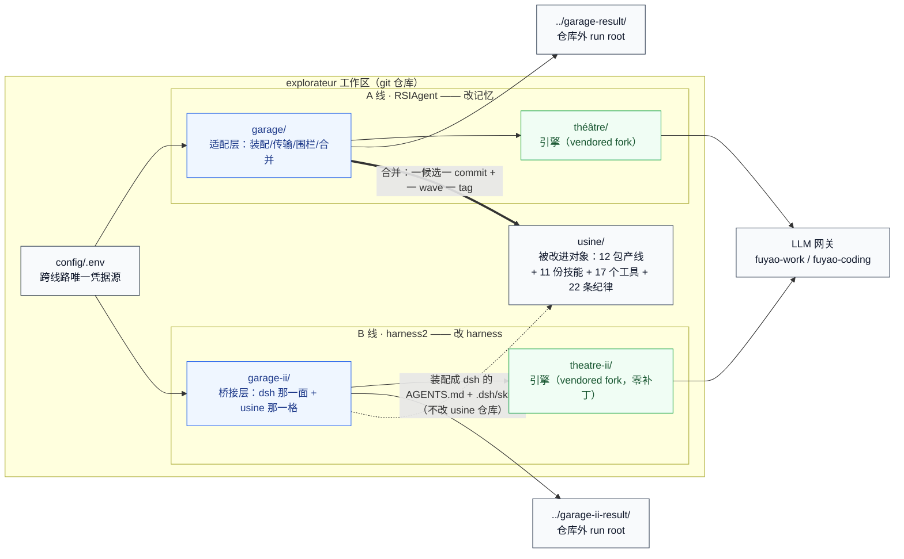

读图要点：

- **两条线改的是同一个智能体的两个部位**。A 线改「手」（工具面、请求 schema、拒答卡、审批文案、技能手册），B 线改「指令」（系统提示、红线、长期记忆、工具指引）。这就是它们不能互相替代、也不能直接比高低的原因。
- **只有 A 线有「合并」这一步**，产物是可逐字复查的 git 提交；B 线的产物是一棵树，验收必须让智能体把活真干一遍再判分，所以实际耗时差一个量级。
- **运行产物一律落仓库外**，两条线分开放。原因不是洁癖——见 §4.1，那是最容易把人坑掉的静默故障。
- **这两台机器不是凭空长出来的**：它们是上游两篇论文的工程化——论文术语与本仓叫法的对照见 **§0.1**，给哪类任务配哪台机器见 **§0.2**。

### 0.1 两条线路并排看

| 维度 | A 线（RSIAgent） | B 线（harness2） |
|---|---|---|
| 引擎 | `théâtre/`（vendored RSIAgent @ `4d7ef43`） | `theatre-ii/`（vendored harness2 @ `1cfe254`，Apache-2.0，零补丁） |
| 适配层 | `garage/` | `garage-ii/` |
| 改什么 | **记忆**（无 schema 的 Markdown 语料库） | **harness 本身**（c1–c8 全文） |
| 沉淀物落 dsh 哪个通道 | ❌ 进不了系统提示、技能路由、工具面——只能作为「一份要主动去读的文件」 | ✅ **就是**智能体每一步都读的那份东西 |
| 反馈信号 | Verifier 的 PASS / FAIL / **UNVERIFIED** + 证据 | **行为对比**（同一任务改前改后的差异），**无地面** |
| 失败语义 | UNVERIFIED 要求补证据，不当成功 | 判据失败返回 `None`，`None` 不是零分，从分母剔除 |
| 治理 | 串行合并、wave barrier、journal 快照、文件数/字节/tree hash 三方对账 | 选择是**盲选**、`Ledger.assert_identity()` 钉账目、指纹 `runmark.fingerprint` |
| 产物形态 | 一条 git 提交 | 一棵可 diff 的 harness 树 |
| 会跨轮次累积的东西 | **记忆树**（`lineage/memory`，实测 7290B → 8410B → 11460B） | **experience 记录**（cue / lesson / evidence / confidence） |
| 一次成功的实际耗时 | **上限是「每一波」的，不是「整场跑」的**（跑满会在完整波次边界停，所以整场耗时可以超过上限）。实测：bfs17 单波 754.7s（当年上限 1500s）+ 门禁 26.4s；**现行上限 2050s 下**——foodnames-video5 单项目 **1989.2s**、xfer3b-20261022 三项目 **1350.7s**、memctl-plain-20261022 三项目 **1577.6s**、pin-plain-20261022 三项目 **3345.4s**（`over_ceiling: true`） | 一轮 sweep（B 线的一整轮演化，见名词表）实测 8016s = 2h14m（旧协议）；换 `openai-completions` 后同一道题 **5105s = 85m5s** |
| run root | `../garage-result/` | `../garage-ii-result/` |
| 花钱的 ack | `RUN-USINE-PHASE1-WAVES` / `RUN-USINE-PHASE2-DRS` | `RUN-USINE-H2-SWEEP` / `RUN-USINE-H2-COMPARE` |

**共同点**（别把两套说成对立）：开头那句「都不碰权重」只是最表层的一条，更深的同构藏在这几处——都有「第一份沉淀物指引后续工作」的结构（RSIAgent 的记忆语料 ↔ harness2 的经验库 R），都有评测隔离，都把「沉淀物可以重组、可以收缩」当作正常。

**根本分歧**：RSIAgent 的进化**不看自己改了什么的影响**（Verifier 判的是「任务做对没有」），harness2 的进化**就看改了之后行为怎么变**。所以 RSIAgent 需要地面，harness2 不需要。

而 `usine` **没有官方评测器**（`garage/config/roles-usine/target-usine.yaml` 记明 unavailable，合并器钉 `official_evaluator_calls: 0`）。RSIAgent 的架构**依赖**一个能给出地面的 Verifier——`garage/verifier_adapter.py`（41 KB）就是那套替身。harness2 的方法**明确不需要地面**（论文原话：*without ground-truth feedback*）。

**术语对照表**（论文里的角色名 → 本仓叫法 → 代码位置）：

| 上游术语 | 出自 | 本仓叫法 | 代码位置 |
|---|---|---|---|
| Curriculum Agent（课程智能体） | RSIAgent | 出题席 | `garage/config/roles-usine/curriculum-usine.yaml` |
| Actor Agent | RSIAgent | 干活席 | `garage/config/roles-usine/actor-usine.yaml` |
| Verifier Agent（验证智能体） | RSIAgent | 验证席 | `garage/config/roles-usine/verifier-usine.yaml` |
| Persistent Memory（持久记忆库） | RSIAgent | 记忆树 | run root 的 `memory/` 目录，见 §2.9 |
| BRS（广度递归自探索） | RSIAgent | Phase-1 广度波次 | `--phase 1`，ack `RUN-USINE-PHASE1-WAVES` |
| DRS（深度递归自探索） | RSIAgent | Phase-2 深度波次 | `--phase 2`，ack `RUN-USINE-PHASE2-DRS` |
| Test-time Memory Reuse（测试时记忆复用） | RSIAgent | 冻结的记忆树（快照进仓库，下一波作种子） | §2.9 |
| Base Harness $X_0$ | Harness² | 基准树 | `garage-ii/harness_base/`，见 §1.1 |
| Harness Editor（编辑器） | Harness² | 提案者 | `garage-ii/minimax_proposer.py` |
| Invariant / Domain 候选 | Harness² | 宽模式的 INV / DOM 两支 | §3.4 |
| Probe（探测） | Harness² | 在同一任务上重跑候选 | §3.3 |
| Harness Composer（合成器） | Harness² | 采纳与合成 | §3.6 |
| Reflector（反思器） | Harness² | 教训蒸馏 | `selection.reflect_adoption` → `_distil`，见 §3.8 |
| `EXPERIENCE.md` 经验库 | Harness² | 经验库 | `theatre-ii/harness2/core/library.py`，见 §3.8 |

**两处不是一比一的地方**：论文第三阶段（Test-time Memory Reuse）是「部署后禁用课程智能体、冻结记忆库，让 $X$ 独自执行下游任务」——本仓没有独立的部署阶段，它把这一形态落在**波次之间**：记忆树冻结成快照进仓库（§2.9），下一波从它起步出题，语义相同、落点不同。论文的 Harness² 把被改进对象的配置抽象成**八类可挂载文件**（c1..c8）；本仓的基准树只装得下 dsh 这一面认的四节加技能（§1.1、§3.2），c5 子智能体与 c8 插件在这一面**不存在**——宁可标「不支持」，也不给一个改得动却装不上的假接口。

**部位对照表**（论文看的层面是「被改进对象的哪些部位会被改造」）：

| Harness 的部位 | RSIAgent 改不改 | Harness² 改不改 |
|---|---|---|
| 1. 系统提示 | **不改**（只通过上下文注入检索到的记忆片段） | **直接重写**：核心指令、角色设定与推理策略 |
| 2. 护栏与约束 | **不改**（环境结果的校验由外置 Verifier 承担） | **直接重写**：在挂载的护栏文件里加安全边界与格式校验规则 |
| 3. 记忆系统 | **核心改造区**：写操作规程、可复用脚本、失败教训 | **直接重写**：动态编辑挂载的 Memory 文件，外层另维护 `EXPERIENCE.md` |
| 4. 工具使用指引 | **不改工具定义**（只在记忆里记隐藏限制与调用技巧） | **直接重写**：参数说明、调用时机与错误回退 |
| 5. 技能与脚本 | 探索中由干活席沉淀 Bash/Python 脚本**存进记忆库** | **直接重写**：在挂载的 `Skills` 与 `Scripts` 里新建、修补 |
| 6. 子智能体拓扑 | **内部子智能体不变**，外挂课程与验证两个协同智能体 | **直接重写**：子智能体角色配置与分工 |
| 7. 中间件与插件 | **不触碰**底层拦截器与编排代码 | **直接重写**：上下文钩子、日志过滤、状态流转 |

**它可能怎么坏掉**：这张表是最容易张冠李戴的地方——**「论文说能改」不等于「本仓这条通道能改」**。本仓的对应版本在 **§5.3(a)**（能力边界：沉淀物落在 dsh 的哪个通道）：那张表把七个部位换成了 `usine` 的具体面，结论是**记忆进不了系统提示、技能路由与工具面**；harness2 那侧能改 c1/c2/c4/c6，但**c8 插件在 dsh 这一面没接**、**技能的 `references/` 与 `assets/` 不在可编辑面上**。论文的表用来建立直觉，**读数一律以 §5.3(a) 为准**。

两篇论文各自的拓扑（课程席下发—执行—验证—回灌的双闭环；编辑—探测—合成—反思的嵌套双循环）在本仓已有对应的图，本节不另画：**§2.1** 的席位图与 **§2.2** 的九步序列是 A 线那张拓扑的展开，**§3.3** 的演化流程与 **§3.8** 的经验库图是 B 线那张拓扑的展开。单一事实源：同一个机制只存一处（§6.2）。

### 0.2 选型

**生活里的类比**：修车厂里有两类活。**有地面**的活（发动机异响、底盘刮蹭）交给举升机上的诊断仪——仪器读得出「修好了没有」；**没有地面**的活（车开着有点抖，说不清哪儿不舒服）只能靠换了件再开一圈、看差别。两类活不能用同一把尺子。

**上游的选型建议**：

| 任务形态 | 选哪台 | 为什么 |
|---|---|---|
| **边界明确、可构建沙盒**（OS 桌面操作、代码仓库修复、CAD 建模、游戏开发），且容易编写或让大模型充当客观环境验证器 | **RSIAgent** | 不需要重构被改进对象的代码；在离线阶段挂接它跑一遍广度与深度探索，即可为它灌注一个高价值的领域记忆库 |
| **开放世界任务**（复杂企业办公流、法律文档分析、无标准答案的研究任务），无法设计可靠的自动 Verifier | **Harness²** | 把被改进对象的配置解耦成标准挂载文件，在测试时让更强的编辑模型自动做架构调优 |
| 被改进对象**自身的提示词、工具描述、子智能体分工、中间件逻辑**存在设计瓶颈 | **Harness²** | 它改的正是这几格；RSIAgent 压根不碰它们 |
| 两者兼有 | **混合演进** | 先用 RSIAgent 在沙盒里做广度与深度探索，积累底层环境的记忆与脚本；真实开放场景再接入 Harness²，用 Propose–Probe–Compose 动态调优系统提示、护栏、子智能体与插件 |

**本仓落在哪一格**：**最后一格——混合演进，而且两台机器现在就在同时跑**。A 线改 `usine` 的记忆、B 线改 `usine` 的 harness 本身，引擎分别 vendored 在 `théâtre/` 与 `theatre-ii/`，产物落仓库外的 `garage-result/` 与 `garage-ii-result/`（§4.1）。

**它可能怎么坏掉**：上游那条「先 A 后 B」的顺序在纸面上成立，在本仓**不成立**——两台机器改的是同一个对象 `usine` 的不同部位，产物落在不同通道，**彼此不互相等待**（§5.3(a) 逐格对照）。把「先记忆后 harness」读成「B 线必须等 A 线的记忆攒够」，会推出一个不存在的依赖。第二个坑是**把「论文说能改」当成本仓能改**（§0.2 的提醒）；第三个坑是**把选型建议当运行手册**——这里说的是「哪类任务配哪类机器」，不是「怎么跑」，跑法在 §5.5。

**外部参考**：[RSIAgent 自主探索与递归自我改进原理解析](https://www.youtube.com/watch?v=6rKSQmMckvM)——直观展示课程、干活、验证三个智能体如何协同完成先广度后深度的环境探索与记忆构建。

---

## 1. 六个必须先懂的词

在讲流程之前，这六个词会反复出现。都用类比先立住。

### 1.1 harness

**harness** 控制**每一步都在影响模型行为的全部东西**：

- **系统提示**（system prompt）：开场就告诉模型「你是谁、你的规矩是什么」的那段话；
- **护栏**（guardrails）：硬性禁止（「不要建议用户开启发布功能」）；
- **工具指引**：它能调用哪些工具、每个工具什么时候该用；
- **技能手册**（skills）：一页页操作说明（「要做一页纸海报，照这些步骤走」）；
- **记忆**：跨会话留下来的事实（「这条产线的验收口径是 XX」）。

关键点：**harness 是模型每一步都读的东西。** 它写错了，模型就每一步都错；它写对了，模型不需要变聪明也能做对。

**论文把这圈东西按「什么时候进入模型的视野」分成四组**：**上下文构造**（系统提示 / 护栏 / 记忆 / 技能）、**中间件**（钩住每一次工具调用，在模型的裁量之外）、**工具界面**（模型能调用什么、怎么调）、**编排**（工作什么时候委派给一个新智能体）。中间那圈是**冻结的模型**，自我进化改的是**它周围的这一圈**。分组图与逐格落点在 **§3.2**。

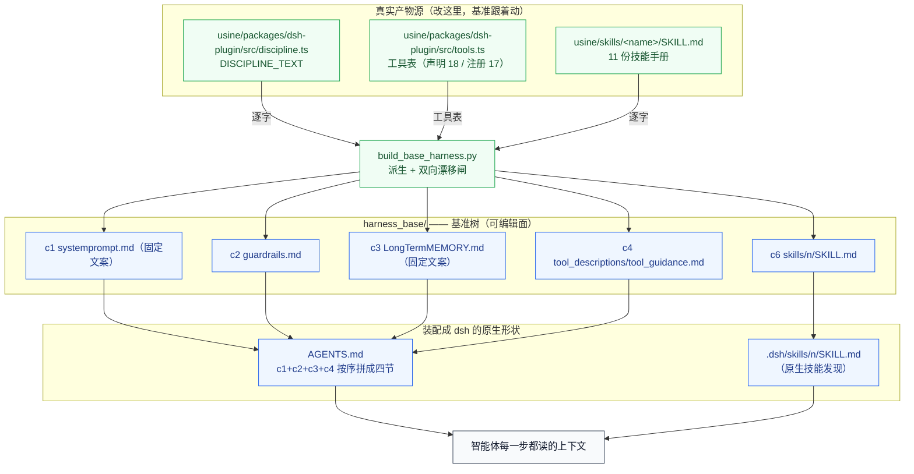

### 1.2 基准（baseline）：为什么必须「同源」

要说「改进了」，你必须先有一个**没改过的版本**做对照。这个没改过的版本叫**基准**。

本仓库有一条硬规矩：**基准必须与被改进对象同源**——基准 harness 树必须是从真实的 `usine/` 派生出来的，不能是人手另抄一份。

A 线也有同一个问题的另一版本：它的种子是 `git archive HEAD`（真实产线树的快照），不是手工搭的样例仓库。

> ⚠️ **失效面**：基准一旦漂了，你拿旧基准去比，读出来的差其实是「旧纪律 vs 新纪律」。所以 `build_base_harness.py --check` 是**开跑前的硬闸**，不是可选的体检。

### 1.3 rollout（一次完整的「干活」）

**rollout** = 让智能体在**一个干净的工作区**里，从拿到任务到交出结果跑完一遍。

关键在「干净」：每次 rollout 都拿到一份 `workspace/` 拷贝（`usine_adapter._launch_one`）。为什么？因为如果两次 rollout 共用一个工作区，第二次就会看到第一次留下的文件——你量到的就不是「它这次干了什么」，而是「它这次在上一轮的废墟上干了什么」。

**而且必须串行。** `usine_adapter._rollout_lock` 加了一把锁，原因写在代码注释里：`usine_verify` 跑的是 usine 仓库里的全量门禁，同一个仓库并发跑两遍会互相踩。

> ⚠️ **失效面**：工作区不隔离 ⇒ 量到的是「上一轮残留」。实测踩过：同一个 `run_id` 被重跑时旧那次留下的 `exit_code` / `final.txt` 还在，工作区却被重建成空的——判据拿「最终回答说交付了」和「工作区里没有产物」对着看，量出来的是**进程管理**不是智能体，而且方向恰好是**对演化有利**的假阳性。修法三处：`_launch_one` 整目录清盘、`rollout_integrity()` 认「任务文件必须写在 rollout 结束之前」、**作废 ≠ 工具故障**（作废的 rollout 从 n 里剔出去并记理由）。

### 1.4 判据（criteria）：怎么「机检」它干得好不好

要判断一次 rollout 成不成功，最直觉的办法是让人看，或者让另一个模型打分。本仓库**两者都不用**。

**判据是机械的**：它读两样东西——

1. **轨迹**（trajectory）：这次 rollout 里发生过的事件序列（调了哪个工具、参数是什么）；
2. **最终回答**：模型最后说的那段话。

然后用正则 / 结构化匹配判「过」或「不过」。例如：

| 判据 kind | 判什么 |
|---|---|
| `skill_loaded` | 动作里出现过 `one-page-poster` 这个名字 |
| `tool_called` | 真的调了 `usine_poster` 工具（只给方案不算交付） |
| `tool_face_invoked` | 走了**被认可的产线入口**（MCP 工具 **或** CLI `feuille poster <子命令>` 任一） |
| `artifact_exists` | 工作区里真有一个 `.png` |
| `no_tool_face_bypass` | 没有直接调浏览器干产线的活（**按「量 vs 产」分流**：`--dump-dom` 是量，`--screenshot` / `--print-to-pdf` 是产） |

完整 12 种 kind 与 25 个任务的权威定义在 `garage-ii/bench_usine.py`（`Check(..., kind=...)` 与任务表）。

**为什么不用 LLM 打分器？** 两个原因，一好一坏，都得说：

- **好处**：判据不会随模型版本漂移。今年判「过」的东西明年还判「过」，所以两个月的数字可以直接比；也不花额外的判据钱。
- **代价**：判据只覆盖「**做没做**」，不覆盖「**做得好不好**」。海报好不好看、12 语种排版对不对——这些**没有**进判据。

这个代价是明写的，不是疏忽。要评「好不好看」得上整套媒体栈和像素基线，量级完全不同。

#### 判据最要命的一条纪律：失败返回 `None`，不是 0

如果一次 rollout 因为**基础设施问题**没跑成（模型 502、传输层截断、超时），它**没有分数**，不是零分。

代码里这个语义是 `None`（`usine_adapter.score`），并且从分母里剔除。B 线是同一件事的独立实现：`harness2/core/judge.py` 的 `Scored.graded` 说的是「**判成了**」，不是「跑得好」；未判成功时 `frac` 返回 `None` 而非 `0.0`，`summarise()` 里均值**只对判成的样本求**。

为什么这条至关重要？因为把「没跑成」记成 0 分，就等于把基础设施故障算成「智能体不会干」——那会**系统性地把好方法判成坏方法**（这个噪声是单向的：只会让分数变低）。

> ⚠️ **失效面**：`None` 在**分布层面**守住了，一到**渲染层**就会被 `get(name, 0.0)` 变回零分。实测过：演化臂 6 条全 `score=None`，逐判据表却显示「演化臂失分 0.0%、Δ=−100、← 变了」。所以空样本格必须**单列**（「比不了」），失分率用 `None` 承载「未知」，渲染打「—」。

### 1.5 臂（arm）与零分布

**臂（arm）= 一棵树 × 一个任务 × n 次 rollout**。这个词来自医学试验：一组人吃药（演化臂），一组人吃安慰剂（基准臂）。

**零分布** = 什么都没改的时候，分数会怎么自己动。

这两个词为什么重要，见 §5.3(b)——它是整个工程里最容易被自欺的一步。

### 1.6 树（tree）

B 线的一切产物都是「一棵树」：一组「相对路径 → 文件内容」的映射（`harness2/core/tree.py` 里就是 `dict[str, str]`）。它不是代码，是一个**数据**。可编辑路径由硬编码正则定义，改到面上之外的文件会被引擎拒收。

---

---

## 2. A 线：改记忆（RSIAgent）

A 线由三样东西组成：`théâtre/` 里的 RSIAgent 引擎（vendored fork）、`garage/` 里的适配层（装配、传输、围栏、合并、门禁预检），以及被改进对象 `usine/` 生产树。它改的是**记忆**：每一波把一段真实经历蒸馏成 `memory/` 目录下的一棵记录树，这棵树是唯一跨波次传递的东西——下一波的出题席读它、干活席拿着它干活、分支蒸馏后再回灌。

运行产物落**仓库外**的 `garage-result/`（与本仓库同级的目录），两线不混放——harness2 线的产物落 `garage-ii-result/`。这条落位由代码保证：`garage/run_usine.py` 的 `DEFAULT_RUNS_ROOT` 是唯一事实源。

---

### 2.1 四个席位与它们的契约

**生活里的类比**：这是一支装修队。**出题席**是甲方代表，负责说这一趟要改哪儿；**干活席**是施工班组，动手改；**验证席**是监理，来看改完对不对；**记忆席**是写施工日志的人，把这一趟学到的东西写成能传给下一班的笔记。四个角色各有一份 YAML，装配期一次性读进来，阵容对不上就在开跑前拒掉。

**代码位置**：配置在 `garage/config/roles-usine/*.yaml`；`run_usine._load_roles` 读它们，`run_usine._check_lineup` 做 fail-closed 校验，`run_usine.ALLOWED_MODEL_SLUGS` 是允许的模型集合（当前只有 `fuyao-work` 与 `fuyao-coding` 两个 slug，阵容漂移即拒跑，不烧一个 token）。

| 席位 | 干什么 | 配置文件 | 模型 | 推理档 | 自声明时间上限 | Phase-1 生效切片 |
|---|---|---|---|---|---|---|
| 出题席 Curriculum | 授权一波（或判饱和/停滞），写项目指令与 fixture | `curriculum-usine.yaml` | `fuyao-work` | `low` | 400s | **400s** |
| 干活席 Actor | 改代码 / 改 skill，写交付物并交 `STATUS: SUBMIT` | `actor-usine.yaml` | `fuyao-coding` | `low` | 950s | **950s** |
| 验证席 Verifier | 在隔离镜像里复核，出 `VERDICT: pass` 或 `wrong` | `verifier-usine.yaml` | `fuyao-work` | `low` | 500s | 420s |
| 记忆席 Memory | 蒸馏段 → 调和段，把经历写回记忆树 | `actor-usine.yaml`（`ROLE_FILES` 里的 `memory_actor` 与 `actor` 同指一份） | 必须与 Actor 同模型 | `low` | 950s | 与干活席共享 **950s** |

自声明时间上限与生效切片不是一回事。`time_budget.apply_slices` 在装配期把每个席位的 `wall_clock_secs` **收紧**到切片计划里，**绝不放宽**——一个席位自己配的更紧值不会被切片放松。因此上表的生效切片才是运行时真正生效的数：Phase-1 的切片计划是 `time_budget.DEFAULT_SLICES`（curriculum 400 / actor 950 / verifier 420 / merge 120，合计 1890s，加 `OVERHEAD_RESERVE_SECS` 100s 是 1990s，运行上限 `DEFAULT_RUN_CEILING_SECS` 2050s，余量 60s）。

四个席位共享同一套实践循环语义：**每一轮模型回复只含一个 JSON 动作**，优先级是 Program > Look > Ask > Done；程序跑完之后，观察以 `PROGRAM OUTPUT (exit, secs):` 作为一条新的 user 消息喂回模型，而段的 charter 一直留在 history 里。续轮模型看到的是「charter + 自己的动作 + 观察输出」。

段的完成语义各不相同，因为「这一段算不算做完」是探针说了算，不是模型自称：

| 段类型 | required 文件 | done 判定 |
|---|---|---|
| 出题席授权段 | wave handoff 可解析 + fixtures 非空 | 探针过即收段，**无需再调模型** |
| 干活席 handoff 段 | `/home/user/actor_handoff.md` | 模型发 done → 探针 `GATE_YES` 才收 |
| 自由相位（蒸馏 / 调和） | 无 | done 直接收（但记忆文件得真写出来才过后续审计） |

升级段是**完全不对称**的：主段是 `fuyao-coding` 干活席对 `fuyao-work` 验证席，升级段反过来是 `fuyao-work` 干活席对 `fuyao-coding` 验证席。这套映射写在 `target-usine.yaml` 的 `escalation_model` / `escalation_verifier_cross_model` 上，不是约定俗成。

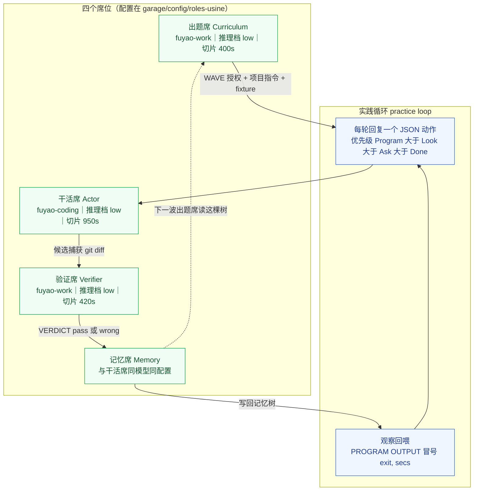

---

### 2.2 一次波次的九步

**生活里的类比**：一次波次像一次完整的交付流程——先做方案报批（预检），再让甲方定题（出题），然后把仓库拉一份到工位（播种），施工（干活），把改动打包（捕获），监理验收（验证），写施工日志（蒸馏），进版本库并跑通测试（合并），最后刷新产品镜像（dist 重建）。

**代码位置**：编排器是 `garage/run_usine.py`；引擎的波次循环复用 `explore/phase1_wave.py` 的 `evolve_parallel_phase1`，适配层只在四周装接缝。里程碑事件写进 run root 的 `events.jsonl`。

**先把两个反复出现的词说清**（正式定义在 §2.3）：**宿主（host）**是你这台真机器——真实仓库、真实磁盘、跑编排的 Python 都在上面；**guest** 不是一台真虚拟机，而是宿主上圈出来的一块**工作区**、套了一层「看起来像独立机器」的路径马甲——guest 里看到的 `/home/user`、`/tmp` 这些地址牌，其实都映射回宿主磁盘上的一块 scratch 目录。

九步分别是：

1. **预检**。`--preflight` 只读：打印就绪载荷，**不写任何东西、不烧任何 token**（不发 LLM 请求是 preflight 的老规矩）。载荷里能看到模型阵容、端点解析、围栏、门禁可跑性、guest 工具链探针、时延预检结论、铺开约束。
2. **出题**。出题席在授权段里做一次决策：授权一波（`WAVE`）、判已饱和（`SATURATED`）还是判停滞（`STALLED`），并写下项目指令与 fixture。授权段的探针一过就收段，不再调模型。
3. **播种**。把真实仓库快照推进 guest 并解包。种子是 `git archive HEAD` 的产物；`run_usine._build_seed` 造它，`run_usine._seed_guest` 推进 guest、用 `stat -c` 与 `sha256sum` 核对字节数与摘要再解包（核对不过直接抛），解包后立刻做一次 guest 工具链探针（`node --version` / `pnpm --version`，Node 需 ≥ 24、pnpm 需 ≥ 11），探针不过就在烧 token 之前 fail-closed。
4. **干活**。干活席在 handoff 段里干活，写 `/home/user/actor_handoff.md`，首行必须是 `STATUS: SUBMIT`；完成探针是 `test -f` 加首行 token 匹配。之后是一个 fresh + replay 的复演段：用新上下文重跑候选。
5. **捕获**。把 guest 工作树打包。`run_usine._CAPTURE_EXCLUDE_PARTS` 把 `node_modules`、`dist`、`build` 这些可再生的重物剪掉——它们是 install/build 的产物，不是工作成果；不剪会撞 120s 的 tar 超时，也会把未设栏的第三方内容撑爆审计面。剪枝与合并侧的 `wave_merge.EXCLUDED_PARTS` 是同一约定，两头对称。
6. **验证**。验证席在**回滚镜像**里复核（见 2.4），交一份报告，报告里恰有一行 `VERDICT`。上下文里藏掉干活席的私产。
7. **蒸馏**。记忆席的蒸馏段把分支经历抽成记录，调和段把这些记录整合成可复用的形态，写进记忆树。**失败与通过都进蒸馏**——只有通过才进合并。
8. **合并**。`wave_merge.merge_wave` 在 `PHASE1_WAVE_COMPLETED` 事件上**同步**执行：门禁不绿，波不算完（见 2.6）。
9. **dist 重建**。`pnpm verify` 顺带重建被 gitignore 的 `packages/dsh-plugin/dist/index.mjs`，于是被采纳的改进直达 dsh 加载的智能体面，不需要任何额外管道。下一轮的围栏从新的 HEAD 重算。

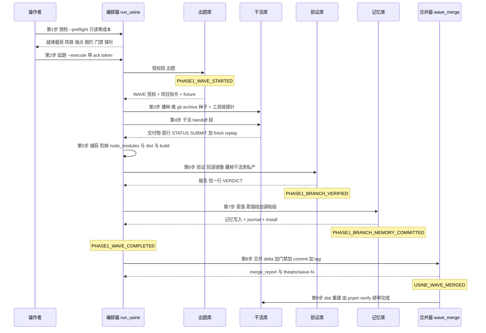

九步各自归谁管：出题、干活、蒸馏三步是**模型程序在 guest 里跑**（琥珀），播种与 dist 重建是**宿主上的可信设施**（绿），预检、捕获、合并是**编排控制面**（蓝），验证席跑在**隔离域**里（红）。

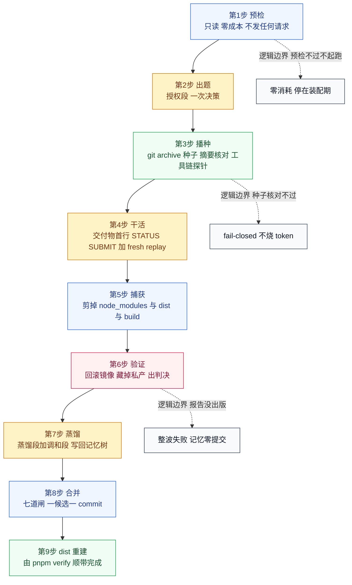

---

### 2.3 guest 传输层

**生活里的类比**：guest 不是一台真的虚拟机，更像**会议室里的白板加投影仪**——你写上去的是宿主磁盘上的真实文件，你看到的是 `/home/user` 这样的固定地址牌。这套「地址牌」就是路径改写表。

**代码位置**：`garage/guest_env.py` 的 `WorktreeEnv`（工作区基座）与 `worktree_vm_factory()`（工厂）；路径改写规则在 `WorktreeEnv._build_rewrite_rules`，正反映射在 `guest_to_host` / `host_to_guest`。

底层拓扑是**主机上的进程间拓扑**：Windows 宿主 Python ↔ git-bash ↔ `subst` 盘符指向的 scratch 树。路径改写表是适配层唯一允许的「路径谎言」，且双向一致。

| 客体路径 | 映射到 | 说明 |
|---|---|---|
| `/home/user` | `<盘符或 scratch 前缀>/home/user` | guest 契约根，恒等映射 |
| `/tmp` | `<盘符或 scratch 前缀>/tmp` | Windows 上 MSYS 的 usertemp 挂载在并发 guest 下是黏的，POSIX 上字面 `/tmp` 会解析到真实宿主根 |
| `/dev/shm` | `<盘符或 scratch 前缀>/dev/shm` | 种子 tgz 的落点 |
| `HOME` / `USERPROFILE` | 钉死在 guest 的家目录 | guest 程序里的 `expanduser` 必须落在沙箱盘上，绝不落在宿主真家目录（那里存着平台登录 profile） |

盘符的分配是 `guest_env._claim_drive`：`Z:` 优先，被占用则回退 `Y:`；`A` 与 `B` 是历史软驱字母，永不作为 guest 盘。`subst` 映射**跨进程持久**，所以 guest 关闭时必须显式摘除（`_release_drive`）。

环境纪律同样属于传输层的一部分：`MSYS_NO_PATHCONV=1` 禁掉 MSYS 的参数改写；PATH 前置 `/usr/bin` 与 `/mingw64/bin`，防止 Windows 自带的 `find.exe` 截胡；`python3` 是一个 shim 脚本，兑现 guest 契约里的 `python3` 名字；`APPDATA` / `LOCALAPPDATA` 留在宿主侧，package 缓存才能继续工作。

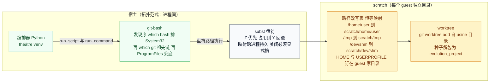

---

### 2.4 验证席的隔离：文件级事务

**生活里的类比**：验证席像验收员在**样板间**里验房——开工前把整间房拍照存档（快照），把住户的私人物品搬到房外（隔离），验完把房间恢复到拍照那一刻，一个字节都不差（回滚）。房子本身还是那间房子。

**代码位置**：`garage/verifier_adapter.py`。`FileLevelRollbackTransaction` 是「整盘快照」的宿主侧替身，`WorktreeVerifierExecutor` 继承引擎的 `AgenticVerifierExecutor`，只换掉事务与隔离两件事，其余（构造、`verifier-report` 通道、报告校验、ready-token 契约）原样继承。

事务的五个阶段：

1. **begin**。`copytree` 把整张 guest 盘（`disk_root`：`home` + `tmp` + `dev/shm`）拷到 scratch 下的快照目录。拷贝失败即弃，guest 未被动过。
2. **quarantine**。`_quarantine_private_paths_host_side` 把干活席的私产路径**整体搬离 guest 盘**——目标是宿主的 scratch 隔离区。隔离路径来自 `target-usine.yaml` 的 `verifier_private_paths`：`/home/user/work` 与 `/home/user/.memory`。这比上游的 root-only 隔离更强：上游只是把私产挪到 VM 内的 root 目录，这里是**挪出 guest 盘**。
3. **workspace**。在 guest 盘上直接建 `/home/user/.verifier/rsiagent-verifier-<hex>`。上游靠挂载命名空间与 keeper 进程维持的隔离，在这套基座上不存在，由这个目录加整盘回滚顶替。
4. **ready token**。程序执行前，wrapper 先打印 `__RSIAGENT_VERIFIER_MIRROR_READY_<token>__`。**这个 token 必须出现在模型可见的输出里**；缺失就是基础设施错误 125——执行状态未知，**禁止判分**。
5. **rollback**。先清扫 guest 进程（`_stop_guest_processes`：命令行引用本盘或 scratch 路径的进程全杀），再清空盘内容（**不删根目录**，否则 subst 映射失效），最后按字节还原快照。回滚失败时**保留快照**、阻断判分，并抛 `AgenticVerifierInfrastructureError`——绝不静默混态。

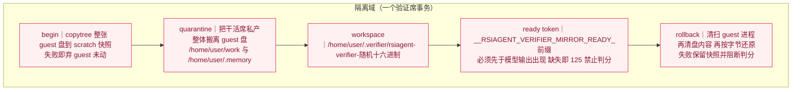

---

### 2.5 内容围栏与发布红线三层

**生活里的类比**：围栏像**防串题的栏杆**——题目的原文不能出现在任何别的地方，否则模型可以直接抄；发布红线像**门禁闸机**——推着「发到线上平台」这个动作的门永远焊死。

**代码位置**：静态围栏在 `garage/run_usine.py` 的 `_check_distribution_fences`（配合 `_fence_texts` 收集审计源）；运行时审计在 `garage/usine_hooks.py` 的 `UsineAudit`；发布红线在 `usine_hooks.PublishBlacklistVM` 与 `usine_hooks.scan_publish_boundary`，由 `run_usine` 装成 `vm_factory = publish_blacklist(worktree_vm_factory())`。

**静态围栏**是一道启动时的真载荷门禁：把 `distribution-usine.md`（出题席的目标方向语料）切成 **8-gram shingle**，证明它与所有可能到达受审计面的文本**零相交**。审计源包括：种子化的 usine tracked 文本与 capture 成员名、引擎第一方提示与基础设施模块（`explore` / `core` / `env` / `config` / `llm`）、适配层目录本身（传输注记）、以及角色配置的 `system_extra`。当前实测是 **435 个 shingle 对 447 个源**。这道闸在两个入口和每次 resume 都跑（resume 在 pending 合并之后重跑，因为 HEAD 动了）。**相交意味着改 distribution 的措辞，绝不改围栏。**

**运行时审计**是五面构造性空转：`validate` / `text` / `transcripts` / `captured` / `memory`。判定式是 `suspect = 文本的 shingle 交集 corpus 减去已授权集合`。在 phase1 里已授权面就是目标方向本身，而 corpus 是 distribution 的 shingle，所以交集恒为空集——**它的价值在配置漂移时立刻生效，而不是当下拦截**。审计镜像解码有固定规则：前 8 KiB 出现 NUL 就判二进制，跳过**内容**只审**名字**（usine 基线带着一个 32 MB 的 zip 和一个 4.3 MB 的 mp4，逐词 8-gram 对它们只有成本没有围栏价值）。

**发布红线**在 docstring 里是三层：VM 门面、guest-home 钉死（Windows 的 `USERPROFILE` / POSIX 的 `HOME`）、offline-only 门禁。VM 门面那一层的具体机制是：只扫描模型自己写的程序通道（`run_script`），命中 `feuille publish` 或 `launch_persistent_context` 就**在执行前**拒绝，退出码 126，并把解释写回给模型。`run_command` 等宿主自己写的通道**不扫**——它们合法地带着项目文件名。另一条互补的纪律是**编排器不持有 TTS 与积分凭据**：没有额度就烧不出视频。

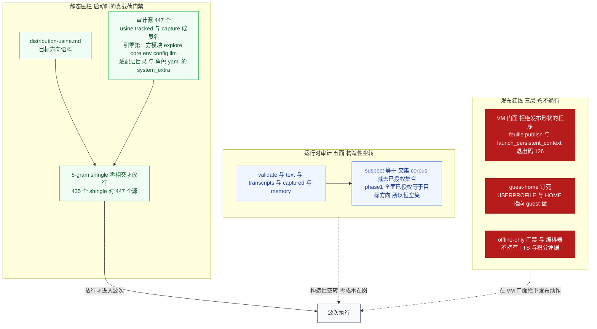

---

### 2.6 合并管线：七道闸

**生活里的类比**：合并管线像**入库前的质检**——一个候选要过七道关卡才能进版本库，每道关卡有明确的拒收理由写在报告里。拒了不是失败，是「这一条不带病入库」。

**代码位置**：`garage/wave_merge.py` 的 `merge_wave`。判定结果逐条写进 `merge_report.json` 与 `merge_report.md`，落 run root 的 `waves/<wave>/` 下；事件 `USINE_WAVE_MERGED` 同步发出。

七道闸与它们拒收后写下的 `decision`：

1. **终态门**。`terminal_outcome` 必须是 `PASS`。否则 `decision = not_pass`。**注意：FAIL 也能出记忆，只是进不了合并。**
2. **形状门**。三件事：候选含 symlink 变更 → `decision = symlink_unsupported`；候选与基线逐字节相同 → `decision = merged_noop`；新增路径违反路径策略（Windows 保留名、尾点尾空格、命中 gitignore）→ `decision = path_policy_skipped`。
3. **一致性门**。漂移判定：每个被改动的路径必须**要么**等于基线（还没合）**要么**等于候选（已经合了），否则判漂移、**整条候选**跳过。已合 → `decision = already_merged`；漂移 → `decision = drift_skipped`。
4. **规范同步门**。改了被规范文档管辖的代码，规范必须同批更新，否则 `decision = spec_sync_rejected`，报告里点名规范路径与代码路径。这道闸放在 apply 之前，因为它是二值判定，读文件就够，不该白花门禁时间。**存量的漂移（合并前就与代码对不上）不否决候选，只记 notice**——一道失效的闸会把整条流水线卡死，而卡死的闸没人看得见。
5. **真门禁**。在**合并后的树**上重跑 `pnpm verify`（超时 1800s，实测 21–27s）。退出码非零 → 回滚候选 → `decision = gate_rejected`。
6. **智能体面门（L3）**。门禁跑完 dist 已经重建，这时候验它比门禁之前更准。L3 冒烟红 → 回滚 → `decision = l3_rejected`：**改进没有到达智能体面，就不算改进。**
7. **健康分门**。合并器在**应用候选之前**量一次基线、**应用之后**量一次候选，逐指标比：有指标变坏 → 回滚 → `decision = health_rejected`，报告里点名是哪个指标。这道闸问的是「更好了没有」，而门禁只防退化。

七道全过 → `decision = merged`，写一候选一 commit（带 `X-Theatre-Wave` trailer）、每 wave 一个 annotated tag `theatre/wave-N`、写 `merge_report.json` 与 `.md`、发 `USINE_WAVE_MERGED` 事件。最后，**终态记忆树单独快照进仓库**（`garage/memory-snapshots/<unit>-<NNN>/`，带自己的 `manifest.json`，单独一个提交带 `X-Theatre-Memory` trailer）——记忆是唯一跨波次传递的东西，它必须能 review、能 diff，而不是只活在仓库外的 run root 里。

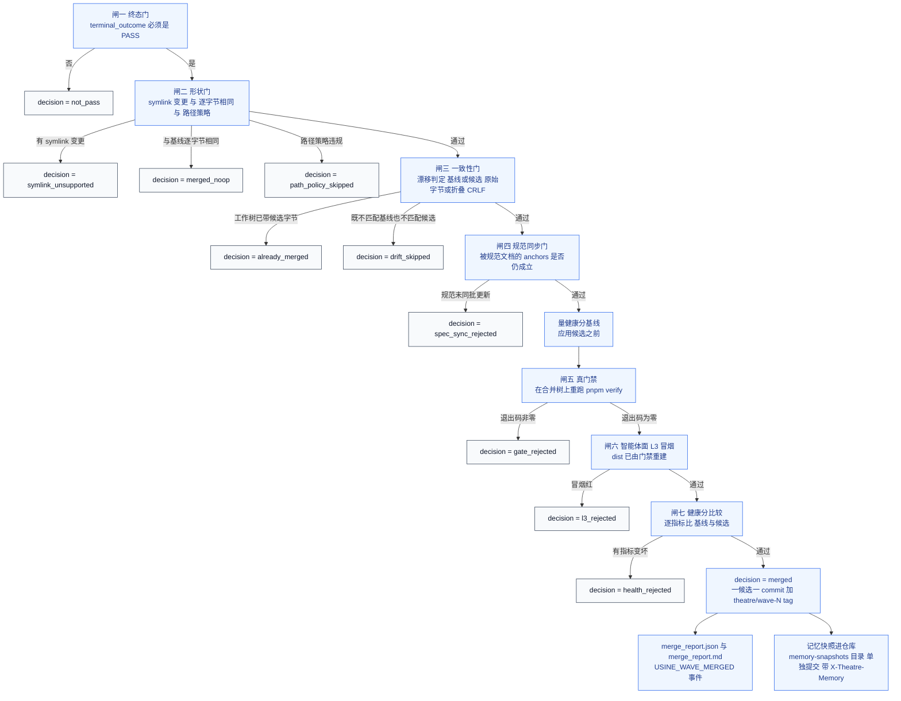

---

### 2.7 铺开闸与时延预检

**生活里的类比**：这两道闸像**轮班表**与**体检报告**。轮班表防止所有人连续三个月都去修同一台机器；体检报告防止你派出去的人根本干不动这个活。

**代码位置**：铺开闸在 `garage/spread.py`（`build_spread_state` 读历史、`render_constraint` 渲染约束、`apply_to_seat` 追加进席位），接线在 `run_usine._apply_spread_constraint`，策略在 `garage/config/spread.json`。时延预检在 `garage/latency_budget.py` 的 `assess`，接线在 `run_usine` 的装配期与 `_latency_blocks`。

**铺开闸为什么存在**：到 2026-10-20 为止，三次合并进仓库的改进（`6e8665f` wave-1、`1d550b2` drs-1、`eedaf73` wave-1）**全部**落在 `packages/dsh-plugin/` 一个包里，生产线本体（core / karaoke / poster / poetry / storyteller / copy / bgm / publish）零改动。查下来不是 Agent 偷懒——出题席的 brief 当时写着「in menu target A, B or C ONLY」，把它锁死在了三个文件上。规格造成的单一化，机械地治。**到 2026-10-22 为止这个格局已经被打破**：后三条合并分别落在 `tools/foodnames/`（两条）与 `packages/gate/`（一条）——**`tools/` 能被波次看见，正是把 `tools/` 提为一等顶层单位（`garage/config/spread.json`，见下一段）的直接结果。**

闸的三个旋钮（`garage/config/spread.json`）：`cold_window` 3（看最近 3 次波次）、`repeat_ban` 2（连续被打了 2 次的包，本波禁入）、`cold_priority` 为 `required`（冷区是**必须**落在其中，不是「优先考虑」）。包重要度顺序是 core > karaoke / poster / poetry / storyteller > copy / bgm / publish > cli / gate > **tools** > dsh-plugin——dsh-plugin 排最后，因为它已经被连着做过三次；**`tools/` 排在 `gate` 与 `dsh-plugin` 之间**（2026-10-21 加进去的，`spread.json` 的注释写着「真正出货的内容产线」——不加的话，RSI 波次永远看不到 foodnames 这条产线）。

约束的写法是闭集的 MUST / MUST-NOT，点名目录、不写「以及其它」——与 DRS 那套「brief 必须有上界」是同一个原则。**只动 Phase-1 的出题席**：Phase-2 有自己的出题席，它的工作是复盘并交一份有上界的 drill，不是选题铺开。

**时延预检为什么存在**：网关首响应时延实测在 50.6s / 108.2s / 138.7s / 322s / 大于 300s 之间跳，而出题席切片是 400s（Phase-1 与 DRS 同数）。**切片吸收不了波动**——照那样开波，运气差就整波烧光。预检**只读、零成本**（不发任何 LLM 请求），只读历史 run root 里引擎已经记下的每席实际耗时，与本波的计划切片比：某席的 max 超过计划切片的 **60%**（`latency_budget.DEFAULT_RISK_RATIO = 0.6`）就判**高时延风险**，**默认拒绝开跑**，并报出哪一席、历史 max、计划切片、以及怎么办（降 `reasoning_effort` / 换端点 / 放宽 `--run-ceiling-secs`）。

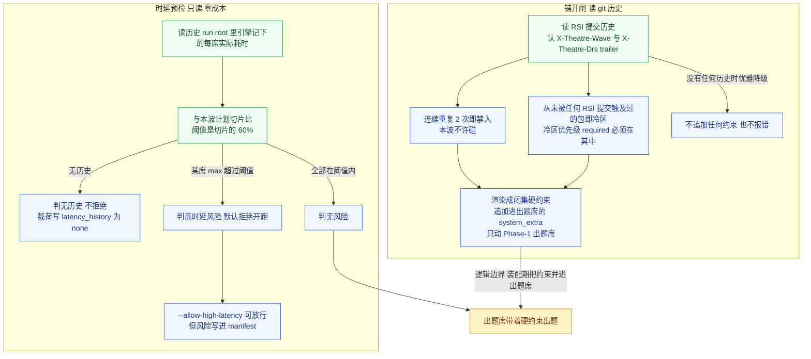

---

### 2.8 DRS 深度波次

**生活里的类比**：广度波次像**扫楼**——一层一层把整栋楼的毛病找出来；DRS 是**深挖**：在上一轮找到的那个具体问题上下钻，挖出比上一轮更细的根因。

**代码位置**：`garage/run_usine.py` 的 `--phase 2` 路径；出题席是 `garage/config/roles-usine/curriculum-drs.yaml`；接缝检查在 `run_usine._check_drs_wiring`；上限与切片在 `garage/time_budget.py` 的 `DRS_RUN_CEILING_SECS` 与 `DRS_SLICES`；产物验收在 `garage/verify_drs_run.py`；补合并在 `garage/merge_drs.py`。

DRS（深度递归波次）**必须在 Phase-1 之后**，且有**独立的 ack token** `RUN-USINE-PHASE2-DRS`——深度波次绝不会被一条陈旧的 Phase-1 命令行带起来。run root 是 Phase-1 的**同级兄弟**（`phase2/`），Phase-1 的 manifest 与 tree hash 保持权威，DRS 只复制不搬移。

DRS 有自己的上限与切片，因为**它不是同一份活**：

| | Phase-1 广度波 | Phase-2 DRS 深度波 |
|---|---|---|
| 运行上限 | **2050s** | 2100s |
| 切片计划 | curriculum 400 / actor 950 / verifier 420 / merge 120 | curriculum 400 / actor 900 / verifier 280 / memory 320 / merge 20 |
| 出题席 | `curriculum-usine.yaml` | `curriculum-drs.yaml` |
| 前置条件 | 工作树与暂存区必须干净（`_assert_preconditions`） | 只要求 HEAD 可解析（`_assert_seedable`），工作树状态**记进** `seed_source.json` |
| 是否合并进 usine | 是，事件入口自动触发 | 否，串行核发 `PROJECT_CLOSED` 而不是 `PHASE1_WAVE_COMPLETED` |

DRS 的**结果载荷带 `drs_delta`**：基线与终态的 tree hash、文件数增量、`memory_changed`。论文指出记忆增长包含收缩（整合记录会替换多条旧记录），所以判据是**树变化**，不是体积增长。

DRS 的默认产出是记忆，不是代码。但候选也可以显式合进仓库：`run_usine.py --merge-drs`（**Phase-2 专有**，与 Phase-1 互斥，误用 fail-closed）走的是广度波次同一套机器——delta、漂移闸、真树门禁、commit、tag；合不进去不吞，结果载荷写 `drs_merge.ok=false` 加原因，进程退出码 **4**（「跑成了但没合进去」与「跑成了并合进去了」是两个不同的 claim，不能混成一句「DRS 成功」）。给已经跑完的 DRS 补合用 `garage/merge_drs.py --run-root <phase2 目录>`，其中 `--plan` 是只读预览：报 delta 与**合并会得出的判定**（fresh / already_merged / drift），不碰仓库、不跑门禁、不建 commit 与 tag。

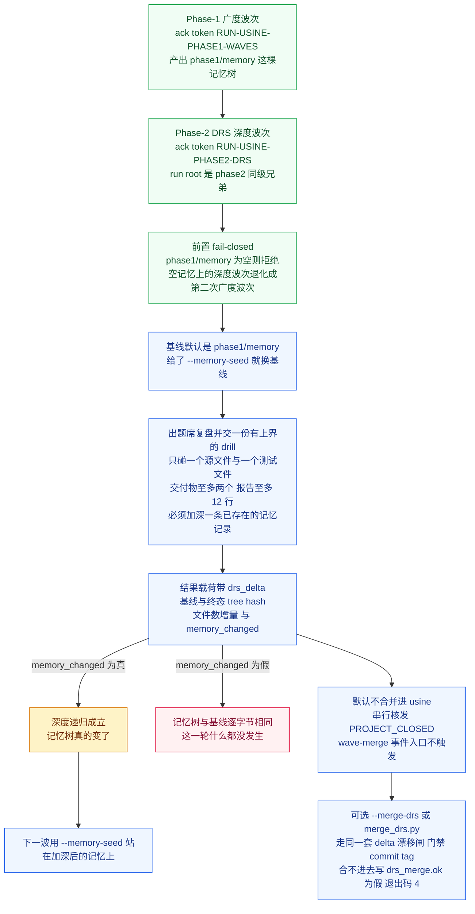

---

### 2.9 记忆种子：让第二波站在第一波上

**生活里的类比**：记忆种子像**把上一班的交接本复印一份放在这一班的桌上**——不是把原件搬走（那样第一班的记录就没了），也不是借个链接（那样一改就串了），是一份实实在在的复印件。

**代码位置**：`run_usine._install_seed_memory`（安装）、`run_usine._inspect_memory_seed`（体检）、`run_usine.main` 的 `--memory-seed` 参数与 Phase-2 的基线选择；引擎侧读的是 `explore.practice_loop._read_memory_tree`，哈希用 `explore.target_learning._memory_tree_sha256`（与 `explore.memory_hash.tree_sha256` 同一口径）。专测是 `garage/smoke_memory_seed.py`（9 项）。

「再跑一遍会不会更好」的前提是**第二遍看到的是第一遍学到的东西**，而不是从零重来。引擎本来就既读又写 `lineage/memory`（出题席读它、干活席拿着它干活、分支蒸馏后回灌），所以预置这棵树**不需要改引擎**：把记录拷进 run root 的 `memory/` 就行。

- `--memory-seed <目录>`：这次波次从这棵记忆树起步。Phase-1 默认从空树起步；给了种子就是「在上一波的收获上再跑」。
- Phase-2 默认以 `phase1/memory/` 为基线；给了 `--memory-seed` 就**换基线**——这就是「第二次 DRS 加深的是第一次 DRS 加深过的那棵树」。`drs_delta` 的基线也跟着换（`baseline_dir` 写进载荷），所以「长了多少」仍然答得上来。
- 种子是**拷贝**，不是链接也不是搬移：`_install_seed_memory` 先把目标目录整棵删掉重建，逐文件 `copy2`，遇到 symlink 直接报错。Phase-1 的 manifest 与 tree hash 必须保持权威、可重复读。
- 种子目录必须存在且非空，否则开跑前 fail-closed（空记忆上的深度波次证明不了任何事）。
- 预置在**引擎跑之前**完成，引擎自己的 `mkdir(exist_ok=True)` 不会动已放好的记录。

记忆树还有第二条去处：**快照进仓库**。波次收口时把终态记忆树抄进 `garage/memory-snapshots/<unit>-<NNN>/`，配一份 `manifest.json`（文件数、字节数、树哈希、记录时间），**单独一个提交**（带 `X-Theatre-Memory` trailer），不混进候选提交——「一候选一 commit」那条规矩管的是代码候选，记忆快照不是候选。理由很直接：记忆是唯一跨波次传递的东西，它只住在仓库外的 run root 里的话，评审看不见、run root 一清就没了、变更不可 diff。

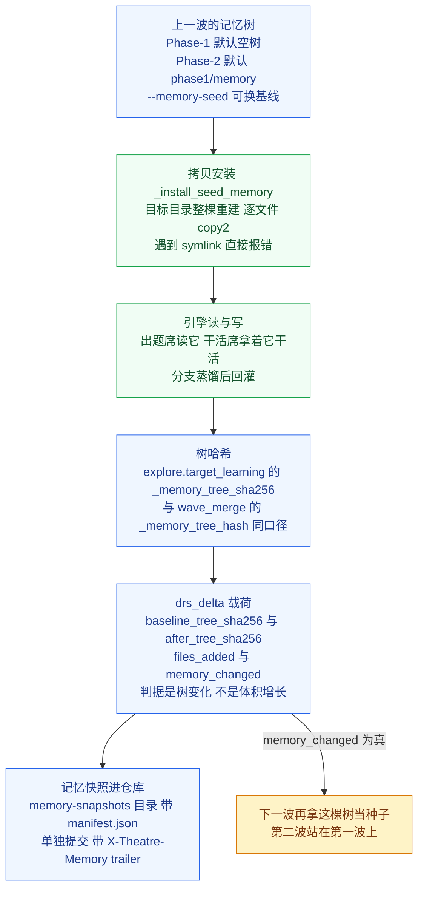

---

## 3. B 线：改 harness（harness2）

B 线改的是 **harness**——模型周围的整个系统：系统提示、护栏、记忆节、工具指引、技能、脚本——不是记忆，也不是模型权重。一次演化 = 提一个 harness 改动的提案 → 在**同一个任务**上跑一遍看效果 → 从两次执行的**行为差异**里组合出一个更好的 harness。

三样东西在这条线上分工明确：**引擎**在 `theatre-ii/`（harness2 的 vendored fork，零补丁），**桥接层**在 `garage-ii/`，**被改进对象**是 `usine/`（feuille 多语种视频产线，宿主是 dsh / DeepSeek Harness）。`theatre-ii/PROVENANCE.md` 声明：引擎目录里**没有一行** usine 或 dsh 专属代码，dsh 的接缝、usine 的任务与判据全在 `garage-ii/`。

### 3.1 三条轴：method / substrate / benchmark

**类比**：像「菜谱 / 灶台 / 客人的点菜单」三样东西。**改菜谱的人**不必知道灶是燃气还是电磁，**掌灶的人**不必知道客人点了什么，**验收的人**也不必知道菜谱怎么写。三个角色各干各的，只在两张交接单上碰面。

`theatre-ii/harness2/core/spec.py` 的模块 docstring 把这件事定死了：**method（方法）/ substrate（执行器）/ benchmark（基准）**三层互不知道对方的具体实现。

| 轴 | 是什么 | 上游代码位置 | 本仓对应 |
|---|---|---|---|
| **method** | 怎么改 harness：提案、探针、组合、选择、经验库 | `core/recursion.py` `core/proposer.py` `core/context.py` `core/selection.py` `core/library.py` `core/prompts.py` | 直接用（未改） |
| **substrate** | 跑 rollout 的那个智能体框架，以及它**可编辑的面** | `substrate/base.py` `substrate/opencode.py` `substrate/codex.py` `core/tree.py` 的 `SurfaceSpec` | 本仓新写：`garage-ii/dsh_substrate.py` |
| **benchmark** | 任务、判据、执行环境 | `benchmarks/jobbench.py` `benchmarks/lab.py` `benchmarks/workbuddy.py` | 本仓新写：`garage-ii/bench_usine.py` `garage-ii/usine_adapter.py` |

两边只通过 `core/spec.py` 的两个协议相遇：`SubstrateLike`（`spec.py` 的 `class SubstrateLike(Protocol)`）只要求一件事——`surface()` 交出「这个框架的可编辑面长什么样」；`BenchmarkAdapter`（`class BenchmarkAdapter(Protocol)`）要求 `tasks()` / `task_prompt()` / `execute()` / `delivered()` / `trajectory()` / `base_harness()` / `validate_tree()` / `score()`。方法层只认这两个协议，不认 dsh，也不认 usine。

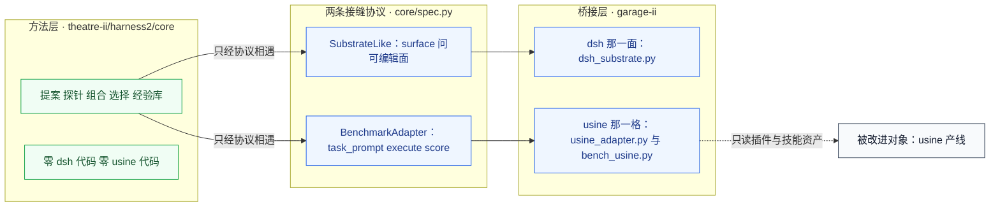

**它可能怎么坏掉**：接缝一旦被绕过，方法层就会开始认识具体框架，于是换执行器就要改引擎——`theatre-ii/` 是零补丁的 vendored fork，改引擎等于背上一份补丁清单（`theatre-ii/PROVENANCE.md` 记着另一条线是怎么背的）。这条接缝一旦被稀释，跨线路对照（同任务、同模型、同判据、同执行器）就不成立，两条线的读数也就不能放在同一张桌子上比。

### 3.2 c1..c8：可编辑面是数据，不是代码

**类比**：像「装修清单」而不是「施工图纸」。清单上写「哪几面墙归人改」，图纸是别人画的——改清单不用重画整栋楼。

`theatre-ii/harness2/core/tree.py` 的 `SurfaceSpec` 是「一个智能体框架的可编辑面」的**声明式描述**：一块数据（frozen dataclass），不是代码。

| 字段 | 含义 |
|---|---|
| `always_on` | 永远进上下文的文件（c1 系统提示 / c2 护栏 / c3 记忆 / c4 工具指引） |
| `always_on_max` + `always_on_cap_reason` | always-on 的字符预算，以及超了会怎样 |
| `skill_dir` / `skill_name_rule` | 技能目录与命名规则（c6） |
| `autotrigger_file` / `trigger_line` | 技能没被点名时，自动补触发句到哪个文件、补什么句 |
| `plugin_dir` | 插件目录（c8）；`None` = 这面不支持插件 |
| `hooks_file` + `hook_events` | 钩子文件与它允许的事件名 |
| `subagent_requires_mode` | 子智能体是否要求 `mode: subagent` 前言（c5） |
| `stubs` | 目录占位 README（不计入可编辑内容） |

**共享逻辑只写一遍**：`read_tree` / `write_tree` / `validate` / `autotrigger` / `diff_summary` 全是 `SurfaceSpec` 的泛型。两个上游 substrate（opencode、codex）**没有一个字节是重复的**——差别全在 `SurfaceSpec` 的取值与各自的 install mode。

dsh 那一面的取值在 `garage-ii/dsh_substrate.py` 的 `DSH_SURFACE`：`always_on` 是 `systemprompt.md` / `guardrails.md` / `LongTermMEMORY.md` / `tool_descriptions/tool_guidance.md` 四个文件，`always_on_max = 24_000`，`skill_dir = "skills"`，`skill_name_rule = "must_match"`，`autotrigger_file = "systemprompt.md"`，`plugin_dir = None`，`hooks_file = None`。

**上游那八个部件长什么样：论文按「什么时候进入模型的视野」分四组。** harness2 论文把「一个智能体框架」拆成八个部件，分属四组——**分组的依据不是「文件放在哪」，而是「它在什么时候起作用」**：

| 部件 | 上游文件 | 组 | 回答的问题 | 进入时机 |
|---|---|---|---|---|
| c1 系统提示 | `systemprompt.md` | **上下文构造**（context construction） | 什么进入上下文，什么时候进 | **每次调用** |
| c2 护栏 | `guardrails.md` | | | **每次调用** |
| c3 记忆 | `LongTermMEMORY.md` | | | **每次调用** |
| c6 技能 | `skills/<n>/SKILL.md` | | | **被调用时**（on invoke） |
| c8 插件 | `plugin/<name>.ts` | **中间件**（middleware） | 钩住每一次工具调用，**在模型的裁量之外** | 每次工具调用 |
| c4 工具指引 | `tool_guidance.md` | **工具界面**（tool interface） | 模型能调用什么、怎么调 | **每次调用** |
| c7 脚本 | `scripts/<name>.py` | | | **经 bash** |
| c5 子智能体 | `sub_agents/<n>/AGENT.md` | **编排**（orchestration） | 工作什么时候委派给一个新智能体、怎么委派 | **经 task 工具** |

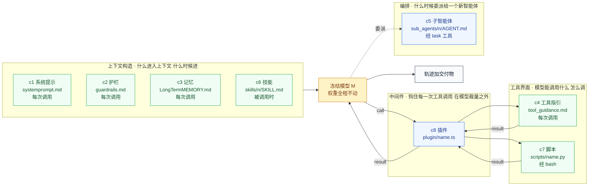

**这张表里最要紧的一列是「进入时机」**：c1 / c2 / c3 / c4 是**每次调用**都进上下文，所以它们有 `always_on` 预算——`always_on_max = 24_000` 量的是**这四个**（不是八个）；c6 是**被调用时**才进；c7 是**经 bash 被执行**；c5 与 c8 更在模型的直接视野之外——c8 在每次工具调用的前后插钩，模型不知道；c5 由 task 工具把工作**委派**出去。

**由此得到一条读法：「可编辑」不等于「可察觉」。** 改了 c7 脚本，产物判据可能完全看不见；改了 c1 / c2 / c3 / c4，智能体每一步都变。所以每次扩判据时要问的不是「还能加什么」，而是「**现在有什么是我以为在测、其实没测的**」（§5.3(c) 那句结论）——这张「进入时机」表就是回答这个问题的地图：它告诉你**改动能藏在哪几格**。

**本仓的落地是它的子集**：图里那四组，在 dsh 这一面**中间件与编排两组是空的**——c8 插件装在 **profile** 里、c5 子智能体是**插件 provider**，都不是工作区文件，proposer 改完不生效（见下表与「c5 / c8 为什么不做」）。

**dsh 只有三个原生可编辑通道**：`AGENTS.md`（永远进上下文）、`.dsh/skills/<name>/SKILL.md`（按需加载）、工作区脚本。其余四类组件要么靠拼装、要么干脆不做：

| harness2 组件 | 所属组（上游） | dsh 原生落点 | 状态 |
|---|---|---|---|
| c1 system prompt | 上下文构造 | `AGENTS.md`（agent-instructions 读同名候选） | 原生 |
| c2 guardrails | 上下文构造 | `AGENTS.md` 的一节 | 拼进去（dsh 的 guard 是**代码插件**，不是文本） |
| c3 memory | 上下文构造 | `AGENTS.md` 的一节 | 拼进去（dsh 默认没有工作区记忆文件） |
| c4 tool guidance | 工具界面 | `AGENTS.md` 的一节 | 拼进去（dsh 的工具描述在插件代码里） |
| c5 subagents | 编排 | dsh 的子智能体是**插件 provider**（in-process / ACP / Codex） | v1 不做 |
| c6 skills | 上下文构造 | `<projectRoot>/.dsh/skills/<name>/SKILL.md` | 原生 |
| c7 scripts | 工具界面 | 工作区里的确定性帮手（`harness_scripts/`） | 原生 |
| c8 plugins | 中间件 | cordis 插件，装在 **profile** 里 | v1 不做 |

**c5 / c8 为什么不做**：一个装在 `<workspace>/plugin/foo.ts` 的文件既不会被 dsh 加载，也无法在本轮里被 proposer 改完就生效——那是个**假接口**。宁可标「不支持」，也不给一个看起来能用、实际不生效的面。

**拼装的代价**：c1..c4 在方法层是四个独立可编辑组件，在安装层才合成一个 `AGENTS.md`。一个文件坏了，全盘坏。所以 `dsh_substrate.compose_agents_md` 保序、给每节留锚点（`<!-- dsh-harness:<相对路径> -->`），**空节留占位**（模型知道这里本该有护栏，比护栏变成空白更危险）。

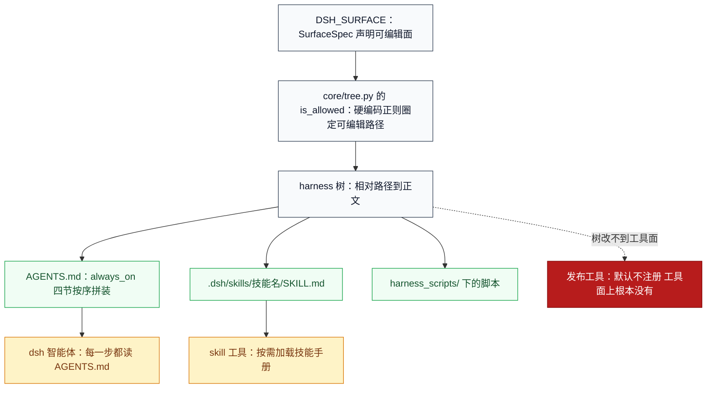

**引擎层对照的坐标轴**：下面这张表是决定性的——「沉淀物落在 dsh 的哪个通道上」。它把上面这张 c1..c8 表横过来读，就知道两条线各自够得着哪几格（能力边界的结论版在 §5.3(a)）：

| usine 的具体面 | RSIAgent 能改吗 | harness2 能改吗 | 原因 |
|---|---|---|---|
| 红线纪律文本 | 否 | 能 | 记忆进不了系统提示；harness 的 c2 就是它 |
| 技能路由 / 触发句 | 否 | 能 | 记忆不是路由；harness 的 c6 加 `autotrigger` 就是它 |
| 技能正文 `SKILL.md` | 否 | 能（**但不含 `references/` 与 `assets/`**） | 记忆不是技能 |
| 工具指引 | 否 | 能 | harness2 的 c4 |
| **工具面本身** | 不能 | c8 能改，但**在 dsh 这一面没接** | 插件要装进 profile，不是工作区文件 |
| 发布工具「不可达」这件事 | 记忆里写「发布要先开 config」反而是错的 | c2 可以把「不可达是设计」写死在护栏里 | 沉淀物的形状决定它能承载哪类知识 |
| 跨会话沉淀的产线事实 | 强项 | c3 的 `LongTermMEMORY.md` 是一节，但没有 Verifier 那种 grounding | RSIAgent 的强项 |
| 「只写验证过的东西」的纪律 | 强项（Verifier 隔离天然保证） | 没有地面就没有 grounding | RSIAgent 的强项 |

**它可能怎么坏掉**：`is_allowed()` 用**硬编码正则**定义哪些路径可编辑（技能、脚本、子智能体、插件）。正则是写死的，于是「引擎认为可编辑」和「这个框架真的认」之间会出现缝——缝里的文件改得动、装不上，效果是提案被悄悄丢掉而不是报错。

### 3.3 一次演化：Propose–Probe–Compose

**类比**：像「把录像看完，写一张整改单，让它照着改，改完再录一遍看差别在哪」的闭环。整张整改单上只有**改动的部分**，没提到的部分原样保留。

`theatre-ii/harness2/core/recursion.py` 的 `_run_stage` 是一次「阶段」，五步：

1. **建证据**（`core/context.py` 的 `build`）：把任务题面、当前 harness、基线 rollout、候选池、既往决策、经验库拼成一份证据目录 `context/`。轨迹写在 `context/rollouts/<label>.md`，**完整轨迹，不做 prompt 预算截断**。
2. **提使命**（`core/context.py` 的 `mission`）：`core/prompts.py` 的 `propose` / `aggregate` / `compose_round` 把 benchmark 的 `BenchPrompts` 插值成一条任务说明，内容是「证据在磁盘上 `context/`，去读」的**指针**。
3. **提案**（`core/proposer.py` 的 `Proposer.call`）：proposer 在 `context/harness/` 里**就地改文件**（编辑契约 omitted-is-inherited，见 §3.5）。
4. **收树 + 校验**（`recursion._accept_tree`）：`read_tree` 读回改动的树 → `autotrigger` 补触发句 → `validate`（harness2 通用规则）→ `adapter.validate_tree`（benchmark 专属规则）→ `assert_tree_has_no_grader_verdicts`（评测隔离的机械闸）。**读回来**的树是唯一事实，proposer 说什么不算。
5. **无效提案重试一次**（`STAGE_ATTEMPTS = 2`）：第二次仍无效就**继承当前 harness**（`fell_back=True`，绝不假装成功）。

**关键点：没有 ground-truth 反馈。** 提案的依据是**同一个任务上两次执行的行为差异**（contrastive），不是分数。分数只在**选择之后**由裁判读（见 §3.6、§3.7）。

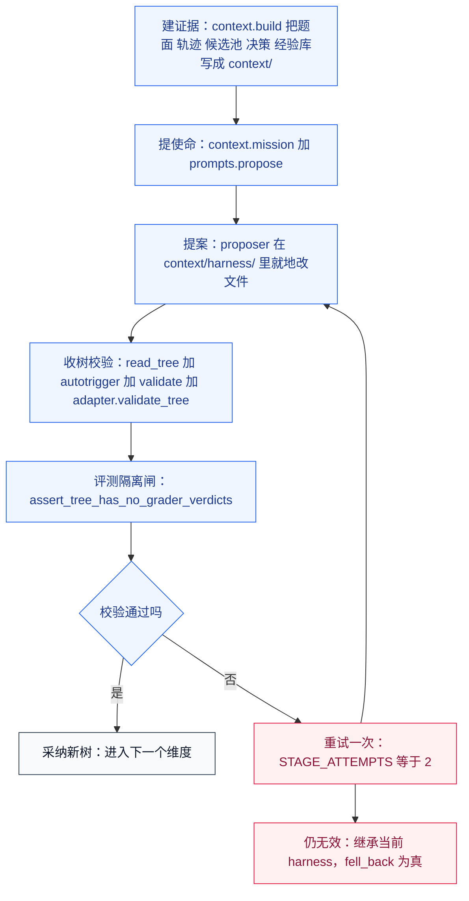

### 3.4 两种递归与账目：R=4k / P=3k

**类比**：宽是「同时派几个人各提各的方案，比一比再挑」，深是「一个人一版一版往下改，改完再改」。

| 模式 | 磁盘 token | 形状 | 什么时候用 |
|---|---|---|---|
| parallel | `agg` | **宽**：从共享证据提 2k 个候选（k 个 INV 通用改动 + k 个 DOM 领域改动），各跑一次；跑完后再从共享证据提 k 个**互不相干**的组合，各跑一次 | 想要更宽的探索面 |
| sequential | `seq` | **深**：k 轮嵌套，每轮把上一轮组合出来的 harness 带着继续改 | 想要更深的精修 |

代码位置：`theatre-ii/harness2/core/recursion.py` 的 `run_parallel`（宽）与 `run_sequential`（深）；`core/schedule.py` 的 `run_task` / `run_domain` / `run_sweep` 负责调度：域之间并行，域内按流序串行。

**账目**在 `theatre-ii/harness2/core/ledger.py`：`expected_rollouts(k) = 4k`，`expected_sessions(k) = 3k`。

| 账目 | 数量 | parallel（agg） | sequential（seq） |
|---|---|---|---|
| R（rollout） | 4k | k 次共享基线 + 2k 次候选 + k 次组合 | k 次共享基线 + 2k 次候选 + k 次合成 |
| P（会话） | 3k | k 个 INV + k 个 DOM + k 个 AGG | k 个 INV + k 个 DOM + k 个 COMPOSE |

`Ledger.assert_identity()` 钉住三件事：R 恰好 4k、P 恰好 3k、**没有重复的 label**。重复 label 先查，因为它能让计数凑齐——重复意味着两个阶段写了同一个 run id，其中一个把另一个静静覆盖了，于是「账本数到的那个候选」其实从没被生产出来。重试是单独的 invocation count（`Entry.attempts`），**选择与反思记在这本账之外**。

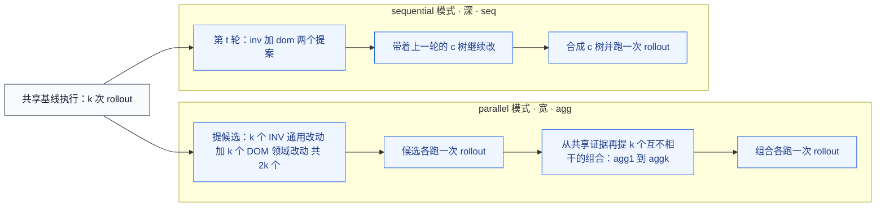

### 3.5 提案协议：omitted-is-inherited 与两条正当答案

**类比**：像「改不动就写报告说明为什么改不动」——不写报告等于「装作改了」。这不是失职，是信息。

**编辑契约 omitted-is-inherited**：提案只声明它改了的部分，**没回报的文件原样继承**。本仓通道 `garage-ii/minimax_proposer.py` 把它落成一个具体协议——文件块格式 `<<<FILE context/harness/<相对路径>` … `>>>FILE`，只回报真改了的文件，每个文件回报**完整新内容**（不是 diff、不是片段）。

**为什么本仓要自建这条通道**：上游两个通道都不通——`opencode` 通道要 vendor 半个第三方仓的源码检出（`third_party/` 与 `dependencies/` 未 vendor），`claude_cli` 通道把 `ANTHROPIC_*` 全清掉、强制走 Vertex AI（本机没有 gcloud ADC）。

**两条正当的「不改动」答案**（`minimax_proposer.call` 里处理）：

| 标记 | 含义 | 引擎记账 | 为什么单开一个标记 |
|---|---|---|---|
| `KEEP_BASE` | 证据不支持任何改动 | 交回**没改过**的树，引擎记 `kept_base` | 少这一条，模型在饱和任务上会去**编一个不存在的失败**（2026-10-20 实测：它凭空描述了一次轨迹里没发生过的工具调用） |
| `KEEP_BASE OUT_OF_SCOPE` | 想改的东西**不在可编辑面**（冻结的技能、插件自带的东西） | 同样交回原树、同样不作废，但 notes 要写清「改不动」 | 读数时要分得开「没有证据」（这一格饱和）与「改不动」（障碍在 harness 之外）；混成一个词，报告里就分不出「引擎保守」与「引擎够不着」 |

引擎从 `reply.text` 里用 `<notes>…</notes>` 抠决策说明，所以通道的 `text` 必须带这个标记。

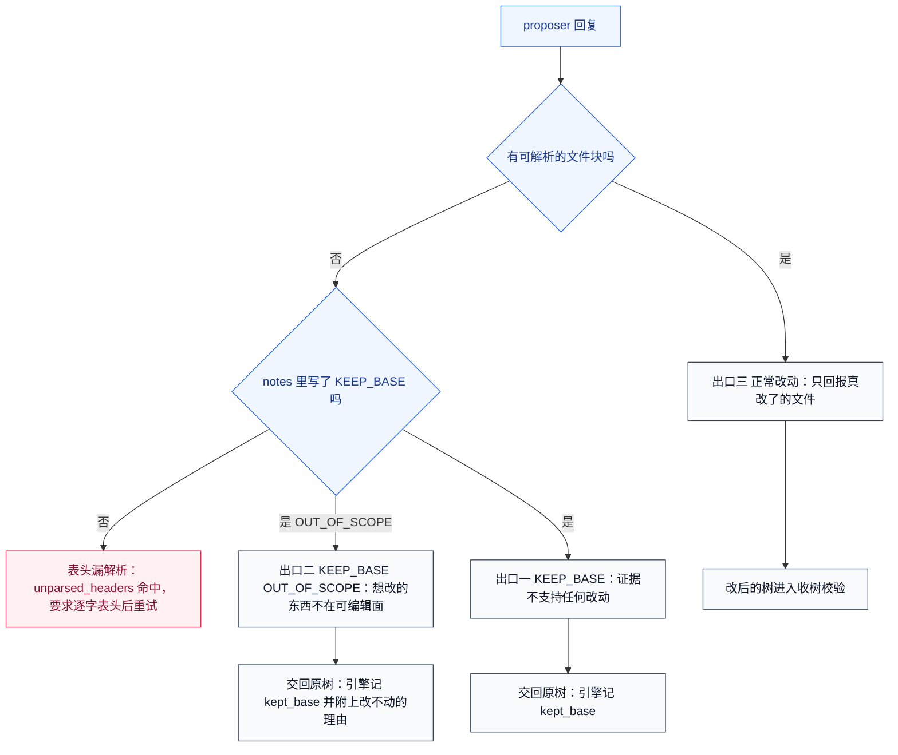

### 3.6 组合与盲选：为什么裁判在选择之后

**类比**：像「先把候选的标签撕掉，再让评委挑一个；挑完再去量分数」——量分数的那一步必须晚于挑，否则评委会被分数牵着走，挑的就不是「看着更好」，而是「量起来更好」。

`theatre-ii/harness2/core/selection.py` 的 `run_selection` 就是这条：

1. 候选**匿名化**（`assign_ids` 给每个候选一个匿名编号，真实 label 不进提示）。
2. 渲染选择池（`_render_pool`）：每个候选一个文件 `context/candidates/<匿名编号>.md`，任务说明写在 `context/task.md`。
3. selector 会话：提示要求「把每个候选都打开看过再挑」，回复里必须带 ```` ```choice ```` 块与 `<why>` 说明。
4. **selector 失败时回落到一个已交付的基线**（`_fallback`），**绝不抛异常**；只有 adapter 的 bug 才抛——那是 bug，不是选择结果。
5. `trivial_selection`：k=1 时候选只有一个，直接交付那一个 final，不开 selector 会话。

**裁判在选择之后才跑**：`theatre-ii/harness2/core/judge.py` 的模块 docstring 写得很直白——「Measurement of the run that selection chose, after it chose it.」方法层**不 import** 这个模块。治理靠三样东西：选择是**盲选**、`Ledger.assert_identity()` 钉账目序列、装配指纹 `core/runmark.py` 的 `fingerprint`。

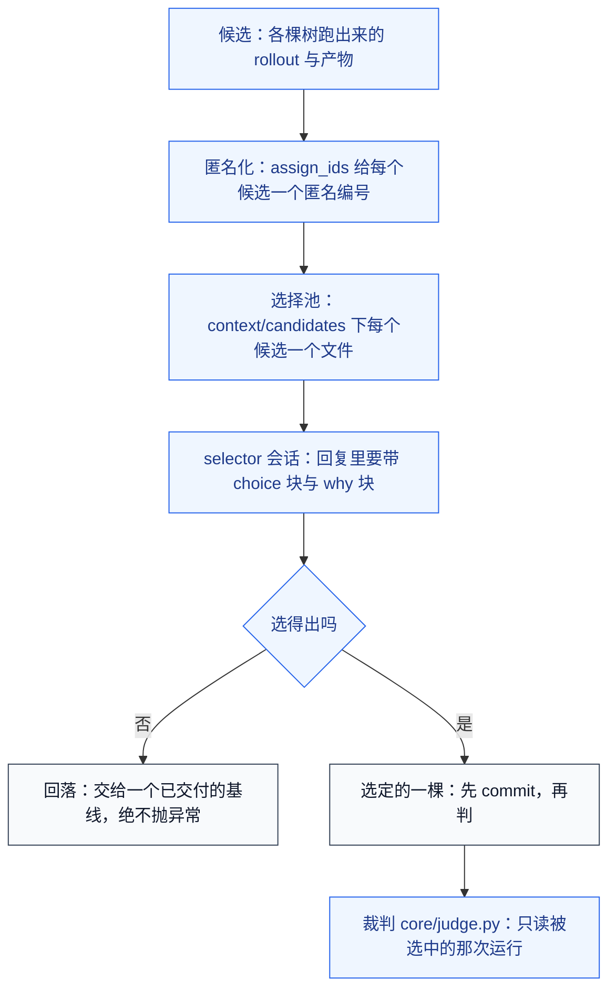

### 3.7 裁判：判据失败是 None 不是零分

**类比**：像「量不出来」不等于「量到零」——尺子坏了要写「量不了」，不能写「0 分」。把「量不了」记成 0 分，读数就会显得比真实情况更糟，而且会得出「演化让它变差了」这种凭空结论。

`theatre-ii/harness2/core/judge.py` 的 `Scored` 有两个关键性质：

- `graded` 属性：「Whether the judge succeeded, not whether the run did well.」它的判据是 `n_criteria is not None and n_criteria > 0`——**判成了**不等于**跑得好**。
- `frac`：`n_passed / n_criteria`，**没判成时是 None**。`None` 从分母里剔除。

`judge_one` 的失败语义有三种：判据抛异常 → 记 `error`、返回未判成的 `Scored`；判据返回空 → 记 `judge returned nothing`；正常返回 → 投影成 `n_passed` / `n_criteria` / `all_pass`。

桥接层那一侧在 `garage-ii/usine_adapter.py` 的 `UsineAdapter.score`：**`None` = 判据本身失败**（run 目录不在、事件流文件不在、`run_checks` 抛异常），不是零分，也**绝不被缓存成零分**。判据只在这一步跑，方法层拿不到它。

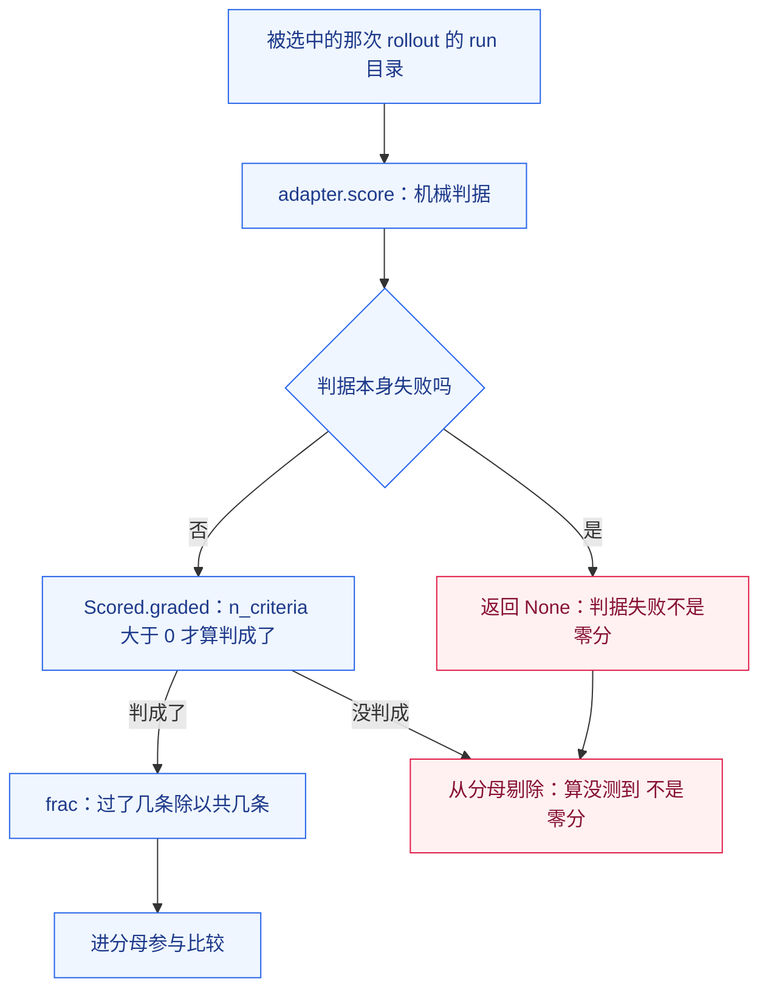

### 3.8 经验库：唯一跨轮次累积的东西

**类比**：像「做完一件事，把『什么时候该怎么做』写进自己的笔记本；下一件事先翻笔记本」。笔记本记的是判断，不是流水账。

`theatre-ii/harness2/core/library.py` 的 `Library` 是**第二个沉淀物**（第一个是被选中的 harness 树）：

- 目录形态：`<root>/<run-tag>/<mode>/<domain>/INDEX.md`、`<root>/<run-tag>/<mode>/<domain>/harnesses/<task>/harness/<rel>`、`<root>/<run-tag>/<mode>/<domain>/harnesses/<task>/EXPERIENCE.md`。
- **整棵树被搬过去，从不存摘要**。
- 检索是**构造性**的：一个域的目录里只放同域条目。每轮 sweep 每个域从空开始（root 按 run 与 mode 分域）。

教训由 `selection.reflect_adoption` → `_distil` 蒸馏出来：从采纳记录里抽「有支撑的教训」，`<experience>` 块按 `cue` / `lesson` / `evidence` / `confidence` 四行解析。**三样都在才算数**——`library.has_experience` 要求 cue / lesson / evidence 三样齐备，缺了就当没有经验，`Library.add` 直接返回 `None`（这一格不进经验库）。

```mermaid
flowchart TD
    classDef host fill:#f0fdf4,stroke:#16a34a,color:#14532d
    classDef ctrl fill:#eff6ff,stroke:#2563eb,color:#1e3a8a
    classDef sandbox fill:#fef3c7,stroke:#d97706,color:#78350f
    classDef isolated fill:#fff1f2,stroke:#e11d48,color:#881337
    classDef banned fill:#b71c1c,stroke:#7f0000,color:#ffffff
    classDef neutral fill:#f8fafc,stroke:#334155,color:#0f172a
  A["采纳一棵候选树"]
  E["reflect_adoption 与 _distil：从采纳记录抽有支撑的教训"]
  F["EXPERIENCE.md：cue lesson evidence confidence"]
  L["Library.add：整棵树搬进 harnesses 下任务名的目录"]
  I["INDEX.md 从磁盘重建"]
  N["下一轮 sweep：context.build 把经验库拷进 context/library/"]
  A --> E
  E --> F
  F --> L
  L --> I
  I --> N
  class A,E,F,L,I ctrl
  class N neutral
```

```mermaid
flowchart TD
    classDef host fill:#f0fdf4,stroke:#16a34a,color:#14532d
    classDef ctrl fill:#eff6ff,stroke:#2563eb,color:#1e3a8a
    classDef sandbox fill:#fef3c7,stroke:#d97706,color:#78350f
    classDef isolated fill:#fff1f2,stroke:#e11d48,color:#881337
    classDef banned fill:#b71c1c,stroke:#7f0000,color:#ffffff
    classDef neutral fill:#f8fafc,stroke:#334155,color:#0f172a
  R["经验库根：按 run 与 mode 分域"]
  R --> D1["域目录"]
  D1 --> IDX["INDEX.md"]
  D1 --> E1["条目目录：任务名"]
  E1 --> H1["harness/：被采纳的整棵树"]
  E1 --> X1["EXPERIENCE.md：为什么选它 加 教训"]
  class R,D1,E1,H1 neutral
  class IDX,X1 ctrl
```

### 3.9 阶段回退：一个会骗人的假信号

**类比**：像「整改单没过审，系统默默拿原来的方案把流程跑完了，报告上却写着『本轮完成』」。流程绿、产物在、退出码 0——只有一行小字说「其实没改」。

`recursion._run_stage` 在两次提案都无效时返回 `Stage(fell_back=True, tree=dict(fallback))`：**交回的是基准树（parallel 模式）或上一轮合成的树（sequential 模式），不是改动后的树**。引擎**不假装成功**——但它也不会因此中止这一轮。

所以这一轮「看起来跑完了」，而最终被采纳的可能是**没改过的基准**。`garage-ii/run_usine_h2.py` 的 `_report_stage_fallbacks` 负责把这件事说出口：sweep 与 judge 都会把回退的阶段和原因打出来，并以**退出码 1** 结束——**分数量的是基准还是演化后的，看这一行就知道**。

```mermaid
flowchart TD
    classDef host fill:#f0fdf4,stroke:#16a34a,color:#14532d
    classDef ctrl fill:#eff6ff,stroke:#2563eb,color:#1e3a8a
    classDef sandbox fill:#fef3c7,stroke:#d97706,color:#78350f
    classDef isolated fill:#fff1f2,stroke:#e11d48,color:#881337
    classDef banned fill:#b71c1c,stroke:#7f0000,color:#ffffff
    classDef neutral fill:#f8fafc,stroke:#334155,color:#0f172a
  S["阶段提案失败：两次都无效"]
  B["退回基准树：Stage.fell_back 为真，树等于 fallback"]
  R["引擎照跑：这一轮看起来跑完了"]
  K["被选中的可能仍是基准树：选择记录里的 chosen_tree_is_base"]
  D["_report_stage_fallbacks 把回退的阶段与原因打出来"]
  E["sweep 与 judge 以退出码 1 结束"]
  S --> B
  B --> R
  R --> K
  K --> D
  D --> E
  class S,B,D,E ctrl
  class R,K isolated
```

## 4. 两条线共用的护栏

两条线改的东西不同（RSIAgent 改**记忆**，harness2 改**harness**），但跑批环境、判据纪律、读数纪律是**同一套**。RSIAgent 线是 `théâtre/` + `garage/`（落 `garage-result/`），harness2 线是 `theatre-ii/` + `garage-ii/`（落 `garage-ii-result/`）。这一章的五条护栏，两线都必须守；每条都有各自的落点。

### 4.1 运行产物必须落在仓库外

**类比**：像「实验室的样品不能放在办公楼的公共抽屉里」——抽屉会被别人翻，翻了也不会有人告诉你。

dsh 的 project root 判定是「**最近的含 `.git` 的祖先，没有就用 cwd**」。run root 要是落在本仓库里，`.dsh/skills` 就会被判到**仓库根**，于是候选技能一个都扫不到——**跑得动、跑得对、跑的是错的**。这类故障不报错，只让分数静默塌到基线。

落位由代码保证，不是靠自觉：`garage/run_usine.py` 的 `DEFAULT_RUNS_ROOT` 是 `<explorateur 同级>/garage-result`；`garage-ii/preflight.py` 的 `DEFAULT_ROOT` 是 `<explorateur 同级>/garage-ii-result`（`GARAGE_II_RUNS_DIR` 可覆盖）。`preflight.check_run_root` **fail-closed**：run root 落在仓库内就报错，不许开跑。**两线分开放**的理由是读数必须能分开翻账——「这批数字是哪条线路的」不该靠猜。

```mermaid
flowchart TD
    classDef host fill:#f0fdf4,stroke:#16a34a,color:#14532d
    classDef ctrl fill:#eff6ff,stroke:#2563eb,color:#1e3a8a
    classDef sandbox fill:#fef3c7,stroke:#d97706,color:#78350f
    classDef isolated fill:#fff1f2,stroke:#e11d48,color:#881337
    classDef banned fill:#b71c1c,stroke:#7f0000,color:#ffffff
    classDef neutral fill:#f8fafc,stroke:#334155,color:#0f172a
  subgraph T1["拓扑范式：进程间"]
    direction TB
    O1["garage-ii-result：harness2 线的 run root 在仓库外"]
    O2["garage-result：RSIAgent 线的 run root 在仓库外"]
  end
  subgraph T2["explorateur 仓库内"]
    direction TB
    I1["含 .git 的目录"]
    I2["run root 若落在这里"]
  end
  P1["dsh 进程：project root 取最近的含 .git 的祖先"]
  P2["扫 .dsh/skills 找候选技能"]
  E["候选技能一个都扫不到：不报错 分数静默塌到基线"]
  I1 --> P1
  I2 -.->|"落错位置"| P1
  P1 --> P2
  P2 --> E
  class O1,O2 neutral
  class I1,I2,E isolated
  class P1,P2 sandbox
```

### 4.2 工作区必须健全，否则量的是环境

**类比**：像「考场上少发了一页参考资料，不能怪考生答不出」。

2026-10-20 实测到本层最贵的一个坑：**基准工作区本身是坏的**，于是那一格量的是「工作区完整与否」，不是 harness 的好坏。两处根因：

1. **技能只装了 `SKILL.md`**。真实插件注册技能的写法是 `customSkillDirs: [resolve(usineRoot(), 'skills')]`——**整个 `usine/skills/` 目录连同 `assets/` 与 `references/` 一起注册**。只搬手册等于把真实环境删掉一半：手册里「copy `assets/template/poster_src.html`」这一步不可执行，智能体于是（**正确地**）判定「工具面之外没有验收口径」而停手。
2. **PATH 上没有 `feuille`**。工作区是仓库外的裸目录，而真实产线里它在 PATH 上（pnpm workspace）。智能体 `which feuille` 落空，就推断「工具面没有包」——哪怕 `usine_poster` **确实注册在工具面上**。

修法两处：`dsh_substrate._install_skill_assets()` 把真实资产源 `usine/skills/` 装进 `.dsh/skills/`（以及工作区里的 `skills/`），**SKILL.md 由 harness 树覆盖——资产是源，手册是被改进对象**（树里那份可能已被演化改过）；`usine_adapter._feuille_shim_dir()` 造一个只含 `feuille` 的小 bin 目录（垫片是一行 `exec node <真实 cli> "$@"`，**不复制、不改写 CLI**）。

**两条闸**：`build_base_harness.py --check` 的 `check_skill_assets()`（手册引用的每个资源路径都必须在盘上）与 `preflight.py` 的 `check_workspace_assets()`（**装配一次**——只装配、不跑模型、不花钱——逐个核对资源真落进了工作区）。**源在不在与装得对不对，是两回事。**

```mermaid
flowchart TD
    classDef host fill:#f0fdf4,stroke:#16a34a,color:#14532d
    classDef ctrl fill:#eff6ff,stroke:#2563eb,color:#1e3a8a
    classDef sandbox fill:#fef3c7,stroke:#d97706,color:#78350f
    classDef isolated fill:#fff1f2,stroke:#e11d48,color:#881337
    classDef banned fill:#b71c1c,stroke:#7f0000,color:#ffffff
    classDef neutral fill:#f8fafc,stroke:#334155,color:#0f172a
  subgraph T1["拓扑范式：进程间 · 装配"]
    direction TB
    A1["dsh_substrate._install_skill_assets"]
    A2["usine_adapter._feuille_shim_dir"]
  end
  A1 --> W["工作区：.dsh/skills 下有 assets 与 references"]
  A2 --> W2["工作区的 PATH 上有 feuille"]
  W --> G["dsh 智能体：手册里的每一步都执行得了"]
  W2 --> G
  G --> J["判据量到的是 harness 的好坏"]
  X["缺资源或缺 CLI：智能体判定没有验收口径而停手"]
  X -.->|"量到的其实是工作区完整度"| J
  class A1,A2 ctrl
  class W,W2 neutral
  class G sandbox
  class J neutral
  class X isolated
```

### 4.3 事件流边跑边落盘

**类比**：像「行车记录仪要边开边写，不能等出事才回放」——出事时你需要的恰恰是出事**之前**的那几秒。

跑批的 rollout 可能跑十几分钟，一旦超时被杀，「跑完才写」等于**一次超时就零证据**，而读数看着像「没做」。`garage-ii/dsh_run.mjs` 现在用 `createWriteStream(eventsPath, { flags: 'w' })` 开着 `events.jsonl`，收到 SDK 的 `session.event` 通知就 `write` 一行——**边跑边 append**。

```mermaid
flowchart LR
    classDef host fill:#f0fdf4,stroke:#16a34a,color:#14532d
    classDef ctrl fill:#eff6ff,stroke:#2563eb,color:#1e3a8a
    classDef sandbox fill:#fef3c7,stroke:#d97706,color:#78350f
    classDef isolated fill:#fff1f2,stroke:#e11d48,color:#881337
    classDef banned fill:#b71c1c,stroke:#7f0000,color:#ffffff
    classDef neutral fill:#f8fafc,stroke:#334155,color:#0f172a
  N["dsh SDK 的 session.event 通知"]
  A["dsh_run.mjs：收到一条就 append 一行"]
  F["events.jsonl：边跑边写"]
  K["被杀的 rollout 也留下已经发生的事"]
  N --> A
  A --> F
  F --> K
  F --> T["轨迹渲染：共享文法 ACTION OBSERVATION ERROR"]
  T --> S["机械判据读它"]
  class N,A ctrl
  class F,T,S neutral
  class K neutral
```

### 4.4 不许在被跑机器的主人身上留外部副作用

**类比**：像「借用别人家的厨房，不能顺手改人家的门锁」——用完要还原到原样，而不是「反正我也不是故意的」。

2026-10-20 实测：冻结手册第 6 步教的 `google-chrome --headless --dump-dom` **没有**本仓自己的 mock-keychain 旗标（`usine/packages/core/src/platform.ts` 明写「headless 渲染绝不碰用户钥匙串」），于是每轮 rollout 都多一次「摸用户钥匙串」的机会。

修法是 `garage-ii/browser_shim.py` 的垫片：**每次**浏览器启动都包上 `--use-mock-keychain --password-store=basic`（`MOCK_KEYCHAIN_FLAGS`），`$CHROME_BIN` 与 PATH 上的裸名都指向它。四条不变量同时成立：

- **工具面用的浏览器不许变**——垫片照抄 `platform.BROWSERS` 的顺序解析出同一个二进制（换浏览器就是换像素基线）；
- **被测行为不许被顺手改掉**——智能体照样手搓、照样绕开工具面，判据照样命中；
- **用户的钥匙串一律不碰**——不改 ACL、不删项、不动 `security list-keychains`；
- **跑批机器的主人不留外部副作用**——机检在 `browser_shim.selfcheck()`：垫片起一次 headless 浏览器 + 全新 profile，断言 **`SecurityAgent` 没被拉起**（它出现 = 弹窗出现）。

```mermaid
flowchart TD
    classDef host fill:#f0fdf4,stroke:#16a34a,color:#14532d
    classDef ctrl fill:#eff6ff,stroke:#2563eb,color:#1e3a8a
    classDef sandbox fill:#fef3c7,stroke:#d97706,color:#78350f
    classDef isolated fill:#fff1f2,stroke:#e11d48,color:#881337
    classDef banned fill:#b71c1c,stroke:#7f0000,color:#ffffff
    classDef neutral fill:#f8fafc,stroke:#334155,color:#0f172a
  subgraph T1["拓扑范式：进程间 · 跑批"]
    direction TB
    A["跑批进程：起 dsh rollout"]
    B["browser_shim 垫片：每次启动都包上 mock-keychain 旗标"]
  end
  C["chrome 进程：同一份二进制 全新 profile"]
  D["用户钥匙串：不弹窗 不改 ACL 不删项"]
  E["工具面用的浏览器不变：像素基线不变"]
  F["智能体照样手搓浏览器：判据照样命中"]
  A --> B
  B --> C
  B -.-> D
  B --> E
  A --> F
  class A,B ctrl
  class C,E,F sandbox
  class D host
```

### 4.5 评测隔离：判据不许进 harness 树

**类比**：像「考卷答案不许抄进复习笔记」——抄进去之后，复习就变成了背答案，不再是学会。

harness2 侧的隔离有**两道机械闸**加一条结构约束：

- **结构约束**：方法层**不 import** `core/judge.py`（judge 模块自己的 docstring 明写这条）。裁判在选择之后才跑，方法层拿不到分数（`core/spec.py` 的 `RunView` docstring 也明写「Never carries a score」）。
- **闸一（读边界）**：`core/context.py` 的 `assert_no_grader_verdicts` 扫证据目录——按**文件名**和**内容**两种方式找 `GRADER_VERDICT_MARKERS` 里的标记串。
- **闸二（树边界）**：`core/context.py` 的 `assert_tree_has_no_grader_verdicts` 扫 agent 写的 harness 树——这样的树一旦带上判据结论，**以后永远不能再当证据送给后面的任务**。

同一纪律在 RSIAgent 那一边是**同名同义**的独立实现：官方评测器输出是 host artifact，不得进入该轮后续学习（论文 §4.2）。两边各有一份，本仓**不重复实现第二套**（红线 2）——harness2 侧有机械闸就够了。

```mermaid
flowchart TD
    classDef host fill:#f0fdf4,stroke:#16a34a,color:#14532d
    classDef ctrl fill:#eff6ff,stroke:#2563eb,color:#1e3a8a
    classDef sandbox fill:#fef3c7,stroke:#d97706,color:#78350f
    classDef isolated fill:#fff1f2,stroke:#e11d48,color:#881337
    classDef banned fill:#b71c1c,stroke:#7f0000,color:#ffffff
    classDef neutral fill:#f8fafc,stroke:#334155,color:#0f172a
  S["判据输出与裁判结论"]
  T["agent 写的 harness 树"]
  G1["闸一：assert_no_grader_verdicts 守读边界"]
  G2["闸二：assert_tree_has_no_grader_verdicts 守树边界"]
  E["证据目录：proposer 读得到的一切"]
  X["拦下：去找那条读路径，而不是放宽标记表"]
  B["发布工具：默认不注册 工具面上根本没有"]
  S --> G1
  G1 -->|"干净"| E
  G1 -->|"命中标记"| X
  T --> G2
  G2 -->|"干净"| E
  G2 -->|"命中标记"| X
  G2 -.->|"不是判据 是设计"| B
  class G1,G2 ctrl
  class S,T,E neutral
  class X isolated
  class B banned
```

---

## 5. 两个框架的收益与问题（合并总结）

> 这一节把原先的十节（怎么量、三臂对照、产物、运行手册、人机交互、验收、踩坑录、方法论、四份现场、红线）压成一份「账」：两个框架各自**带来了什么收益**、**暴露了什么问题**。它只给结论与最硬的几个数字，逐字实测、运行手册、四份现场日志、红线原文都不在这里复制——每小节末尾的**指针**指向仓库里仍然活着的权威文件（git 提交、[`garage-ii/BENCH-APPENDIX-2026-10.md`](../garage-ii/BENCH-APPENDIX-2026-10.md)、`garage/runs/`、各 `PROVENANCE.md`、[`usine/tools/foodnames/README.md`](../usine/tools/foodnames/README.md)、以及代码本身）。要动手改这台机器，先读 §1 的六个词，再读这一节。

**先说清两个框架是什么**（§0 已并排看过，这里只提一句好让下面的账读得懂）：A 线（RSIAgent）改的是智能体的**记忆**——一份 Markdown 语料；B 线（harness2）改的是智能体的 **harness 本身**——系统提示、护栏、工具指引、技能手册。两者都不碰模型权重，改的都是模型周围的东西，被改进的对象也都是同一个 `usine/`。

### 5.1 一句话的账：改好了什么、试了没收益

两个框架各自的账，摆成两栏最直观——**左栏是真改好了、能拿出来给人看的**（都可复查），**右栏是试了、却没量到收益的**（也都有据，不是「没做」）。每个数字的出处与指针在 5.2（左栏展开）与 5.3、5.4（右栏展开）。

| 框架 | 真改好了（拿得出手、可复查） | 试了、却没量到收益（诚实记下来） |
|---|---|---|
| **A 线**（改记忆） | **六条真 git 提交**（`pnpm verify` 全 exit 0），一路从「改一句拒答话」→「改一条视频产线」→「改判据自己的落点」；最硬的一条：foodnames 旧 12 期版式不达标 **954 → 0**、音画不同步 **54 → 0**（句子门 144/144 逐词对上） | 记忆**进不了** dsh 每步都读的系统提示 / 技能路由 / 工具面，只能当「一份要主动去读的文件」；单项目波次那个 `held_out_generalization` **只是标签**，从没在第二个项目上验过 |
| **B 线**（改 harness） | 「手册树」这个杠杆**补上了 A 线够不着的产线专有格**：基准臂 6 条全红，加一份写着产线两条 house rule 的手册后 **Δ=0.75、p=0.0333**（三种处置全过）；两臂各扩到 n=11 后泛化判决 **`generalizes`**（train 1 格 + eval 4 格涨、零格跌） | 引擎**自己演化**（第三臂）**Δ=0.2、p=0.4545，三种处置全不过**：它确实学到「宿主 shell 被挡就改走文件工具」且机制上生效（计入的 `pwsh` 调用均值 **17.2 → 5.4**），但一条**通用**规则救不了产线**专有**的版式格 |
| **两条线一起** | 逼出一套**测量纪律**：没有同树零分布不许说「提升」、train/eval 分侧读、判据失败是 `None` 不是零分、判据不进 harness 树 | 三次真波次**全都没跑到判分**——首测 17 个工具面全丢、wave1-blocked 撞 **184 次 401**、wave1r 死于 **429 + 400**；**是 infra 挡路，不是想法错了**（详见 5.4） |

**两栏背后的根本差异**：A 线**需要「地面」**——一个能判对错的 Verifier，而 `usine` 没有官方评测器，只能用 `garage/verifier_adapter.py` 补一套替身；产物是可 `git show` 的提交，但记忆进不了那三个抽屉。B 线**明确不需要地面**（论文原话 *without ground-truth feedback*），沉淀物**就是**智能体每步都读的那三个抽屉（AGENTS.md / 技能 / 脚本）本身，所以它能改红线文本、能改技能路由——这是 A 线够不着的（代价：一轮 sweep 很贵，旧协议实测 2h14m）。而两栏共同的最大收益其实**不是哪个分数**，是右栏逼出来的那套**测量纪律**：它让「没收益」能被诚实认出来（第三臂的负读数、三次受阻的 infra 归因），而不是被包装成「还在进步」。

### 5.2 左栏展开：真改好了什么（能拿出来给人看的）

**A 线——仓库里可取证的六条提交**（全部 `pnpm verify` exit 0；用 `git show <hash>` 逐字复查）：

| 提交 | 改了什么（一句话） | 门禁 |
|---|---|---|
| `eedaf73` | 把「fail closed 未提交」这句机器口吻的拒答，改写成「什么没发生、下一步怎么做」 | exit 0 / 24.7s |
| `1d550b2` | DRS 那一支同类拒答卡文案 | exit 0 / 26.3s |
| `6e8665f` | 另两个拒答分支，并补一句「每次消耗额度的 submit 都要单独一次人工点头」；**这一波站在第一波肩上**（种子记忆 8410B → 11460B） | exit 0 / 26.4s |
| `6985542` | 修掉 foodnames 视频产线的真病灶：句首 token 被无条件替换成词形 → 让「菜名」成为独立主角 | exit 0 / 26.2s |
| `f02b9f3` | 把两条量化要求（暗词不透明度 ≥ 0.45、当前词高亮落品牌三色）**钉成测试** | exit 0 / 37.3s |
| `17c92c9` | 把「仓库根」判定本身做成可判定的（修的正是那道在 guest 里量错目录的结构门） | exit 0 / 50.1s |

最值钱的一条落地数字：foodnames 旧 12 期的 **954 条版式不达标 + 54 处音画不同步**，改完是 **0 / 0**（句子门 144/144 逐词一致）。**时间分布本身就是读数**——10-20 一天三条（全改拒答话），10-21 深夜一条（改产线真病灶），10-22 下午两条（把判据钉成测试、再把判据落点修对）：A 线从「改一句话」走到了「改一条产线」再走到「改判据本身」。**指针**：`git show` 上述提交；产线判据的权威文本在 [`usine/tools/foodnames/README.md`](../usine/tools/foodnames/README.md)；波次级记忆快照在 `garage/memory-snapshots/`；现场在 `garage/runs/`。

**B 线——「手册树」这个杠杆能改进产线专有的那一格**（第五轮，2026-10-22）：基准臂 6 条 rollout **全红**（照通用模板做出来的 0.18 暗词 + 中性灰高亮），演化臂（基准树 + 一份写着产线两条 house rule 的手册）**Δ = 0.75、p = 0.0333**，而且**三种处置全部通过**（现状处置 Δ=0.75/p=0.0333；把「被时间上限掐死且无交付」也作废 Δ=1.0/p=0.0119；最保守的「作废全当零分」Δ=0.5/p=0.0909）——**结论不依赖处置的选择**，这是这一格最硬的一句话。**指针**：`garage-ii/scene_layout_arms.py`；[BENCH-APPENDIX](../garage-ii/BENCH-APPENDIX-2026-10.md)。

**B 线——第一份有功放的泛化读数**（2026-10-22，两臂各扩到 n=11）：判决 `generalizes`——**train 侧 1 格、eval 侧 4 格显著上涨，零格显著下跌**，形状是「学到了可迁移的东西、没有过拟合」。边界要读清：6/11 格「有演化但分不开」（「每格都提升」没有证据）。**指针**：`garage-ii/generalization.py`、`garage-ii/task_split.py`；[BENCH-APPENDIX §20](../garage-ii/BENCH-APPENDIX-2026-10.md)。

**三臂对照这把尺子本身也是收益**：`base`（什么也不加）/ `h2`（演化后的 harness 树）/ `rsi`（冻结记忆语料挂成 AGENTS.md 的一节），**同任务、同模型、同判据、同 dsh 版本**，臂间之差 = 这个沉淀物值多少。两条取料臂各有一个「静默退化」的坑（找不到树 / 没给记忆），脚本都**显式标在报告里**而不是当成「与 base 一样」。**指针**：`garage-ii/compare_rsiagent.py`。

### 5.3 问题：会骗过你的东西

右栏那些「没收益」，根子分三类，**读的时候别把它们混成一类**——(a) 能力边界：结构上够不着、或试了也没量到收益（不是 bug）；(b) 测量陷阱：读数会说谎；(c) 静默故障：账面绿而事实错。

**(a) 能力边界：结构上够不着、或试了没量到收益（不是 bug）**

- **记忆进不了 dsh 的三个抽屉**：dsh 智能体每步读的只有系统提示（AGENTS.md）、按需加载的技能、可跑的脚本；RSIAgent 的产出是「一份笔记」，**不自动进这三条通道**，本对照里是**人工**把它挂成 AGENTS.md 的一节才测得到效果。
- **工具面两边都改不了**：17 个注册工具本身，A 线改不了，B 线的 c8 插件理论上能改但**在 dsh 这一面没接**（插件要装进 profile，不是工作区文件）；技能的 `references/` 与 `assets/` 也不在可编辑面上。
- **「发布不可达」是设计不是经验**：记忆里写「发布要先开 config」是**危险的**（把不可达说成了待解锁）；只有 harness 的 c2 护栏能把「不可达是设计」写死。沉淀物的**形状**决定了它能承载哪类知识。
- **B 线自演化学到的是通用工作方式、不是产线知识**（第三臂，引擎自己产出的树）：**Δ = 0.2、p = 0.4545，三种处置全部不通过**。它从「rollout 里宿主 shell 被沙箱挡住」这个失败里学到「改走文件工具」，机制上**确实生效**（计入条目的 `pwsh` 调用均值从基准臂 17.2 压到 5.4），但一条通用规则**救不了**产线专有的版式格。**下一步**：想让 B 线自己长出产线知识，得把产线口径放进**它能读到的面**（基准树里的技能手册），或让评测结果成为提议者的反馈。
- **`usine` 没有官方评测器**（`official_evaluator_calls: 0`）：于是「这一波让产线好了多少」此前**没有数字**回答，自我进化实际只剩「防退化 + 刷验证席 PASS」；A 线靠 `garage/verifier_adapter.py` 这套替身补上地面。

**(b) 测量陷阱（读数会说谎）**

- **没有零分布就没有「提升」**：同一棵基准 harness、同一道题，四棵臂树**逐字相同**，分数却是 **80% / 100% / 100% / 100%**——臂间差的第一嫌疑不是 harness 改了，是同一棵树重跑就会抖。
- **`--k 1` 时无论 Δ 多大都判不出显著**：完全分离下的最小 p 是 `1/C(2k,k)`，k=1 时是 **0.5**，永远过不了 0.1。所以「读不出」是 `underpowered`（这次跑法没有判别能力），**不是**「演化没用」——这两句话必须分开，否则一次白跑会被记成一个负面结论。
- **判据失败是 `None` 不是零分**，从分母剔除；汇总只统计判成功的，所以「平均分」的分母每臂可能不同——横向比均分之前先看判成功条数。
- **train/eval 必须分侧读**：只看合并均值时，「学到可迁移的东西」「只在见过的题上变好（过拟合）」「学到的规矩在别处是错的（负迁移）」三者长得一模一样；负迁移甚至**不需要**跌幅超过涨幅就能把均值伪装成正数。判决按两侧显著性：train 涨 + eval 不涨 = `train_only`；eval 显著跌 = `harmful`（**train 涨多少都不抵**）；缺 eval 侧 = `no_eval`（不许当「泛化没问题」读）。
- **阶段回退会骗人**：提案阶段失败时引擎**退回基准树**继续跑，这一轮「看起来跑完了」，而最终被采纳的其实是**没改过的基准**——分数量的是基准不是演化后的。`sweep` / `judge` 会把回退打出来并以**退出码 1** 结束，看这一行就知道量的是谁。

**(c) 静默故障族（账面绿而事实错）——原「十七个坑 + 跨轮次方法论」的浓缩**

- **run root 落进仓库 → 分数静默塌到基线**：dsh 的 project root 判定是「最近含 `.git` 的祖先」，run root 落在仓库里，`.dsh/skills` 会被判到仓库根，候选技能一个都扫不到——**跑得动、跑得对、跑的是错的**。所以两条线的产物一律落**仓库外**、且分开放（`../garage-result/` 与 `../garage-ii-result/`）。
- **量到「缺陷」之前先问一句：这是被改进对象的缺陷，还是我自己判据/环境的缺陷**：guest 里那道结构门把 harness 的家当成了「内容产物」（量错了目录，真仓库里它是绿的）；429/400 死在协议层不是模型；基准臂产物被后来的进程擦掉，判据照直判成「没交付」——那量的是进程管理。**不是「智能体不行」的，不要记成「智能体不行」。**
- **自检只测内存里的对象等于没测**：新字段没进 `to_dict`（CLI 路径上判定从没生效）、compare 只比两臂交集（少一格照样绿灯）、`rescore` 指错参数会**静默擦掉一个臂还退出 0**。凡是「落盘 → 读回 → 判定」的逻辑，自检必须走那条真实路径。
- **判据不许比被改进对象自己的文件更严**，而且**放宽往往更严**（基准抬高 ⇒ 演化要追的差距更小）；判据引用纪律要给「文件 + 行号 + 原文」，不要写会漂、会张冠李戴的编号。
- **heredoc 正文不是命令**（`cat > x <<'EOF'` 到 `EOF` 之间是数据，shell 从不执行）；**清洗函数必须幂等**（断言直接比 `f(f(x)) == f(x)`，否则第二次调用会一路剥到结尾把真命令吃掉）。
- **两处撞名，都尚未修**：① **tag 撞名不建也不报错**——`wave_merge._ensure_wave_tag` 探测到 `theatre/wave-1` 已存在就直接返回，于是 foodnames 那波合进来了却**没有指向自己的 tag**（仓库里 `theatre/wave-1` 仍指向 `eedaf73`）；② **记忆快照目录撞名**——快照名只有波次编号而每个 run root 都从 1 开始，两棵不同 run root 的记忆树写进了同一个 `wave-001/`（盘上 8 个文件，`manifest.json` 只描述 3 个），**没有任何一层会报这个**。
- **「量不到」不等于「达标」**：`minOpacity === null ? true` 让「只渲染当前词、其余全藏起来」的页面白拿一条通过——「量不到」有三种归宿，**没有一种叫通过**。**「被掐死」还分两种掐法**（提供方掐死 vs 我们自己的时间上限掐死），而作废**不是随机缺失**（被掐死的多半是「做得更多、正在挣扎」的，剔出分布对演化臂反保守）——所以读数要把作废条数一起报，并给出「作废当零分」的最坏情形。
- **文档会过期、归因会骗人**：渲染破口的第一版归因写「Chrome 155 自动升级」，被实测推翻（产线用的是 Edge 144，Chrome 压根没被调用；真因是 headless 视口比窗口矮 93px，产线那条 `poster render` 从不补偿）。**指针**：`garage-ii/arms.py`、`garage-ii/tree_discipline.py`、`garage/wave_merge.py`、`garage/guest_env.py`、`garage/smoke_agent_surface.py`；[BENCH-APPENDIX §17](../garage-ii/BENCH-APPENDIX-2026-10.md)（最终判决与 14 条「测不到什么」）。

### 5.4 右栏展开：三次受阻、一次落地（现场的形状）

四份真跑现场里，**三份受阻、一份落地**。留下的最有用的信息不是「跑成没跑成」，而是**形状**（工具列表的数目、`classification` 的取值、那行 `out=25502266 chars`）——形状能被后来的读数直接引用，结论会随工位、题面、判据一起过期。

- **首测（dsh 宿主第一次真跑插件）**：装配全绿、宿主起来、会话跑完，**唯一症状是工具列表里一个 `usine_*` 都没有**——**boot 过 ≠ 插件活**（inject 缺 `approval` 时 17 个工具面全丢而宿主无感，vitest 的 fakeCtx 不校验 inject 所以测试面永远看不见）。修法不是「多写点日志」，是把工具面变成**可机械核验的事实**（`garage/smoke_agent_surface.py`）。
- **wave1-blocked（第一次 Phase-1 波次，5 个项目）**：装配全绿（围栏 712 shingle 与 707 源不相交、语料建成、guest 起来），但 `events.jsonl` 只有 5 条（1 条 STARTED + 4 条 BRANCH_EXCEPTION），**没跑到判分**。真因是 MiniMax 那一支 **184 次 401**——`classification: infra`。**「上游答的是鉴权，不是能力」**：没有这层分类，184 次 401 会被读成「智能体干得差」。
- **wave1r（换阵容后的第二次波次，7 个项目）**：唯一一份**真把模型调起来过**的（MiniMax 落点从 `agent.minimax.cn` 换到 `api.minimaxi.com`，530 次 200、iter 编号最深到 137），但仍**没跑到判分**——死于 **429 速率限制**（recoverable）+ **400 上下文超限**（fatal）；400 的前因写在上一行：`iter 136` 那次程序超时并吐了 **25.5 MB** 输出，把下一轮请求的上下文撑破。**教训不在模型，在输出体积**——那是收口/围栏/判据该管的事。
- **foodnames（落地）**：一次跨两条线路的实验，A 线五波（四种不同的失败理由）后第五波落成**真提交**，B 线四轮读不出（结构性无效）+ 第五轮读出（Δ=0.75）+ 第三臂负读数——细节已在 5.2 / 5.3 里。**指针**：`garage/runs/` 下三份现场 README + 项目指令（原始件不许改写）。

### 5.5 怎么跑 & 红线（操作性约束的浓缩）

原来的运行手册、人机交互、三层验收、红线四节，压成下面这几条**必须守住的操作约束**；完整原文以代码与 AGENTS.md 为准。

- **三条总闸（两条线同序）**：① **自检先行**——`--preflight` / `--dry-run` 只读，打印就绪载荷，**不写不烧 token**；② **执行需 ack token**——A 线 `RUN-USINE-PHASE1-WAVES` / `RUN-USINE-PHASE2-DRS`，B 线 `RUN-USINE-H2-SWEEP` / `RUN-USINE-H2-COMPARE`，**用户喊跑才跑**（「你直接跑」不算授权）；③ **发布永不自动**——本仓发布路径在工具面上**根本不存在**（`usine_publish` 默认不注册），不是靠提示词劝阻。
- **run root 落仓库外、两线分开放**：落位由代码保证不是靠自觉（`garage/run_usine.py` 的 `DEFAULT_RUNS_ROOT`、`garage-ii/preflight.py` 的 `DEFAULT_ROOT`，`check_run_root` 会 fail-closed）；原因见 5.3(c) 第一条。
- **验收三层，全部机械可查**：**L1 合并完整性**（`merge_report.json` 计数 / gate exit 0 / delta 不含 `node_modules`·`dist` / exec 位保留 / 记忆快照进仓库）→ **L2 门禁层**（真树 `pnpm verify` 全绿，红线用例只可加强不可放松）→ **L2.5 产线健康分**（门禁说「没坏」，它说「更好了」；有指标变坏则整条候选作废）→ **L3 智能体面真验**（dist 已重建、`__require` 垫片、真跑首任务）。**SKIP 不是 PASS，编出来的数据比没有数据更坏。**
- **红线四类**：**额度**（feuille 自身零 H3 调用；消耗额度的 submit 逐次人工点头，母版一次生成、按画幅成对、生成后冻结、永不重复消耗）；**发布**（VM 门面拒发布动词 + 审计面黑名单 + 编排器不持有 TTS/积分凭据，三层永不通行；认证扫码/验证码一律人工，检测到风控停下等人，绝不自动重试）；**治理**（一候选一 commit、每 wave 一 tag、**永不 push**）；**fork**（`théâtre/` POSIX 补丁逐字节不变、`theatre-ii/` 零补丁，要补的行为一律落适配层 `garage/` 与 `garage-ii/`）。**指针**：[`AGENTS.md`](../AGENTS.md) 第九节、[`usine/AGENTS.md`](../usine/AGENTS.md) 的 H3 铁律、各引擎目录旁的 `PROVENANCE.md`。

> ⚠️ **红线中的红线：不要为了让门禁变绿而改门禁。** 白名单、判据、阈值都是**人手工维护的判断题**，它们红了通常说明真有问题；把它调松是最容易也最坏的一种「修」。历史上唯一合理的改法是——有**独立于结论的语义依据**（如「heredoc 不是命令」），而不是「往哪边定都是我想要的结果」。一格判据的结论能在 p=0.05 与 p=1.00 之间摆动时，它的 Δ 无论正负都不进判决，正确定位是「待重造」，不是「已量到」。

---

## 6. 文档索引与权威关系

```mermaid
flowchart TB
    subgraph CORE["唯一总文档"]
        M["docs/self-evolution.md<br/>本文件：机制 + 运行手册 + 测量协议 + 产物对照"]
    end
    subgraph CODE["留在代码里的契约"]
        C1["garage/run_usine.py docstring<br/>装配契约 13 条（次序承重）"]
    end
    subgraph FORK["留在引擎目录旁的约束"]
        F1["théâtre/PROVENANCE.md<br/>POSIX 补丁逐字节不变"]
        F2["theatre-ii/PROVENANCE.md<br/>零补丁"]
        F3["théâtre/ADAPTATION.md<br/>théâtre/PORTING-NOTES.md"]
    end
    subgraph ARCH["逐字归档"]
        A1["garage-ii/BENCH-APPENDIX-2026-10.md<br/>实测记录，节号与协议一一对应"]
    end
    subgraph RAW["真跑现场原始件"]
        G1["garage/runs/<br/>脚本 · 日志 · 事件流<br/>门禁要读的那几个文件也在里头"]
    end
    subgraph RULE["规则层"]
        R1["AGENTS.md 第九节：20 条顶层条目<br/>其中 18 条是读数纪律"]
        R2["usine/AGENTS.md：22 条产线纪律 + H3 铁律"]
    end
    M --> C1
    M --> F1
    M --> F2
    M --> A1
    M --> G1
    M --> R1
    M --> R2
    C1 -.->|"契约以代码为准"| M
    F1 -.->|"fork 纪律以引擎目录为准"| M
    G1 -.->|"§5.4 讲现场；原始件不许改写"| M
    R1 -.->|"本文是规则的来历，不是替代"| M

    classDef ctrl fill:#eff6ff,stroke:#2563eb,color:#1e3a8a
    classDef host fill:#f0fdf4,stroke:#16a34a,color:#14532d
    classDef neutral fill:#f8fafc,stroke:#334155,color:#0f172a
    class M ctrl
    class C1,F1,F2,F3,A1,G1,R1,R2 host
    class CORE,CODE,FORK,ARCH,RAW,RULE neutral
```

### 6.1 想动手改这套机器时，按这个顺序读

1. **本文 §1**（六个词）→ **§5**（两个框架的收益与问题）——不读 §5 就动手，等于闭着眼睛改一把没有刻度的尺子。
2. [`AGENTS.md`](../AGENTS.md) 第九节 —— **20 条顶层条目**（其中 **18 条**是粗体的「读数纪律」，另两条是「生成类命令默认不覆盖」与「用词纪律」），每条都带实测出处。**这是最浓缩的一份。**
3. **本文 §5.3(c)**（静默故障族）—— 判据怎么修才不算调尺子、什么断言只是装饰、什么样的静默缺陷会让账面保持绿。
4. [`garage-ii/BENCH-APPENDIX-2026-10.md`](../garage-ii/BENCH-APPENDIX-2026-10.md) —— 实测逐字归档；**§17 是最终判决与 14 条「测不到什么」，读数字前必读**。
5. 各线的 `PROVENANCE` —— 改 vendored 引擎之前**必须**读。

### 6.2 落位与索引的纪律

- **本文合并自十二处**：原 `théâtre/ARCHITECTURE.md`、`garage/README.md`、`theatre-ii/ARCHITECTURE.md`、`garage-ii/README.md`、`garage-ii/BENCHMARK.md`、`garage-ii/EVOLUTION-PATHS.md`、`theatre-ii/COMPARISON.md`、`garage-ii/LESSONS.md`、`théâtre/docs/guide.md`、`docs/RSI.md`（两篇上游论文的方法论对照与选型，收进 §0.1、§0.2）、`docs/foodnames-video-2026-10.md`（一次跨两条线路的实验的实录，收进 §5.2、§5.4），以及 `garage/runs/` 下的现场归档（3 份 README + 5 份项目指令）。**这十二处的处置分两种，不要说成一种**：① `docs/RSI.md` 与 `docs/foodnames-video-2026-10.md` **已删除**（它们是本仓自建的专题文档，没有别的理由留在原处）；② 另外九处**保留为指针存根**——正文已删，只留一张「原节号 → 新节号」映射表指回本文，**它们不是第二份说法**（没有正文），但也**不是「已删除」**。`garage/runs/` 下的脚本与日志保留——门禁要读它们。
- **单一事实源**：同一个事实只存一处，其余派生（产线纪律第 10 条）。两份纪律必然漂移，而**漂移的那份没人核对**。
- **正文禁止人为按列宽硬换行**：一个自然段写一行，到段落结束才换行。改既有文档时只改要改的那一段，**不顺手重排别人写好的旧段落**。

---

## 附：名词对照表

| 词 | 一句话 | 在代码里的位置 |
|---|---|---|
| harness | 模型之外、每步都在影响它的全部东西 | `garage-ii/harness_base/` |
| 基准 / baseline | 没改过的对照版本，必须与被改进对象同源 | `build_base_harness.py` 派生 |
| rollout | 智能体在一个干净工作区里跑完一遍任务 | `usine_adapter._launch_one` |
| arm / 臂 | 一棵树 × 一个任务 × n 次 rollout | `garage-ii/arms.py` |
| wave / 波次 | A 线的一整轮演化：出题 → 播种 → 干活 → 验证 → 蒸馏 → 合并（九步见 §2.2） | `garage/run_usine.py`，`--phase 1/2` |
| sweep | B 线的一整轮演化：跑基准 → 提案改树 → 新树再跑 → 采纳一棵（域间并行、域内串行） | `theatre-ii/harness2/core/schedule.py` 的 `run_sweep`，`--phase sweep` |
| 零分布 | 什么都没改时分数会怎么自己动 | `--phase repeat` |
| 判据 / criteria | 机械判「过/不过」的规则，读轨迹 + 最终回答 | `garage-ii/bench_usine.py` |
| 轨迹 / trajectory | 一次 rollout 里的事件序列（调了什么、参数是什么） | `events.jsonl` |
| 阶段回退 | 提案失败 → 引擎退回基准树继续跑（会骗人） | sweep / judge 以退出码 1 报告 |
| `KEEP_BASE` | 提案者说「不用改」，是正当答案 | `minimax_proposer.PROTOCOL` |
| omitted-is-inherited | 提案只写要改的文件，没提的沿用基准 | 引擎的写入协议 |
| 置换检验 | 枚举所有分组方式，看这个差能不能靠运气分出来 | `_exact_permutation_p` |
| 判据戳 / criteria stamp | 判据实现的指纹；变了就说明尺子换了 | `usine_adapter.criteria_stamp` |
| 树级轴 | 树对树比对纪律有没有被改 | `garage-ii/tree_discipline.py` |
| 漂移闸 | 工作树既不匹配基线也不匹配候选就跳过 | `wave_merge.classify_delta` |
| 规范同步闸 | 改了被规范的代码却没同批更新规范 | `garage/spec_sync.py` |
| 产线健康分 | 门禁防退化，这道闸问「更好了没有」 | `usine/packages/eval` |
| 铺开闸 / spread gate | 强制连续波次不许都落在同一个包里 | `garage/spread.py` |
| guest | 「虚拟机」其实是一套路径改写 + 隔离事务 | `garage/guest_env.py` |
| rollback_mirror | Verifier 的隔离模式：整盘快照 → 探查 → 整盘回滚 | `garage/verifier_adapter.py` |
| 8-gram shingle | 文本的滑动 8 词组；两文本的 shingle 集合相交即逐字重叠 | `garage/distribution-usine.md` 的静态围栏 |
| delta | 一次候选相对基线的变更，分 modified / added / deleted | `wave_merge.candidate_delta` |
| SKIP | 没验证，**不是**通过 | vitest 的 skip |
| Curriculum Agent（课程智能体） | 上游派探索任务的那个智能体 | 本仓叫出题席，`garage/config/roles-usine/curriculum-usine.yaml` |
| Actor Agent | 上游真正动手干活的那个智能体 | 本仓叫干活席，`garage/config/roles-usine/actor-usine.yaml` |
| Verifier Agent（验证智能体） | 独立复核环境状态、给出 PASS / FAIL 的智能体 | 本仓叫验证席，`garage/config/roles-usine/verifier-usine.yaml` |
| BRS / DRS | 上游的广度 / 深度递归自探索 | Phase-1 波次 / Phase-2 波次，见 §2.8 |
| Base Harness $X_0$ | 上游里每轮任务的干净起点 | 基准树，`garage-ii/harness_base/` |
| Harness Editor / Harness Composer | 上游提改动的 / 把改动合成的两个角色 | 提案者 `garage-ii/minimax_proposer.py` / 采纳与合成，§3.6 |
| Reflector / `EXPERIENCE.md` | 上游把采纳的改动与教训写回经验库 | `selection.reflect_adoption` → `_distil`，`theatre-ii/harness2/core/library.py` |
| Invariant / Domain 候选 | 上游的两支候选：通用通病改动 / 领域特定改动 | 宽模式的 INV / DOM 两支，§3.4 |
