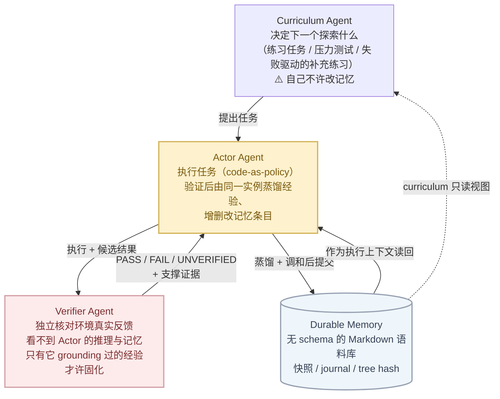

# RSIAgent 的自我进化沉淀物：持久化记忆的形态与治理

> **一句话结论**：RSIAgent 是 training-free 框架，全程不更新模型参数；它「自我进化」沉淀的
> **不是权重、不是 prompt 改写，而是一份经过验证隔离的 Markdown 记忆语料库**——含成功脚本、
> 失败教训与操作手册，以「动作–条件–后果」因果结构组织，探索结束后冻结、直接注入下游执行。
>
> **性质**：本篇是**外部技术调研**，对象是第三方开源框架
> [AetherLabsAI/RSIAgent](https://github.com/AetherLabsAI/RSIAgent)（Aether AI + UCSD + UIC，
> [arXiv 2609.15364](https://arxiv.org/abs/2609.15364)），不是 22 个 `sources/*` 中的任何一个。
> 依据为该仓库 README、`docs/ARCHITECTURE.md` 与论文正文 + 附录 10/12 的实读，
> 对应 2026-10-16 的 `main` 分支内容；trust tier `unverified`。

---

## 三十秒看懂

| 问题 | 答案 |
|---|---|
| RSIAgent 是什么 | 递归自我改进（RSI）多智能体框架：Curriculum / Actor / Verifier 三角色在**新环境**里自主探索、验证、沉淀知识；模型参数全程不动 |
| 沉淀物是什么 | Actor Agent 身上的 **durable memory**：环境特定知识 + 可复用流程与脚本 + 失败教训；核心抽象是**可复用的因果结构**（agentic causal discovery），不是成功轨迹的堆叠 |
| 知识库形态 | **无强制 schema 的 Markdown 文件目录**。蒸馏提示词明文规定「内容、表示、检索、范围、停止决策全由 Actor 自有」；实际收敛为索引 / playbook / 核查清单 / 失败记录 / 事件记录五类文件 |
| 单条记忆长什么样 | `"content-driven table column widths (FREE ~72 px, occupied ~36 px)"`、`"WHY FAIL (decisive): I FROZE THE FIGURE BOXES at their corrupted positions."` ——具体、可操作、带失败归因 |
| 怎么保证不出毒 | 只有 Verifier（与 Actor 隔离、看不到其推理与记忆）grounding 过的经验才许固化；写入走**蒸馏 → 调和**两步；Phase 1 全分支完成后**串行**合并 + journal 快照 + tree hash 对账 |
| 规模 | 三条案例轨迹冻结时分别为 **316 KB/12 文件、141 KB/16 文件、281 KB/17 文件**；也有主动瘦身（某次整合把记忆从 13,243 B 缩到 11,510 B） |
| 效果 | OSWorld 2.0：71.97 → 78.98；ALE：83.75 → 84.82。使开源 GLM-5.3 / Kimi-K3 超越 GPT-6 Astra 与 Claude Opus 5 |

---

## 1 沉淀物是什么，不是什么

三个否定先立住边界：

1. **不是模型能力**。框架名里的 RSI（recursive self-improvement）不碰权重——「自我进化」进化的是 Agent 系统的外挂知识库。
2. **不是 prompt 自改写**。系统框架（三角色、动作–验证循环）在 RSI 与测试阶段完全相同，改的只有记忆内容。
3. **不是轨迹录像**。论文明确区分「记住成功轨迹」与「沉淀因果结构」：人学新软件学到的是**什么因素决定成败**，不是操作回放。

正向清单（论文 + README 口径）：

| 记忆内容类型 | 说明 |
|---|---|
| 环境特定知识 | 界面、工具、约定、状态迁移方式等预训练模型不掌握的事实 |
| 可复用流程与脚本 | 框架采用 code-as-policy，每个动作就是一段可执行 Python/Bash；验证过的好脚本直接留档复用 |
| 失败教训 | 被 Verifier 确认的失败同样写入，供后续避坑（「grounded 失败也能教东西」） |
| 因果结构（核心抽象） | 动作、条件、后果之间的可复用因果关系——整份记忆围绕它组织 |

---

## 2 沉淀是怎么产生的

### 2.1 三角色循环

角色纪律是记忆质量的第一道闸：

- **Curriculum Agent** 只依据学习进度选下一个实践对象，不评分、不替 Actor 写记忆；它的记忆直读视图默认只读。
- **Verifier Agent** 与 Actor 的私有推理和记忆隔离（降低共错关联），在回滚保护的候选副本上检查，检查完回滚；返回 PASS / FAIL / UNVERIFIED，UNVERIFIED 要求补证据而不是当成功。
- **Actor Agent** 是唯一作者：验证结束后由**同一个** Actor 实例蒸馏经验并与既有记忆调和。

### 2.2 两阶段探索 + 冻结

| 阶段 | 结构 | 要点 |
|---|---|---|
| BRS（广度递归自探索） | 并行 wave，默认 8 项目预算、最多 4 路并发 | 每个分支从**同一份 pre-wave 记忆快照**出发独立干活；全部完成有效验证后，按编排顺序**串行**合并各自的蒸馏结果，提交 durable 后才开下一波（wave barrier，防并行分支互相污染） |
| DRS（深度递归自探索） | 串行，`curriculum_review` 停止策略 | 围绕目标递进加难度，专挖 corner case、隐藏约束、边界条件；每次验证过的经验先入记忆再提下一个任务。目标尝试即使 PASS，Curriculum 仍可决定继续加练 |
| 测试时复用 | 冻结快照 | Curriculum 与记忆更新全部禁用；基准评测分数隔离在训练回路之外，永不进记忆 |

冻结是硬边界：评测记录与冻结记忆在**文件数、字节数、tree hash** 三方对账一致；smoke test 明确验证 immutable memory、candidate replay、Verifier 隔离与 checkpoint 回滚。

---

## 3 知识库的形态：无 schema 的 Markdown 语料库

### 3.1 设计立场：不规定任何数据结构

论文附录蒸馏提示词（P5）原话：

> *"You own the content, representation, retrieval strategy, scope, and stopping decision; there is no required schema, length, number of files, or number of turns."*

内容、表示形式、检索方式全部由 Actor Agent 自己决定。所以它不是向量库、不是图数据库，
就是**文件系统上的一个 Markdown 目录**——结构是演化出来的，不是强制的。

### 3.2 实际收敛出的五类文件

三条案例轨迹（T044 视频剪辑、T049 演示文稿修复、T065 铁路订票）的记忆各自从空目录长起，
最终收敛为同一类形态：

| 文件类型 | 职责 | 真实文件名（论文附录引用） |
|---|---|---|
| **memory index**（索引） | 告诉下一个 Actor 去哪找材料，按主题组织 | T049 的 BRS 索引 |
| **playbooks**（操作手册） | 可复用的操作流程与验证流程 | `shotcut-video-editing.md`、GUI 捕获 / 订票流程 / 表单填写 playbook、PDF 与 FreeCAD playbook |
| **verification checklists**（核查清单） | 输出验证步骤 | `media-verification-checklist.md` |
| **failure records**（失败记录） | 带 WHY FAIL 的错误归因 | `shotcut-default-export-fail.md` |
| **episode / project records**（事件与项目记录） | 一次探索的观察、证据、结论 | `seatwatch_tasks.md`、`plan_resolution_pattern.md`、坐标映射笔记 |

两个值得注意的形态细节：

- **索引自己也在学习**。T049 的一个事件发现并行分支已新增了兄弟记录、按旧视角重写索引会漏登，
  于是沉淀出一条元教训：「在阶段边界更新索引前，重新枚举当前项目记录目录与主题标题」——
  记忆库里连「如何保存与检索别的分支的发现」都成了知识。
- **增长包含收缩**。T065 的第三次 BRS 整合把记忆从 13,243 B **缩到** 11,510 B——
  演化是「重组」而非「无限追加」。T044 则相反：DRS 期间文件数不变（12 个）而体积从约 110 KB
  涨到 316 KB，同一批手册被反复充实。

### 3.3 记忆条目逐字示例

**T065 抢票（观察类 + 方法类）：**

> "content-driven table column widths (FREE ~72 px, occupied ~36 px)"
> "a frozen grid misclassified releases #3/#4 until columns were re-detected per state"

座位表列宽随内容变化，冻结像素网格会读错——必须每个状态重新检测列。
配套沉淀的可复用方法：区分「同时可订」与「不同时刻看到的座位」、状态变化后重测布局、
确认监控进程真的在产出证据。

**T049 修 PPT（失败归因类）：**

> "WHY FAIL (decisive): I FROZE THE FIGURE BOXES at their corrupted positions."

把「保持元素属性」误解成「不许移动图框」。失败记录同时保留**两种竞争解读**、观测到的布局缺陷、
以及从参考论文解码出的正确几何——下一次尝试的决策规则直接由这条失败给出。

**T085 音频（配置事实 + 回溯修订类）：**

实践暴露渲染重采样不一致，改 `RENDER_RESAMPLE 0 0 0` 解决；记忆随即**回头修订**了早先
关于渲染器的笼统解释，把旧行为限定到「仅在特定 build 上成立」。

---

## 4 写入协议：蒸馏 → 调和 → 受控提交

### 4.1 两个提示词

**P5 蒸馏（distillation）**——写入的第一遍草稿：

- 只有当轨迹和证据都支持时才写**因果断言**；不支持就保留不确定性。
- FAIL 里可以留有价值的证据，但**不得记成「已验证成功」**。
- 明确授权增、改、重组、删除，也允许整次不动。

**P6 调和（reconciliation）**——提交前的全库重读（与蒸馏同上下文，轨迹、Verifier 证据、
草稿记忆都在场）：

- 主动找：相互冲突的断言、无支撑的因果解释、过期的环境假设、「结论比观测证据更宽」的条目。
- **禁止只追加本次经验、而把被推翻的旧建议留着当事实**；要么收窄、要么加限定、要么删。
- 同样不强制 schema——没有必需的 claim 表、报告、长度或文件数。

### 4.2 合并治理（Host 强制）

| 机制 | 内容 |
|---|---|
| 串行合并 | Phase 1 所有分支完成后，由各 Actor 按**编排顺序**逐个蒸馏提交；预算检查只在完整 wave 边界做 |
| 中断隔离 | 不完整或被隔离的分支阻塞整个 wave，其未发布记忆不合并 |
| 快照对账 | 三条案例轨迹共 39 个 journal 关联快照；文件数、字节数、tree hash 与评测记录逐项核对 |
| 评测隔离 | 官方评测器输出是 host artifact，不得进入该轮后续学习；基建故障记为 unscored 而非零分 |

---

## 5 复用证据：沉淀如何变现

| 任务 | 无记忆基线 | 冻结记忆 | 增益来源 |
|---|---|---|---|
| T049 修 GoogleNet PPT | 0.40 | 0.80 | Actor 第 2 轮即读到失败 + 成功记录，核对文件 MD5 后直接套用记录中的 edge-center 锚点约定，19 条箭头全部命中（基线唯一残留错误是 connector 69 起点偏移 12–14 万 EMU，超评分容差） |
| T044 去视频水印 | 0.40 | 1.00 | 基线用通用 `avfilter.crop` 裁 100px；记忆手册让 Actor 改用 Shotcut **原生** `crop: source`（top=76、center=0），命中评分器只认的原生滤镜与 Center-off 检查 |
| T085 电台 bumper | 0.68 | 0.94 | 第 15 轮检索到 `plan_resolution_pattern.md`，按记录的 8 个源片段区间 + 修订过的重采样设置构建；句间隙与尾句处理两个分项被拉满 |
| T103 FreeCAD 零件重建 | 0.25 | 0.68 | 前 5 轮读完索引 + 4 本 playbook，复用图纸判读规则（打印标签 / PDF 坐标 / 物理尺寸三分）与 STEP 复检流程 |

T044 最能说明「沉淀」的本质：**视觉上两次输出都去掉了水印**，但基线拿 0.4、记忆版拿满分——
记忆存的不是结果，是「该用哪个应用的**原生**操作、以及怎么验证输出」这种应用特定知识。

---

## 6 失败模式：记忆治理的反面教材

论文自己的失败分析点出 RSI 的三大限制，其中第三条直接针对本篇主题：

1. **探索靶向不足**——练习没打到真正致弱的决策上，问题规则留在记忆里继续用。
2. **验证不完整**——局部验证放行了未满足全部要求的工作；一个被接受的错误会成为后续记忆更新和探索决策的基础。
3. **记忆固化不可靠**——未充分验证的决策沉淀成可复用规则后持续污染后续执行。实测案例：Actor 把
   「缺数据标记」当成有效答案、把「信息不可用」解读为否定回答，后续尝试复用这些规则而不再补采缺失事实。

由此得出的设计要求与本框架的做法互相印证：**记忆条目必须保留经验成立的前提条件与不确定性**，
而不是把局部通过当成普适结论——这正是 P5/P6 双提示词与调和阶段存在的理由。

---

## 7 与本仓库 OKF 治理的对照

RSIAgent 的记忆治理与本仓库 `knowledge/` 的 OKF 纪律在意图上同构（细节规范见
[`../../AGENTS.md` §2.3](../../AGENTS.md#23-okf固化与治理)）：

| RSIAgent 记忆 | 本仓库 OKF |
|---|---|
| 「因果断言只在轨迹与证据都支持时才写」 | `sources[]` 行级脚注：每个论断可回答「依据是哪个文件哪一段」 |
| 「保留不确定性、不把 FAIL 记成成功」 | 推断标 `status: draft` + `stale_after`；EXTRACTED 标签不能伪装成 human-reviewed |
| 「调和：不许被推翻的旧建议留着当事实」 | 根 `log.md` 变更时间线；结论更新后同步改判（如 R13 单侧证据盲区的消除） |
| 「tree hash / journal 快照对账」 | `check-okf.py` 结构 lint + computations 的 receipt 复算 |

差异同样值得记：RSIAgent 刻意**无 schema**（把表示权交给模型，换取跨环境通用性），
本仓库 OKF **强 schema**（把可信度做成可 lint 的结构，换取人可审计）。两者面向的问题不同——
前者要在一小时内从零摸索一个未知软件，后者要让多条分析结论跨月、跨人、跨模型地保持可核查。

---

## 8 来源

- 仓库：[AetherLabsAI/RSIAgent](https://github.com/AetherLabsAI/RSIAgent)（README、`docs/ARCHITECTURE.md`）
- 论文：[RSIAgent: Autonomous Exploration for Recursive Self-improvement in New Environments](https://arxiv.org/abs/2609.15364)（arXiv 2609.15364；附录 10.2 提示词 P5/P6、附录 12 案例研究、表 A5–A8）
- 姊妹项目：[RSIGame](https://github.com/WenyiWU0111/RSIGame)（把同一机制扩展到自主游戏开发，arXiv 2609.39045）
