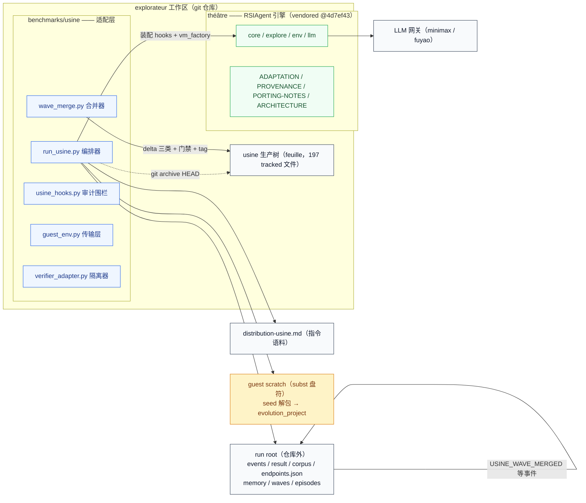
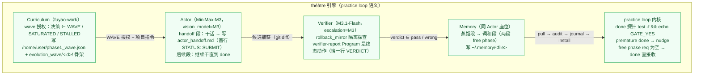
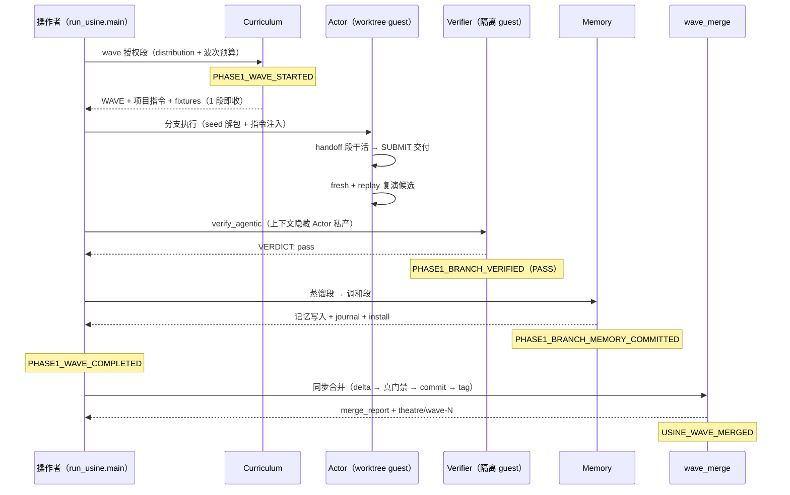
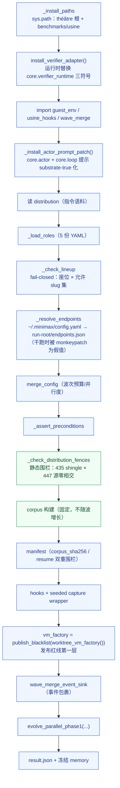
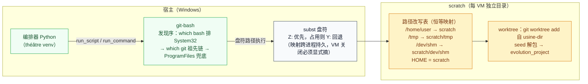
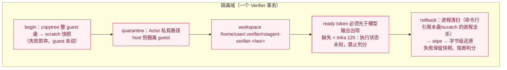
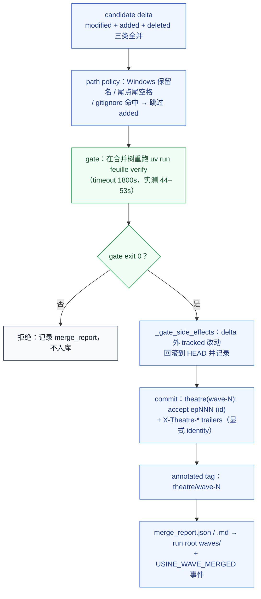
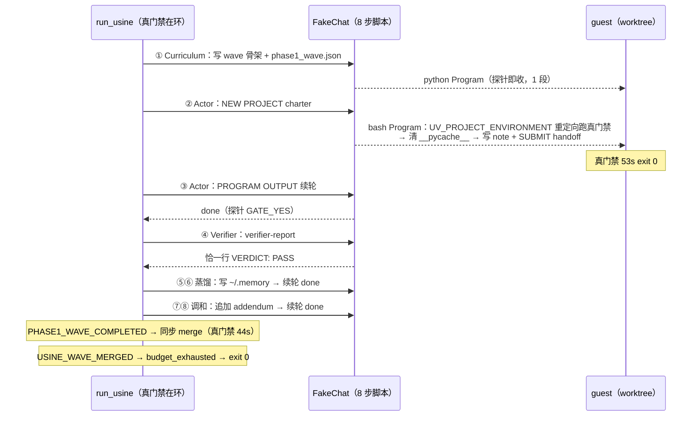
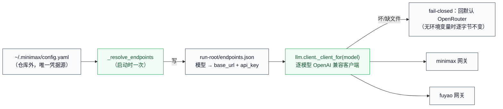

# ARCHITECTURE — théâtre × usine：RSI 引擎与适配层

状态：v1 实现完成（2026-10-16，§9 的 12/12 干跑为 Python 时代 usine 的记录）；
2026-10-18 P9 真作用力改造后 usine 已是 TS pnpm monorepo、门禁为 `pnpm verify`、
改进方向含智能体面——**现行运行手册（怎么跑 wave、怎么校验产物）见
[../benchmarks/usine/README.md](../benchmarks/usine/README.md)**。
本文是常青文档，图随代码维护。纪律与补丁清单见 [PROVENANCE.md](PROVENANCE.md)；
实现相对设计稿的偏离记录见 [ADAPTATION.md](ADAPTATION.md)；跨平台补丁的病根见
[PORTING-NOTES.md](PORTING-NOTES.md)；上游 [README.md](README.md) 与 `docs/` 冻结不动。
usine 侧（被改进对象）的架构文档见
[../usine/docs/architecture.md](../usine/docs/architecture.md)。

---

## 0. 图例与术语速查

### 0.1 颜色语义（全篇统一）

| 色 | classDef | 语义 |
|---|---|---|
| 蓝 | `fill:#eff6ff,stroke:#2563eb` | 编排控制面（run_usine、wave_merge、事件汇） |
| 绿 | `fill:#f0fdf4,stroke:#16a34a` | 宿主内核与可信设施（théâtre 引擎、git、门禁、传输层） |
| 琥珀 | `fill:#fef3c7,stroke:#d97706` | 沙箱内受限执行体（worktree guest 里跑的模型程序） |
| 红 | `fill:#fff1f2,stroke:#e11d48` | 隔离域（Verifier 回滚镜像、私产隔离区） |
| 深红 | `fill:#b71c1c,stroke:#7f0000` | 封禁路径（发布红线，永不通行） |
| 灰 | `fill:#f8fafc,stroke:#334155` | 中性容器（仓库、run root、fixture、数据） |
| 虚线 | `-.->` | 逻辑边界（不存在进程间调用，只有概念归属） |

描绘部署拓扑的图，subgraph 标题带**拓扑范式**标注（如「拓扑范式：进程间」）；
纯机制图不加。

### 0.2 术语（先说明，后使用）

| 术语 | 定义 |
|---|---|
| **worktree guest** | 一个 `git worktree` + 独立 scratch 目录构成的「虚拟机」；模型程序在盘符映射后的 scratch 树里执行，`/home/user` 等契约路径恒等映射到 scratch |
| **subst 盘符** | Windows `subst` 命令把一条主机路径挂成一个盘符（如 `Y:`）；盘符映射跨进程持久，VM 关闭必须显式摘除 |
| **rollback_mirror** | Verifier 的执行隔离模式：先做整盘快照，模型代码在受控 workspace 执行，结束后整盘回滚，副作用归零 |
| **terminal handoff** | 一个 practice 段的「交付物文件」；段的完成探针就是 `test -f` 它（Actor 段还要求首行匹配 token） |
| **8-gram shingle** | 文本的滑动 8 词组；两文本的 shingle 集合相交即「有逐字重叠」 |
| **分布（distribution）** | Curriculum 的指令语料（`benchmarks/usine/distribution-usine.md`），是围栏与审计的对照基准 |
| **seed** | 波次开始时 usine 树的 `git archive` 快照（tgz），推入每个 guest 作为初始工作树 |
| **delta** | 一次分支候选相对基线的变更，分 modified / added / deleted 三类 |
| **gitlink** | git 索引里指嵌套仓库的空指针条目（mode 160000）；入库时必须避免 |

---

## 1. 全景：一次波次在系统里的位置

explorateur 工作区里住着三样东西：**usine 生产树**（RSI 的改进对象，git tracked）、
**théâtre**（vendored RSIAgent 引擎，内嵌 `.git` 仅保留在磁盘、绝不进 explorateur 索引）、
**benchmarks/usine 适配层**（把引擎嫁接到生产树的编排代码）。所有运行产物落在
**仓库外**的 run root；模型程序只活在 guest scratch 里。



要点：

- 适配层**全部代码在 explorateur 层**，théâtre 树只承载引擎与文档（纪律见
  [PROVENANCE.md](PROVENANCE.md)）。
- `endpoints.json`（真网关凭据）只写 run root——它在仓库外，且被 explorateur 根
  `.gitignore` 兜底过滤。
- usine 生产树只在波末被 wave_merge 触碰（一候选一 commit、门禁绿才合并）。

---

## 2. 三角色引擎（théâtre 内核）

三个座位共享同一套 practice loop 机制：**每一轮模型回复只含一个 JSON 动作**，
优先级 Program > Look > Ask > Done；程序跑完后，观察以
`PROGRAM OUTPUT (exit, secs):` 作为**新的 user 消息**喂回，段 charter 留在
history 里——续轮模型看到的是「charter + 自己的动作 + 观察输出」。



段（segment）的完成语义：

| 段类型 | required 文件 | done 判定 |
|---|---|---|
| Curriculum 授权段 | wave handoff 可解析 + fixtures 非空 | terminal probe 过即收段，**无需再调模型** |
| Actor handoff 段 | `/home/user/actor_handoff.md` | 模型发 done → 探针 `GATE_YES` 才收 |
| free phase（蒸馏/调和） | 无 | done 直接收（allow_noop_done；但记忆文件得真写出来才过后续审计） |

---

## 3. wave 生命周期（时序）

一次波次从头到尾发五个里程碑事件（`events.jsonl`），merge 在
`PHASE1_WAVE_COMPLETED` 时**同步**执行——门禁不绿，波不算完。



退出契约：`run_usine` 退出码 0 当且仅当终态 ∈ {saturated, budget_exhausted}；
任何 infra 失败（含分支异常 `PHASE1_BRANCH_EXCEPTION`）都是非零退出 + 保留现场。

---

## 4. 适配层装配次序（run_usine.main）

装配是**单向链条**，每一步失败都 fail loudly；两个运行时替换点（verifier adapter、
actor 提示补丁）必须在引擎 import 前/后按序落位。



---

## 5. guest 传输层（拓扑范式：进程间）

guest 不是虚拟机，是**主机上的进程间拓扑**：Windows Python ↔ git-bash ↔ subst
盘符指向的 scratch 树。路径改写表是适配层唯一允许的「路径谎言」，双向一致。



环境纪律（`MSYS_NO_PATHCONV=1` 禁参数改写；PATH 前置 `/usr/bin` +
`/mingw64/bin` 防 find.exe 截胡；`python3` shim 兑现 guest 契约）；
scratch 根由环境变量在 **VM 构造时**读取（每 VM 独立子目录），close() 默认清空。

> **运维实录**：subst 盘符映射不随进程消亡——早前一个未 close 的 VM 把 `Z:`
> 泄漏成了悬空映射（目标目录已回收）。后果仅是全部 VM 统一回退 `Y:`（行为一致、
> 无正确性影响），但盘符卫生要在收口时人工核查：`subst` 列出后逐个 `subst X: /D`。

---

## 6. Verifier 隔离边界（rollback_mirror）

Verifier 与 Actor 的隔离不靠「提示词自觉」，靠**文件级事务**：进代码前先做整盘
快照，Actor 私产整体搬离 guest（host 侧隔离，比上游 root-only 更强），结束一律回滚。



`close()` = 回滚 + 弃隔离副本；回滚失败抛
`AgenticVerifierInfrastructureError`，判分保持阻断——绝不静默混态。

---

## 7. 内容围栏与审计面

两层防线，职责不同（诚实结论，见 [ADAPTATION.md](ADAPTATION.md) §6）：

```mermaid
flowchart LR
    subgraph FENCE["静态围栏（真载荷门禁，启动时）"]
        D["distribution"] -->|"8-gram shingles（435）"| C["corpus（固定）"]
        SRC["审计源 = usine tracked（197，6 个二进制跳内容）<br/>+ théâtre 五包全部 .py<br/>+ 适配层 .py + 5 份 role YAML"] -->|"零相交才放行"| C
    end
    subgraph AUDIT["运行时审计（五面，构造性空转）"]
        T["validate_corpus / audit_text / audit_transcripts<br/>/ audit_captured / audit_memory"] -->|"suspect =（∩ corpus）− authorized<br/>phase1 全面 authorized = target_direction"| NULL["恒空集（空转但零成本在岗）"]
    end
    subgraph BL["发布红线（三层，永不通行）"]
        P1["VM facade 拒发布动词<br/>（publish / launch_persistent_context）"]
        P2["审计面动词黑名单"]
        P3["编排器不持有 TTS / 积分凭据"]
    end

    classDef host fill:#f0fdf4,stroke:#16a34a,color:#14532d
    classDef neutral fill:#f8fafc,stroke:#334155,color:#0f172a
    classDef blocked fill:#b71c1c,stroke:#7f0000,color:#ffffff
    class D,C,SRC host
    class T,NULL,neutral
    class P1,P2,P3 blocked
```

- **静态围栏**防三件事：corpus 增长、授权面收窄、种子携带目标散文进真仓。
  新源自动纳入（本轮实证：harness 源码入库使审计源 446 → 447）。
- **运行时审计**在 phase1 全部五面 authorized=target_direction，而 corpus 是
  distribution 的 shingles——交集恒空。它的价值在配置漂移时立即生效，而非当下拦截。
- 审计镜像解码规则：NUL 出现在前 8 KiB 判二进制、跳过**内容**只审**名字**。

---

## 8. wave 合并管线

一候选一 commit；merge commit **只含 delta 路径**——门禁副作用被显式回滚出提交。



已知限制（如实记录在 merge_report）：symlink 变更不合并（mode/exec-bit 自 P9 起
已修复：候选归档位 ∪ git 已跟踪 100755 则保留，`bin/feuille.js` 为锚点用例）。
备注：Python 时代的 gate 曾在 usine-dir 根部落一个未跟踪 `.venv/`；现行 pnpm
门禁不再落此类目录。

---

## 9. 干跑验证剧本（假 LLM，零额度）

干跑回答一个问题：**在零 LLM 额度下，三角色到门禁到合并的每一道接缝是否真的
咬合**。做法：fixture 仓库（`git archive HEAD -- usine/` 剥前缀成独立仓）+
FakeChat（判别词分派，off-script 全 raise）+ monkeypatch 假端点（真配置文件
**永不打开**）。



FakeChat 分派规则（fail-loud 的核心）：

1. 按 model slug 定座（verifier / curriculum），M3 座再按 charter 判别词定
   蒸馏/调和/actor（**蒸馏先查**——三份 charter 都含 ACTOR AGENT 字样）；
2. `PROGRAM OUTPUT` 续轮**倒序**扫 history 找最近的 charter 归座（记忆段续接
   actor 会话，正序会错归）；
3. off-script 一律 raise：图像附件、SAME-CONTEXT 传输恢复、未映射座、超脚本数。

**12 项断言全绿**（2026-10-16 实测，全流程 115–128s）：

| # | 断言 | 实测 |
|---|---|---|
| 1 | 脚本文本与 distribution 8-gram 零相交 | 5 文本 × 435 shingle 清 |
| 2 | run_usine 退出码 0 | exit 0（115s） |
| 3 | 调用序列 = 脚本 8 步（fresh 座 history=0；蒸馏/调和续接非空） | 8/8 |
| 4 | result.json：budget_exhausted / 1 project / 记忆 602 字节 | ✓ |
| 5 | endpoints.json 全假值（3 slug，零真凭据） | ✓ |
| 6 | events.jsonl 五里程碑齐全、无分支异常 | 5 事件 |
| 7 | Curriculum 一段发布、一项目声明 | ✓ |
| 8 | episode 工件：指令原文 / SUBMIT / VERDICT: PASS / outcome | ✓ |
| 9 | 终态记忆 = 蒸馏 + 附录（逐字节） | 602 字节吻合 |
| 10 | merge_report：merged / delta 只加 note / gate 绿 / tag 建成 / base=fixture init | ✓ |
| 11 | fixture 仓：2 commits、tag 指 HEAD、merge 只碰 note、-uno 干净 | ✓ |
| 12 | 真 usine 子树分毫未动（HEAD 不变 + 字节一致） | ✓ |

> **CRLF 底座事实**：guest 里跑的是 Windows Python，`write_text` / `open("a")`
> 默认文本模式把 `\n` 落成 `\r\n`（干跑记忆文件 14 个换行 = +14 字节）。管线从
> guest 拉取 → journal → install 全程**字节保真**；断言按底座真实字节断言——若
> 管线哪天擅自规范化换行，第 9 项当场红。bash heredoc 写的文件保持 LF（note
> 字节断言同理）。
>
> 干跑迭代实录（假脚本自身 2 bug，接缝 0 bug）：① FakeChat 没给 PROGRAM OUTPUT
> 续轮配响应（修：倒序归座）；② 记忆断言没算 CRLF（修：按底座字节断言）。

---

## 10. 模型阵容与端点接线

| 座位 | 模型 | 视觉 | 依据 |
|---|---|---|---|
| Actor | MiniMax-M3 | vision_model=MiniMax-M3 | 原生视觉（Look 看附件）、思考可开关、512k 上下文 |
| Memory（蒸馏/调和） | MiniMax-M3 | — | 同 Actor 座位，续接其会话 |
| Verifier | MiniMax-M3.1-Flash-Preview | 探查截图 | 思考 forced_on；escalation 升档到 MiniMax-M3（cross-model） |
| Curriculum | fuyao-work | —（纯 JSON 决策） | 生命周期路由，无视觉需求 |
| 允许 slug 集 | {MiniMax-M3, MiniMax-M3.1-Flash-Preview, fuyao-work, fuyao-coding} | | fail-closed 校验，阵容漂移即拒跑 |



密钥纪律：凭据只存在于 `~/.minimax/config.yaml` 与 run-root 的
`endpoints.json`（仓库外 + `.gitignore` 兜底）；**永不进仓库、永不进日志**。
干跑时 `_resolve_endpoints` 被 monkeypatch，返回全假值——第 5 项断言守着这条线。
