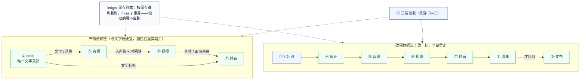
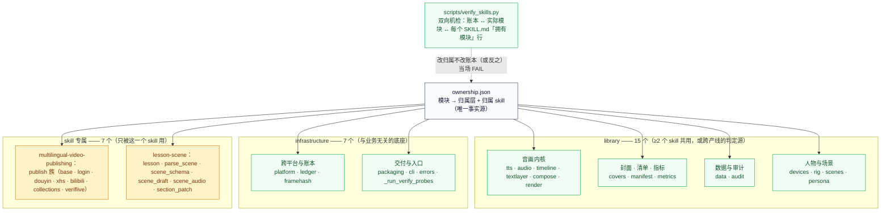
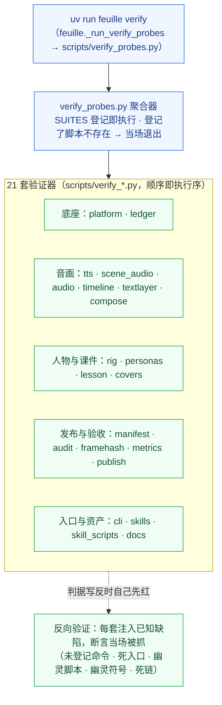
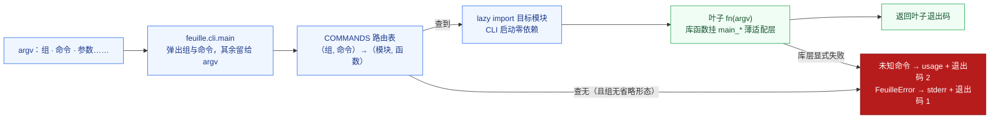

# 架构

状态：v1（2026-10-16）。分工：[workflow.md](workflow.md) 教**怎么干活**（①–⑬
每段的输入 / 步骤 / 产物 / 检查），本文教**结构**——数据从哪来、模块归谁、门禁
怎么兜底、命令怎么路由、RSI（由 théâtre 引擎驱动的波次化自动改进）从哪里接入。
图表配色与术语纪律全篇统一（§0），与仓库级引擎文档
`théâtre/ARCHITECTURE.md` §0（vendored 树，位于本树之外）同一套。

---

## 0. 图例与术语速查

### 0.1 颜色语义（全篇统一）

| 色 | classDef | 语义 |
|---|---|---|
| 蓝 | `fill:#eff6ff,stroke:#2563eb` | 编排控制面（CLI 路由、verify 聚合器） |
| 绿 | `fill:#f0fdf4,stroke:#16a34a` | 宿主内核与可信设施（library / infrastructure 模块、门禁脚本） |
| 琥珀 | `fill:#fef3c7,stroke:#d97706` | 受限执行体（skill 专属层：对外发布的 Playwright 器、场景课生产线） |
| 红 | `fill:#fff1f2,stroke:#e11d48` | 隔离域（外部平台——域外世界，只经 manifest 门禁放行） |
| 深红 | `fill:#b71c1c,stroke:#7f0000` | 封禁路径（发布红线，永不通行） |
| 灰 | `fill:#f8fafc,stroke:#334155` | 中性容器（数据、产物、缓存账本、工具后台） |
| 虚线 | `-.->` | 逻辑边界（概念归属，不存在调用） |

描绘部署拓扑的图，subgraph 标题带**拓扑范式**标注；纯机制图不加。

### 0.2 术语（先说明，后使用）

| 术语 | 定义 |
|---|---|
| **三层归属** | 每个模块属于且仅属于一层：library（≥2 个 skill 共用）/ infrastructure（与业务无关的底座）/ skill 专属（只被一个 skill 用）。归属记在 [ownership.json](../ownership.json)，不按层切目录 |
| **反向验证** | 门禁不只「对好数据放行」，还必须「对坏数据报警」：每个套件都注入已知缺陷，断言当场被抓——判据写反时自己先红 |
| **路由表** | `feuille.cli.COMMANDS`：(组, 命令) → (模块, 函数) 的映射。路由是数据，不是 if/elif |
| **门禁套件** | `scripts/verify_*.py` 的 21 个验证器，由 `scripts/verify_probes.py` 聚合，`uv run feuille verify` 一键全量 |
| **RSI** | 由 théâtre（vendored RSIAgent 引擎）驱动的波次化自动改进：Actor 在隔离 guest 里改代码，Verifier 判定，门禁绿才合并回本树。本树是**改进对象**，不承载任何 RSI 运行时代码 |

---

## 1. 全景：数据 → 生产 → 发布 → 回流

一句话：**数据层唯一事实源 → 生产层 ①–⑬ → 三大产物 → manifest 门禁 →
四平台 → 指标回流闭环**。

要点：

- **片名 / 首句 / 体式标签只写一处**（② `data/`），下游一切文字从 `feuille.data`
  来——设计只改数据，不改编码（③ 纪律）。
- **三大产物依赖固定**：音频 → 视频 → 封面；上游一动全链重走（§2）。
- **发布是单向门**：⑧ manifest 逐项核对（素材在盘 / 字数不超限 / 话题非空 /
  条数齐全）不绿，⑨ 不开始；⑪ 只读核对不过，整条当失败——脚本自报成功不算成功。
- **回流闭环**：⑫ 指标回填（没数据留 null 不填 0），经验沉淀进
  [publish-lessons.md](publish-lessons.md)、[lessons-learned.md](lessons-learned.md)、
  [metrics-playbook.md](metrics-playbook.md)，反哺 ① 的创作决策。
- **H3 铁律**（[../AGENTS.md](../AGENTS.md)）：H3 绝不自动调用；额度逐次确认，
  未确认不生成。

---

## 2. 生产主线：三大产物、改稿数据流与三层验收

三层验收（⑬，贯穿全程）：

| 层 | 时机 | 内容 |
|---|---|---|
| 渲染前检查 | 渲染 / 发布前 | 素材存在、schema 纯函数校验、文案字数 / 话题、格律审计 |
| 渲染后检查 | 渲染后 | `feuille.framehash` 逐帧像素（按平台分桶）、画面探针、裁切安全拼图、重渲比对 |
| 发布后核对 | 发布后 | 管理页截图 + 人眼判定（= ⑪，只读，不点任何修改） |

改稿的两个省钱位：**时长预算卡在 ⑤**（改文本便宜，超预算放宽预算、不压台词）；
**缓存账本卡在重算前**（`feuille.ledger` 按内容寻址键判新鲜，命中不重算）。

---

## 3. 模块三层归属：ownership.json 是唯一事实源

归属不看目录，看 [ownership.json](../ownership.json)：目录解决打包（能不能被
import），账本解决归属（算谁的）。**刻意不按归属层横切目录**——归属是易变
元数据：`devices` 与 `rig` / `scenes` / `persona` 都经历过「skill 专属 →
library」的翻转，翻转在账本里是三处编辑，在目录里是一次搬文件 + 全量改
import。分目录按**域**分（`publish/` 就是先例），不按层分。

每层的完整模块表（职责 + 谁在用）见
[../README.md 模块地图](../README.md#srcfeuille-模块地图三层归属)；
skill 层（`skills/<name>/`）只放**不会被 import** 的资产（SKILL.md 说明书、
模板、工作样例、直跑诊断脚本），会被 import 的实现一律进包、进账本。

---

## 4. 门禁体系：21 套反向验证

纪律是「**没验不许长得像验过了**」：docs 曾带着 135 行死入口教跑不了的命令
（[render-handbook.md](render-handbook.md) 清账前的历史），清账之后由 docs
套件机检兜底，防止死入口随「复制粘贴旧手册段落」回流。

21 套清单（`uv run feuille verify --list` 可现查）：

| # | 套件 | 脚本 | 验什么 |
|---|---|---|---|
| 1 | platform | verify_platform.py | 跨平台解析（浏览器 / ffmpeg / ffprobe / magick resolver） |
| 2 | ledger | verify_ledger.py | 产物缓存账本（注册制 + root 参数化） |
| 3 | tts | verify_tts.py | TTS 内核（缓存键 / 词级时间戳 / 裁尾 / 重试） |
| 4 | scene_audio | verify_scene_audio.py | 场景课 TTS 叶子（选角映射 / 情绪增量 / 台账自描述） |
| 5 | audio | verify_audio.py | 音轨合成（compose_track 顺序坑） |
| 6 | timeline | verify_timeline.py | 时间轴与词级进度轴 |
| 7 | textlayer | verify_textlayer.py | Edge 渲字层（视口探测 / 双 matte） |
| 8 | compose | verify_compose.py | 母版叠加合成（-shortest 改显式 -t） |
| 9 | rig | verify_rig.py | 人物 rig 几何探针（A1–E2 + 幂等） |
| 10 | personas | verify_personas.py | persona 契约校验器（28 人班底） |
| 11 | lesson | verify_lesson.py | 课件校验层（schema 全注册表演习 + doctor 班底体检接线） |
| 12 | covers | verify_covers.py | 封面机制（规格 / 裁切 / 众数底色） |
| 13 | manifest | verify_manifest.py | 发布清单（文案稿解析 / 逐项核对 / 构建） |
| 14 | audit | verify_audit.py | 格律审计 / 节替换 / 打包 |
| 15 | framehash | verify_framehash.py | 逐帧像素基线（视频流定位 / 分桶） |
| 16 | metrics | verify_metrics.py | 指标回流（null ≠ 0 / 两级凭据） |
| 17 | publish | verify_publish.py | 发布器骨架（mock 页驱动，零平台流量） |
| 18 | cli | verify_cli.py | CLI 路由表可达性 + 聚合器一致性 |
| 19 | skills | verify_skills.py | skills 去歧义（前置契约 / 边界 / 转交 / 事实源唯一） |
| 20 | skill_scripts | verify_skill_scripts.py | skill 层脚本判据（publish-copy 指纹 / 溯源 + bgm 垫量 / 床长 + poetry gate） |
| 21 | docs | verify_docs.py | docs 清账门禁（命令 / 脚本 / 符号 / 链接真实性 + 死入口零容忍） |

docs 套件的五判据（本文自身就在扫描范围内——本文提到的每条命令、每个脚本、
每个符号、每个链接都过检，这段话本身也是被验的）：

| 判据 | 规则 |
|---|---|
| 命令真实性 | 文中 `feuille <组> <命令>`（含 uv run 形式；a|b|c 管道写法每个都算）必须登记在 `feuille.cli.COMMANDS`；同行带「未接入 / 预留 / 有意不设」标记的规划位豁免 |
| 死入口零容忍 | 已知死管线的入口名 / 旧模块名一律不得出现——考古看 git 历史，文档只留仍然成立的知识 |
| 脚本真实性 | 提到的 `scripts/<名>.py` 必须真实存在 |
| 符号真实性 | 反引号里的 `feuille.<模块>[.<符号>]` 必须 import 得到、属性真实存在 |
| 链接真实性 | 相对链接目标必须存在（http / 锚点跳过） |
| 反向验证 | 注入未登记命令 / 死入口 / 幽灵脚本 / 幽灵符号 / 死链五类，必须各自被对应判据抓到（跑在内存文本上，不动真文件） |

---

## 5. CLI 路由：表驱动，不是 if/elif

统一入口 `uv run feuille <组> <命令>`。路由器只做三件事：查表、lazy import、
把残余参数原样交给叶子——叶子拿不到组与命令，只拿真实参数（路由层消化掉的
首参数必须还给 argv，这是路由器与叶子之间的契约）。

路由表全量（登记于 `feuille.cli.COMMANDS`，`verify_cli.py` 保证每个叶子
真实可达——登记了不存在的函数 = 路由表说谎，当场抓）：

| 组 | 命令 | 叶子（模块 · 函数） | 覆盖段 |
|---|---|---|---|
| scene | parse | `feuille.parse_scene` · main | ②③ scene.md → scene.json |
| scene | validate | `feuille.scene_schema` · main | ②③ schema 纯函数校验 |
| scene | draft | `feuille.scene_draft` · main | ③ 创意 → 草稿 |
| scene | tts | `feuille.scene_audio` · main | ④ 场景课语音线 |
| lesson | new | `feuille.lesson` · main_new | ③ 开新课件坑 |
| lesson | doctor | `feuille.lesson` · main_doctor | ④ 班底体检 |
| persona | validate | `feuille.persona` · main | ②③ 人设契约校验 |
| cover | make | `feuille.covers` · main_make | ⑦ 封面生成 |
| cover | check | `feuille.covers` · main_check | ⑦ 封面自检 |
| framehash | save | `feuille.framehash` · main_save | ⑬ 采逐帧像素基线 |
| framehash | check | `feuille.framehash` · main_check | ⑬ 零漂移门禁 |
| ledger | status | `feuille.ledger` · main_status | 产物新鲜度问答 |
| publish | login | `feuille.publish.login` · login | ⑨ 扫码登录 |
| publish | douyin | `feuille.publish.douyin` · main | ⑨ 抖音发布 |
| publish | xhs | `feuille.publish.xhs` · main | ⑨ 小红书发布 |
| publish | bilibili | `feuille.publish.bilibili` · main | ⑨ B 站发布 |
| verify | 可省略 | `feuille._run_verify_probes` · run | ⑬ 全量反向验证 |

三个设计取舍：

- **发布类叶子要求可选依赖组**（`uv sync --group publish` 装的是 Playwright）：
  没装时 import 在函数内 lazy 失败，报的是「缺 playwright」而不是「未知命令」
  ——前者告诉用户怎么修。
- **清单组装没有 CLI 叶子**：`feuille.manifest` 的构建吃带闭包的 plans 契约，
  只能从项目脚本调用（⑧ 的调用形态见 [toolchain.md](toolchain.md)）。
- **verify 组可省略命令**：`uv run feuille verify` 跑全部 21 套，
  `uv run feuille verify --only rig` 单跑一套。

---

## 6. RSI 定位：本树如何被安全地自动改进

本树（`usine/`）在 explorateur 仓库里是 RSI 的**改进对象**；引擎
（`../théâtre/`，vendored RSIAgent）与适配层（`../../benchmarks/usine/`）
都在本树之外。**本树不承载任何 RSI 运行时代码**——波次合进来的只是对既有
模块 / 文档的修改，且必须先过 §4 的门禁（含 21 套全量）。

安全性质（全部由适配层保证，细节见仓库级引擎文档
`théâtre/ARCHITECTURE.md`（vendored 树，位于本树之外））：

- **本树在波次期间分毫不动**：Actor 改的是 seed 快照（worktree guest），
  候选以 delta 形式出来，合并是显式动作（一候选一 commit，带 tag）。
- **门禁是合并判据的一部分**：候选 delta 过不了 `uv run feuille verify`
  全量，就不落本树。
- **发布红线对 RSI 同样成立**：适配层在 VM 门面处拒绝发布类命令（三层防线），
  改进波次永不触碰真实平台流量。
- 引擎内部机制（三角色、练习循环、围栏与审计、Verifier 隔离、合并管线）的
  完整架构见仓库级引擎文档 `théâtre/ARCHITECTURE.md`（vendored 树，位于
  本树之外）；适配层相对设计稿的偏离记录见同目录的
  `ADAPTATION.md`（同一 vendored 树内）。
