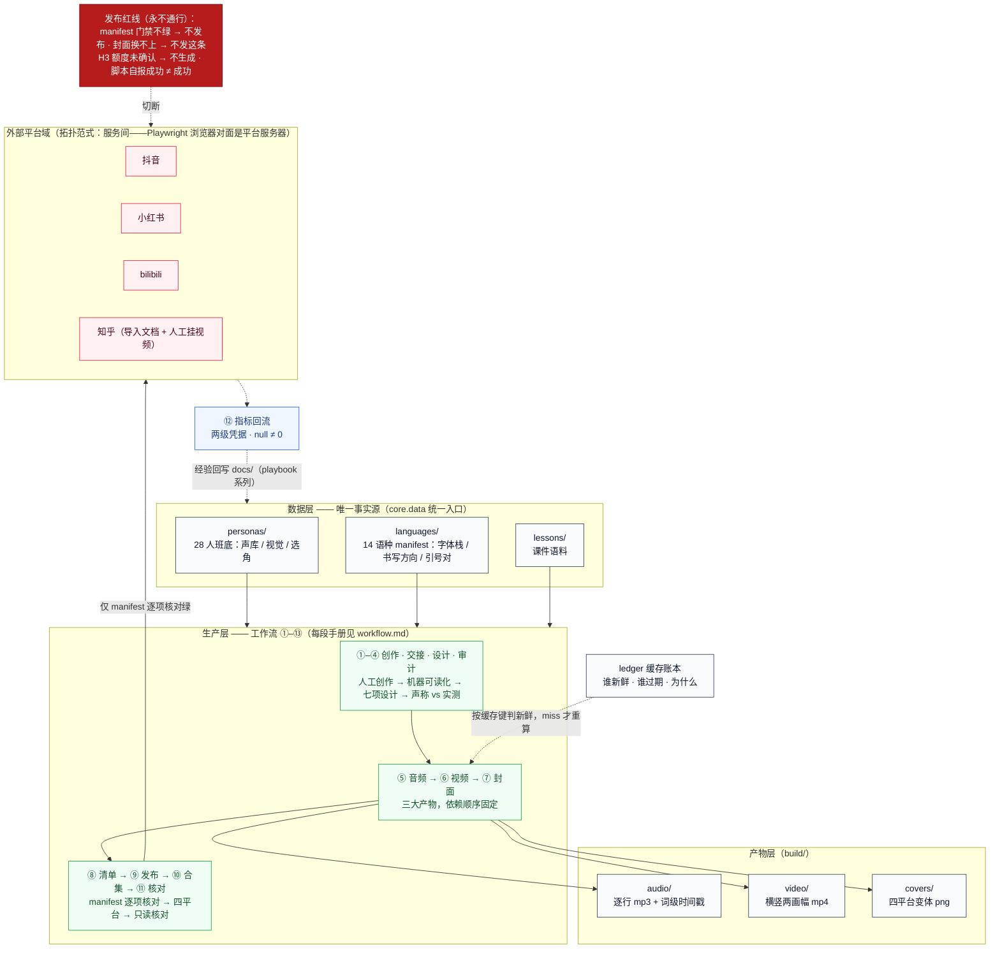
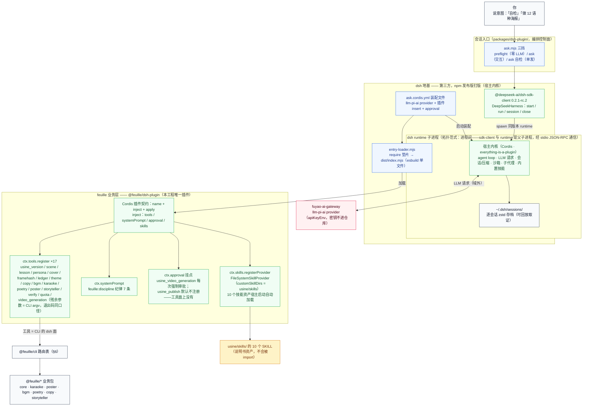
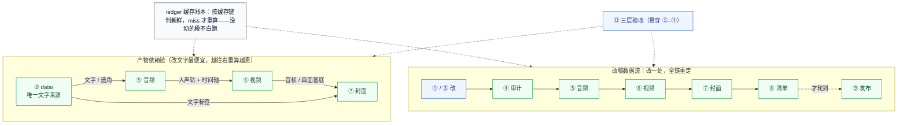
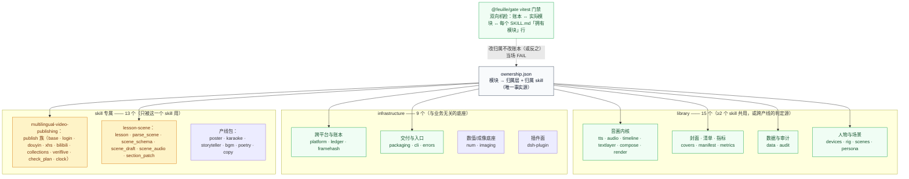
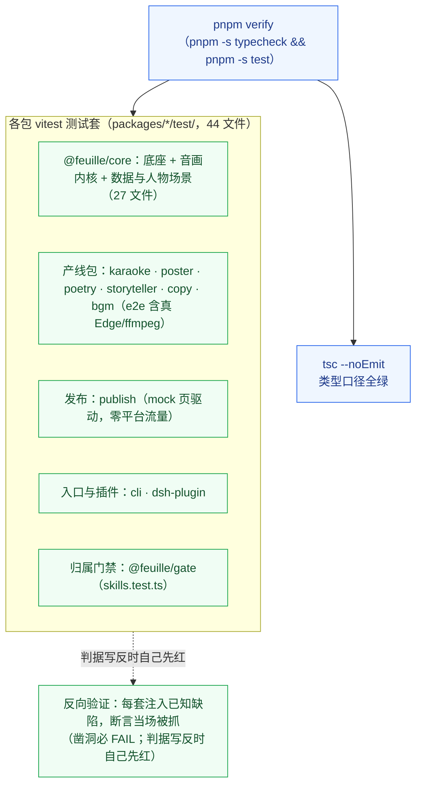
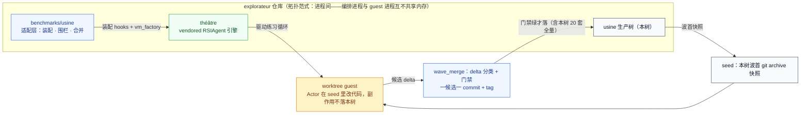

# 架构

状态：v2 落地中（2026-10-18）——usine 已全量迁移为 dsh（DeepSeek Harness，开源 TS 智能体 harness，everything-is-a-plugin / Cordis）原生工程：TS 十包 + dsh 插件工具面 + skills 资产层；Python 实现（src/feuille、scripts/verify_*.py、uv 工程）已随 P7 清场退役。迁移判据（金样本 parity，已采集入库）与阶段记录在 `../migration/`（采集/比对脚本随 P7 退役，金样本与记录保留）。权威门禁 = `pnpm verify`（typecheck + 全部 vitest 测试）。分工：[workflow.md](workflow.md) 教**怎么干活**（①–⑬ 每段的输入 / 步骤 / 产物 / 检查），本文教**结构**——智能体怎么装配（§2）、数据从哪来、模块归谁、门禁怎么兜底、命令怎么路由、RSI（由 théâtre 引擎驱动的波次化自动改进）从哪里接入。图表配色与术语纪律全篇统一（§0），与仓库级引擎文档 `théâtre/ARCHITECTURE.md` §0（vendored 树，位于本树之外）同一套。

---

## 0. 图例与术语速查

### 0.1 颜色语义（全篇统一）

| 色 | classDef | 语义 |
|---|---|---|
| 蓝 | `fill:#eff6ff,stroke:#2563eb` | 编排控制面（CLI 路由、`pnpm verify` 门禁） |
| 绿 | `fill:#f0fdf4,stroke:#16a34a` | 宿主内核与可信设施（library / infrastructure 模块、门禁脚本） |
| 琥珀 | `fill:#fef3c7,stroke:#d97706` | 受限执行体（skill 专属层：对外发布的 Playwright 器、场景课生产线） |
| 红 | `fill:#fff1f2,stroke:#e11d48` | 隔离域（外部平台——域外世界，只经 manifest 门禁放行） |
| 深红 | `fill:#b71c1c,stroke:#7f0000` | 封禁路径（发布红线，永不通行） |
| 灰 | `fill:#f8fafc,stroke:#334155` | 中性容器（数据、产物、缓存账本、工具后台） |
| 虚线 | `-.->` | 逻辑边界（概念归属，不存在调用） |

描绘部署拓扑的图，subgraph 标题带**拓扑范式**标注；纯机制图不加。

### 0.2 术语（先说明，后使用）

| 术语 | 定义 |
|---|---|
| **三层归属** | 每个模块属于且仅属于一层：library（≥2 个 skill 共用）/ infrastructure（与业务无关的底座）/ skill 专属（只被一个 skill 用）。归属记在 [ownership.json](../ownership.json)，不按层切目录 |
| **反向验证** | 门禁不只「对好数据放行」，还必须「对坏数据报警」：每个套件都注入已知缺陷，断言当场被抓——判据写反时自己先红 |
| **路由表** | `cli.COMMANDS`：(组, 命令) → (模块, 函数) 的映射。路由是数据，不是 if/elif |
| **门禁套件** | 各包 vitest 测试套（44 文件，反向验证纪律原样移植：凿洞必 FAIL），由 `pnpm verify` 一键全量；归属对账在 @feuille/gate |
| **RSI** | 由 théâtre（vendored RSIAgent 引擎）驱动的波次化自动改进：Actor 在隔离 guest 里改代码，Verifier 判定，门禁绿才合并回本树。本树是**改进对象**，不承载任何 RSI 运行时代码 |
| **dsh harness** | DeepSeek Harness：开源 TS 智能体 harness（everything-is-a-plugin / Cordis）。本工程智能体的**地基**——agent loop、LLM 供给、会话持久化、审批门、子代理、技能系统全部复用它，不重造（§2） |
| **Cordis 插件** | 装进 dsh 宿主的集成单元：导出 `name` + `inject` + `apply`。`inject` 声明 apply 期要取的宿主服务，真 cordis 对未声明就访问的服务抛错——inject 列表即真实依赖清单。`@feuille/dsh-plugin` 是本工程唯一的插件 |

---

## 1. 全景：数据 → 生产 → 发布 → 回流

一句话：**数据层唯一事实源 → 生产层 ①–⑬ → 三大产物 → manifest 门禁 →
四平台 → 指标回流闭环**。

要点：

- **片名 / 首句 / 体式标签只写一处**（② `data/`），下游一切文字从 `core.data`
  来——设计只改数据，不改编码（③ 纪律）。
- **三大产物依赖固定**：音频 → 视频 → 封面；上游一动全链重走（§3）。
- **发布是单向门**：⑧ manifest 逐项核对（素材在盘 / 字数不超限 / 话题非空 /
  条数齐全）不绿，⑨ 不开始；⑪ 只读核对不过，整条当失败——脚本自报成功不算成功。
- **回流闭环**：⑫ 指标回填（没数据留 null 不填 0），经验沉淀进
  [publish-lessons.md](publish-lessons.md)、[lessons-learned.md](lessons-learned.md)、
  [metrics-playbook.md](metrics-playbook.md)，反哺 ① 的创作决策。
- **H3 铁律**（[../AGENTS.md](../AGENTS.md)）：H3 绝不自动调用；额度逐次确认，
  未确认不生成。

---

## 2. 智能体装配：dsh harness 框架（复用不重造）

一句话：**智能体 = dsh 地基（第三方，npm 钉版发布包）+ feuille 业务层（一个 Cordis 插件）**。agent loop、LLM 供给、会话持久化、审批门、子代理、技能系统全是 dsh 的；我们的代码只回答一件事——**往 dsh 里挂什么**（17 个工具、纪律 systemPrompt、审批挂点、10 个技能资产）。

要点：

- **依赖只走发布包定义**：dsh 侧的一切（sdk-client、dsh-skill-filesystem）钉版在 [packages/dsh-plugin/package.json](../packages/dsh-plugin/package.json)（0.2.1-rc.2，cordis 4.0.5 精确版），零 `link:` 机器路径——换 dsh 版本只改这处定义，与 dsh-example 的钉版纪律同口径（不依赖传递提升）。
- **地基与业务层不分家**：宿主内核的一切能力（loop / 会话 / 审批 / 子代理 / 技能系统）复用不重造；插件不实现业务，只做「feuille → dsh」的集成——17 个工具的残余参数与 CLI 完全一致，业务仍在 @feuille/* 包里，一份实现两个面（dsh 工具面 / CLI 路由面）。
- **技能资产自动加载**：插件注册 `FileSystemSkillProvider` 只扫 `usine/skills/`（路径运行期由 usineRoot() 推得，零机器路径）；宿主启动即在系统提示词的技能清单里——dsh 路不需要挂软链。软链只是无 dsh 环境的兼容路（agent 直读 `~/.agents/skills/`）。
- **审批红线承载在 harness 的 approval 服务上**：花额度的 `usine_video_generation` 每次强制审批（fail-closed、单次有效，「你直接跑」不算授权）；`usine_publish` 默认不注册——发布不可达是「工具面上没有」，不是「调了会报错」。
- **入口三挡，一条命令即会话**（详见 [guide.md](guide.md) §2）：`pnpm --filter @feuille/dsh-plugin preflight`（零 LLM 验装配）、`… ask`（交互）、`… ask 自检`（单发）。2026-10-19 实测：preflight 绿；「自检」真跑中 17 工具可调、10 技能全部在宿主技能清单、quota/verify 真执行（Windows 下固定 argv 通道经 cross-spawn 可跑 .cmd shim，模型可控 argv 通道 fail-closed 不拼 shell——注入红线）。

---

## 3. 生产主线：三大产物、改稿数据流与三层验收

三层验收（⑬，贯穿全程）：

| 层 | 时机 | 内容 |
|---|---|---|
| 渲染前检查 | 渲染 / 发布前 | 素材存在、schema 纯函数校验、文案字数 / 话题、格律审计 |
| 渲染后检查 | 渲染后 | `core.framehash` 逐帧像素（按平台分桶）、画面探针、裁切安全拼图、重渲比对 |
| 发布后核对 | 发布后 | 管理页截图 + 人眼判定（= ⑪，只读，不点任何修改） |

改稿的两个省钱位：**时长预算卡在 ⑤**（改文本便宜，超预算放宽预算、不压台词）；
**缓存账本卡在重算前**（`core.ledger` 按内容寻址键判新鲜，命中不重算）。

---

## 4. 模块三层归属：ownership.json 是唯一事实源

归属不看目录，看 [ownership.json](../ownership.json)：目录解决打包（能不能被
import），账本解决归属（算谁的）。**刻意不按归属层横切目录**——归属是易变
元数据：`devices` 与 `rig` / `scenes` / `persona` 都经历过「skill 专属 →
library」的翻转，翻转在账本里是三处编辑，在目录里是一次搬文件 + 全量改
import。分目录按**域**分（`publish/` 就是先例），不按层分。

每层的完整模块表（职责 + 谁在用）见
[../README.md 模块地图](../README.md#srcfeuille-模块地图三层归属)；
skill 层（`skills/<name>/`）只放**不会被 import** 的资产（SKILL.md 说明书、
模板、工作样例、直跑诊断脚本），会被 import 的实现一律进包、进账本。

---

## 5. 门禁体系：vitest 全量反向验证（`pnpm verify`）

纪律是「**没验不许长得像验过了**」。Python 时代的 20 套 `scripts/verify_*.py`
已随 P7 清场退役——反向验证纪律**原样移植**为各包 vitest 测试套（44 个测试文件
/ 538 项断言，`SKIP 不是 PASS` 仍然成立）；聚合器 verify_probes.py 退役为单命令
`pnpm verify`（= typecheck + 全部测试）。Edge 系测试文件单独成 project 串行
（vitest.config.ts：多实例并发抢浏览器进程是已证实的抖动根因）。

按包清单（`pnpm vitest run <包路径>` 可单跑）：

| 包 | 测试文件（test/） | 验什么 |
|---|---|---|
| @feuille/core | platform · ledger · tts-×5（drm/pure/split/synth/live）· scene_audio · audio · timeline · textlayer · compose · render · rig · persona · data · devices · scenes · themes · lesson · parse_scene · scene_schema · scene_draft · covers · manifest · audit · metrics · framehash · packaging · skeleton · imaging-spike2 | 底座 / 音画内核 / 数据与人物场景全量（金样本 parity：确定性逐字节，光栅化结构与几何） |
| @feuille/karaoke | karaoke.test.ts | 单卡片成片四段产线（gen_tts / build / verify-sync / scan-blank，真 Edge e2e） |
| @feuille/poster | poster.test.ts · measure_korean.test.ts | 海报产线十条 + 韩文逐字形几何实测 |
| @feuille/poetry | poetry.test.ts | 实拍线诊断（audio_profile / color_contrast） |
| @feuille/storyteller | storyteller.test.ts | 多幕评书产线（render_act_frames / assemble，真 Edge e2e） |
| @feuille/copy | check_publish_copy.test.ts | 发布词三平台判据 + --facts 数字溯源 |
| @feuille/bgm | gen_bgm.test.ts | 床生成判据（**零真实 API 调用**：拍速反查 / 频段分布 / 床长） |
| @feuille/publish | publish.test.ts · check_plan.test.ts | 发布器 mock 页驱动（file:// 假页，零平台流量） |
| @feuille/cli | cli.test.ts · router.test.ts | 路由表可达性 + 路由器契约（首参数回还） |
| @feuille/dsh-plugin | plugin.test.ts | 17 工具面 + 红线机制（审批卡停车 / publish 默认不可达）+ 假 LLM 干跑 |
| @feuille/gate | skills.test.ts | ownership.json 三方对账 + skills 去歧义（verify_skills.py 移植 + 凿洞自证） |

> docs 清账门禁（verify_docs.py 的命令 / 脚本 / 符号 / 链接真实性五判据）随
> Python 侧退役，判据未单独移植——命令真实性由 @feuille/cli 路由测试与评审
> 承担；「死入口零容忍、考古看 git 历史」仍是评审纪律。

---

## 6. CLI 路由：表驱动，不是 if/elif

统一入口 `feuille <组> <命令>`。路由器只做三件事：查表、lazy import、
把残余参数原样交给叶子——叶子拿不到组与命令，只拿真实参数（路由层消化掉的
首参数必须还给 argv，这是路由器与叶子之间的契约）。

路由表全量（登记于 `cli.COMMANDS`，`packages/cli` 的 router/cli 测试保证每个叶子
真实可达——登记了不存在的函数 = 路由表说谎，当场抓）：

| 组 | 命令 | 归属包 | 覆盖段 |
|---|---|---|---|
| version | — | cli | 版本口径 |
| ledger | status | core | 产物新鲜度问答 |
| framehash | save / check | core | ⑬ 采逐帧像素基线 / 零漂移门禁 |
| cover | make / check | core | ⑦ 封面生成 / 自检 |
| persona | validate | core | ②③ 人设契约校验 |
| scene | parse / validate / draft / tts | core | ②③④ scene.md → scene.json → 语音线 |
| lesson | new / doctor | core | ③④ 开新课件坑 / 班底体检 |
| theme | match | core | 主题自动匹配（match_theme.py 升包） |
| karaoke | tts / build / verify-sync / scan-blank | karaoke | ⑤⑥⑬ 单卡片成片四段产线 |
| poetry | audio-profile / color-contrast | poetry | ⑬ 实拍线诊断 |
| storyteller | render-frames / assemble | storyteller | ⑥ 多幕评书产线 |
| poster | fetch-fonts / assemble / render / render-page / audit-charset / fit-diag / verify-colors / check-overlay / make-covers / measure-korean | poster | ⑦ 海报产线十件 |
| copy | check | copy | ⑧ 发布词自检（零平台流量） |
| bgm | gen | bgm | ⑤ 纯器乐 BGM 床生成 |
| publish | login / check-plan / douyin / xhs / bilibili | publish | ⑨⑩ 扫码登录 / 清单自检 / 三平台发布 |

三个设计取舍：

- **发布类叶子要求可选依赖**（`playwright` 1.64.1 装在 @feuille/publish 的
  optionalDependencies；代码是 `import('playwright')`，装 `@playwright/test` 不会
  在这里解析得到）：没装时 import 在函数内 lazy 失败，报的是「缺 playwright」
  而不是「未知命令」——前者告诉用户怎么修。系统 Chrome 经 `FEUILLE_BROWSER`
  解析，不下载 Playwright 自带浏览器（`PLAYWRIGHT_SKIP_BROWSER_DOWNLOAD=1`）。
- **清单组装没有 CLI 叶子**：`core.manifest` 的构建吃带闭包的 plans 契约，
  只能从项目脚本调用（⑧ 的调用形态见 [toolchain.md](toolchain.md)）。
- **聚合命令退役为 pnpm 脚本**：全量门禁 = `pnpm verify`
  （typecheck + 全部测试），单包单跑 = `pnpm vitest run <包路径>`。

---

## 7. RSI 定位：本树如何被安全地自动改进

本树（`usine/`）在 explorateur 仓库里是 RSI 的**改进对象**；引擎
（`../théâtre/`，vendored RSIAgent）与适配层（`../../benchmarks/usine/`）
都在本树之外。**本树不承载任何 RSI 运行时代码**——波次合进来的只是对既有
模块 / 文档的修改，且必须先过 §5 的门禁（`pnpm verify` 全量）。

安全性质（全部由适配层保证，细节见仓库级引擎文档
`théâtre/ARCHITECTURE.md`（vendored 树，位于本树之外））：

- **本树在波次期间分毫不动**：Actor 改的是 seed 快照（worktree guest），
  候选以 delta 形式出来，合并是显式动作（一候选一 commit，带 tag）。
- **门禁是合并判据的一部分**：候选 delta 过不了 `feuille verify`
  全量，就不落本树。
- **发布红线对 RSI 同样成立**：适配层在 VM 门面处拒绝发布类命令（三层防线），
  改进波次永不触碰真实平台流量。
- 引擎内部机制（三角色、练习循环、围栏与审计、Verifier 隔离、合并管线）的
  完整架构见仓库级引擎文档 `théâtre/ARCHITECTURE.md`（vendored 树，位于
  本树之外）；适配层相对设计稿的偏离记录见同目录的
  `ADAPTATION.md`（同一 vendored 树内）。
