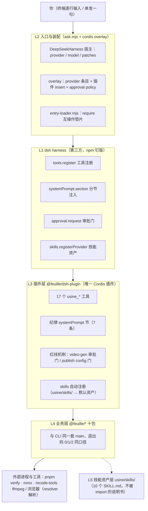

# feuille × dsh 智能体分层架构

> 智能体 = **dsh harness（第三方地基，npm 钉版）+ `@feuille/dsh-plugin`（唯一集成层）+ `@feuille/*` 业务包 + `skills/` 知识资产**，四层各管一件事，边界由接缝钉死。
> 本文自上而下拆每层的职责、接缝与红线承载——想看「装好后怎么用」读 [guide.md](guide.md)，想看产线判据读 [reference.md](reference.md)；本文只回答「这个智能体是怎么搭起来的、哪层管什么、改东西动哪层」。

## 1 全景

| 层 | 落点 | 一句话职责 |
|---|---|---|
| L1 dsh 地基 | `@deepseek-ai/cordis` / `dsh-sdk-client` / `dsh-skill(-filesystem)` / `dsh-tools`（npm 钉版） | 工具注册、systemPrompt 注入、审批门、进程生命周期——**全部复用，不重造 harness** |
| L2 入口与装配 | `packages/dsh-plugin/ask.mjs` + `ask.cordis.yml` + `feuille-usine.cordis.yml` + `entry-loader.mjs` | 宿主对话框 + overlay 装配 + require 垫片；机器无关，零绝对路径 |
| L3 插件 | `packages/dsh-plugin/src/`（index / tools / capture / discipline） | feuille → dsh 的**唯一**集成层：工具面、纪律文本、红线机制、技能注册 |
| L4 业务 | `@feuille/{core,copy,bgm,karaoke,poetry,poster,storyteller,publish}` | 产线本体；同一套 main 同时服务 CLI 与工具面 |
| L5 技能资产 | `usine/skills/`（10 个 SKILL.md） | 「怎么干」的说明书与完成定义；经插件注册为智能体默认资产 |

归属口径：`dsh-plugin` 在 [ownership.json](../ownership.json) 里是 **infrastructure**（与业务无关的底座）；工具面的每个动词在业务包里只有一份实现，插件层不自带第二份。

## 2 L1：dsh 地基层

dsh（DeepSeek Harness）以 **Cordis 插件形状**对外扩展：`export const name` + `export const inject`（声明要用的服务）+ `apply(ctx, config)`（装配期钩子）。feuille 只消费四个服务接缝：

| 接缝 | 用法 | feuille 拿它做什么 |
|---|---|---|
| `ctx.tools.register(def)` | 注册 raw ToolDefinition，返回注销函数 | 17 个 `usine_*` 工具（effect 注册，随插件 fiber 销毁自动注销） |
| `ctx.systemPrompt.section({name, order, text})` | 分节注入 system prompt | 纪律节 `feuille:discipline`（order 10150，7 条红线文本） |
| `ctx.approval.request(req)` | 摆审批卡，`Promise<'allowed-once' \| …>` | 视频生成 submit 的强制审批门 |
| `ctx.skills.registerProvider(...)` | 注册技能目录 | `usine/skills/` 挂为默认技能资产 |

三条工程口径：

- **钉版接入**：`@deepseek-ai/*` 全部按 [packages/dsh-plugin/package.json](../packages/dsh-plugin/package.json) 的 npm 发布版解析，换 dsh 版本只改这一处定义，升级单独裁定。
- **结构化最小面**：approval / systemPrompt 接缝走本地声明的结构化类型（`ApprovalLike` / `SystemPromptLike`），**不 link harness 类型链**——developer preview 的类型链易碎，插件不因上游类型重构而碎。
- **宿主无 TS 变换钩子**：dsh 进程吃不了 TS 源直跑，插件经 esbuild 打成单文件 `dist/index.mjs`；`sharp` / `@napi-rs/canvas` / `ws` 三个原生或重依赖保持 external，从 dsh-plugin 自己的 `node_modules` 解析（故它们同时声明为本包 dependencies）。

## 3 L2：入口与装配层

四个文件各司其职，全部机器无关：

| 文件 | 角色 |
|---|---|
| `ask.mjs` | **宿主对话框**：`new DeepSeekHarness({ cwd: usine 根, provider, model, patches: [ask.cordis.yml] })`；provider / model 可被 `FEUILLE_DSH_PROVIDER` / `FEUILLE_DSH_MODEL` 覆盖；单发（`ask 自检`）、交互（逐行 readline）、预检（`--preflight`）三挡都在这一个脚本里 |
| `ask.cordis.yml` | **本入口的 overlay**，叠在 dsh `sdk` 剖面上、不动 `~/.dsh` 剖面：① 补 provider 条目（`apiKeyEnv` 只写环境变量名，key 本体在 `$DSH_HOME` 凭据店，永不进仓库）；② `insert` 插件（入口指 entry-loader.mjs）；③ `approval policy=never` |
| `feuille-usine.cordis.yml` | **dsh 自家宿主的插件-only overlay**：给 `npx @deepseek-ai/dsh web` 之类宿主装本插件用，不带 provider 与 approval 配置 |
| `entry-loader.mjs` | **require 互操作垫片**：dsh 入口走 Node 原生 ESM 通道，而 esbuild 产物内联的 `__require` shim 运行期要真 require 未打包的 CJS 依赖——直挂 `dist/index.mjs` 会抛 `Dynamic require not supported`；垫片以 `dist/` 为解析根挂 `globalThis.require` 再 re-export 插件面 |

**`approval policy=never` 是红线双保险**：所有审批问询确定性自动拒绝——花额度的视频生成在本入口**结构性停摆**，不是「提示别用」。开发 / 日常对话用 `ask` 入口零额度；真要出母版，用显式配置了 approval 的宿主（那时 `usine_video_generation` 的审批卡才会真正弹给人）。

三挡入口（详见 [guide.md §2](guide.md#2-安装)）：`preflight` 零 LLM 只验「宿主起得来 + 插件挂得上」；`ask` 进交互会话；`ask 自检` 单发体检。

## 4 L3：插件层 `@feuille/dsh-plugin`

`apply(ctx, config)` 按固定顺序做五件事：

1. **纪律 systemPrompt 节**：`feuille:discipline`（order 10150，插在 WEB_SURFACE 与 DEPLOYMENT_PERSONA_SUFFIX 之间），7 条红线文本进 system prompt——**文本管「知道」，机制管「做到」，两层缺一不可**。
2. **注册 13 个 argv 家族工具 + `usine_version`**：每个产线家族一个工具，覆盖面与 CLI 路由表一一对应。
3. **注册 `usine_verify` / `usine_quota` / `usine_video_generation`**：门禁、额度查询、视频生成三条线。
4. **注册技能资产**：`FileSystemSkillProvider` 只扫 `usineRoot()/skills`（`includeDefaultRoots: false`，零机器路径）；宿主没装 skills 服务时整段跳过——结构性可选，不炸加载。
5. **`config.publish === true` 时才注册 `usine_publish`**：动态 import `@feuille/publish`（playwright 是可选依赖，只有真发布路径才碰）；异步注册完成前 fiber 销毁则直接放弃。

`usineRoot()` 按 bundle 位置 → `cwd` → `cwd/usine` 依次探测 `pnpm-workspace.yaml`，全仓库零绝对路径绑定。

### 工具面三族（tools.ts）

| 族 | 成员 | 执行方式 |
|---|---|---|
| **argv 家族**（进程内） | `usine_scene / lesson / persona / cover / framehash / ledger / theme / copy / bgm / karaoke / poetry / poster / storyteller` | `action` 选子命令、`argv` 原样透传，**进程内直调包 main，无 subprocess 桥**；console 四出口（log/error 与 stdout/stderr.write 双保险）被 [capture.ts](../packages/dsh-plugin/src/capture.ts) 拦成结构化 `{exit_code, output}`，main 调用串行化（一次只有一个在捕获窗口内） |
| **子进程通道** | `usine_verify`（pnpm typecheck → vitest）、`usine_quota`（mmx）、`usine_video_generation`（mcode-tools） | `spawn` 捕获跑；win32 上裸名先解析——argv 全由代码写死的通道（verify/quota）可经 cross-spawn 执行 .cmd/.bat shim，argv 含**模型可控内容**的通道 fail-closed 直接拒（exit 127 + 修法），**本通道不开 shell，注入红线** |
| **fetch 通道** | `usine_video_generation` 的 download | `video_url` 直接 fetch 落盘（7 天有效期内） |

退出码语义与 CLI 完全一致：0=过、1=检查不过/出错、2=用法错误；叶子层异常折成 1 + 报错文本进 `output`（不往 dsh 抛——工具结果必须能被模型读到）。

### `usine_video_generation` 的审批流（额度红线原型）

submit 动作走四步，任何一步不过都停在原地：

1. **机械校验**（`validateRequest`）：模型/分辨率/时长/画幅组合不合规格当场拒（invalid），不进审批；
2. **算账**：积分费率按 [skills/video-generation/SKILL.md](../skills/video-generation/SKILL.md) 速查表（Hailuo 走套餐额度不烧积分，H3/H3-Max 按分辨率每秒计费）；
3. **摆审批卡**：`ctx.approval.request()`，卡上展示提示词/画幅/时长/分辨率/预估消耗；宿主没有 approval 服务、或拿不到 agent 执行上下文 → `asked-unavailable`，**fail-closed 宁可拒掉**；
4. **`allowed-once` 才提交**：rejected / cancelled / unavailable 一视同仁——停在那里，不提交、不重试、不换参数试探。单次有效：「你直接跑」不构成本次授权。

### inject 教训（2026-10-18 真宿主首测）

`inject` 漏声明 `'approval'` 时，真 Cordis 对未声明就访问的服务直接抛错，**整个插件加载失败、17 工具面全丢**；而 vitest 的 fakeCtx 不校验 inject——**测试面永远看不见这类断点**。这就是 `preflight` 存在的理由：零 LLM、只验「宿主起得来 + 插件挂得上」，装配坏了当场红，而不是等一次真实对话才发现工具全没了。

## 5 L4：业务层 `@feuille/*` 十包

产线动词在业务包里只有一份实现：每个命令的 `main(argv)` 沿 CLI 口径把人类可读输出打到 console、把退出码当返回值。**CLI 与工具面是同一份 main 的两个消费者**——智能体没有自己的「第二套产线」。三层归属（library / infrastructure / skill 专属）与模块全表见 [README.md](../README.md)，归属唯一事实源是 [ownership.json](../ownership.json)，由 `@feuille/gate` 三方对账。

## 6 L5：技能资产层 `usine/skills/`

10 个 SKILL.md 是智能体的**默认知识资产**：插件装配即自动注册（宿主启动自动加载，无需指定、无需挂软链）。每个 skill 的 description 自带排除语句（Not for …），路由靠它而不是靠猜；产线分水岭（有没有实拍母版）、完成定义（画面/音频/混后/收尾四层全齐）都在 [skills/README.md](../skills/README.md)。

**兼容路**：在没有 dsh 的环境里，任意智能体 + `~/.agents/skills/` 软链复用同一批资产（agent 读 SKILL.md、自己调 `feuille` CLI）；能力面相同，审批门改由宿主自带机制承载。软链缺失不阻塞——直接读本仓库 SKILL.md 照常工作。

## 7 红线总账：文本 × 机制双承载

| 关口 | 文本（discipline.ts 进 systemPrompt） | 机制（代码位置） |
|---|---|---|
| 视频生成额度 | 「每次执行强制审批、fail-closed、单次有效；审批未过不换参试探」 | `tools.ts` submit 四步 + `approval.request`；approval 服务缺失即拒 |
| 平台发布 | 「默认不可达是有意设计，不建议开启、不用 shell 绕过」 | `index.ts`：`config.publish !== true` → 工具**不注册**（不可达不是报错） |
| 开发入口零额度 | —（策略而非文本） | `ask.cordis.yml`：`approval policy=never`，审批问询确定性自动拒绝 |
| 命令注入 | 「本通道不开 shell」 | `tools.ts` `resolveSpawnCmd`：模型可控 argv + .cmd/.bat shim → exit 127 + 修法 |
| 认证与风控 | 「只等待，绝不代填凭据，绝不自动重试」 | publish 工具面文本 + 扫码永远人工（无代填代码路径） |
| 验收诚实 | 「exit ≠ 0 就是不过；SKIP ≠ PASS，当 PASS 汇报 = 造假」 | 退出码原样进结构化结果，模型无法美化数字 |

## 8 验收面（这层怎么被钉住）

| 门 | 吃什么 | 验什么 |
|---|---|---|
| `plugin.test.ts` | **构建产物** `dist/index.mjs`（宿主实际加载的那个文件） | 整链一次验：esbuild 打包 + external 解析 + 插件形状 + 工具注册 + 进程内 main 调用 + approval 门行为；红线是主角——video-gen 必须「问了才动、没点头不动、卡上展示完整清单」，publish 默认连工具都不存在 |
| `plugin-parity.test.ts` | **src 源**（wave 实际编辑的面） | 三方对账：tools.ts 的 action 枚举 ↔ `@feuille/cli` COMMANDS 路由表 ↔ SKILL.md 规格与积分速查；积分数值从 SKILL.md 读入驱动审批卡算账，对不上当场红。所有 submit 用例停在审批 rejected（永不 allowed-once），且套 PATH 剥离兜底——测试在任何环境都不得真烧额度 |
| `preflight` | 真宿主 | 零 LLM 装配预检：宿主起得来 + 插件挂得上（inject 类断点唯一廉价防线） |
| 真宿主实录 | dsh web + patch | 装配链的最终证据（spike 结论沉淀在本仓 migration 记录） |

## 9 实践速查（改这层动哪里）

| 想做的事 | 动作 |
|---|---|
| 加一个产线动词 | 业务包加 main → CLI 路由表加命令 → `familyTools()` 加 action（或新工具）；parity 测试自动钉三方一致，漂移 `pnpm verify` 当场红 |
| 换 dsh 版本 | 只改 [packages/dsh-plugin/package.json](../packages/dsh-plugin/package.json) 的 `@deepseek-ai/*` 版本定义 → `pnpm install` → `pnpm --filter @feuille/dsh-plugin build` → `preflight` |
| 加一个技能 | `usine/skills/<name>/SKILL.md` 落盘即被插件自动注册，零代码改动 |
| 修「工具全没了」类装配病 | 先跑 `preflight`（inject / 加载错误当场红），再看 [guide.md §10](guide.md#10-故障排查) |
| 开发布工具 | 永不动插件层红线：不 shell 绕过、不代填凭据、不把 SKIP 当 PASS 汇报 |

> 红线的机制承载在 L3，文本承载进 systemPrompt，两者都改在 `packages/dsh-plugin/src/`——**改红线必带反向验证**（纪律 2）：approval 门凿洞必须 FAIL，publish 条件注册删掉必须 FAIL。
