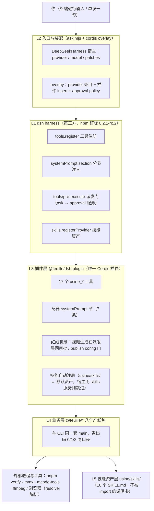

# feuille × dsh 智能体分层架构

> **可视化版**：[dsh-architecture/index.html](dsh-architecture/index.html)（浏览器直接打开）——组件级架构图：每层的具体组件、每个组件的功能、分别挂在 dsh 的哪个机制上 + 挂载图 + 一次调用的完整时序。
>
> 智能体 = **dsh harness（第三方地基，npm 钉版 0.2.1-rc.2）+ `@feuille/dsh-plugin`（唯一集成层）+ `@feuille/*` 业务包 + `skills/` 知识资产**，四层各管一件事，边界由接缝钉死。
> 本文自上而下拆每层的职责、接缝与红线承载——想看「装好后怎么用」读 [guide.md](guide.md)，想看产线判据读 [reference.md](reference.md)；本文只回答「这个智能体是怎么搭起来的、哪层管什么、改东西动哪层」。
>
> **2026-10-20 改版**：额度审批门从工具体内迁到 **dispatch 层**（dsh 原生的 `tools/pre-execute`）、`inject` 降级为只声明硬依赖、工具结果统一成一套契约、输出捕获改成上下文作用域、打包产物自足不再需要全局 require 垫片。改动理由与影响见 [§10 改版记录](#10-2026-10-20-架构评审的改动)。

## 1 全景



| 层 | 落点 | 一句话职责 |
|---|---|---|
| L1 dsh 地基 | `@deepseek-ai/cordis` / `dsh-sdk-client` / `dsh-skill(-filesystem)` / `dsh-tools`（npm 钉版 0.2.1-rc.2） | 工具注册、systemPrompt 注入、**派发层审批门**、进程生命周期——**全部复用，不重造 harness** |
| L2 入口与装配 | `packages/dsh-plugin/ask.mjs` + `ask.cordis.yml` + `feuille-usine.cordis.yml` | 宿主对话框 + overlay 装配；机器无关，零绝对路径 |
| L3 插件 | `packages/dsh-plugin/src/`（index / tools / gate / video / result / capture / discipline / toolnames） | feuille → dsh 的**唯一**集成层：工具面、结果契约、红线机制、技能注册 |
| L4 业务 | `@feuille/{core,copy,bgm,karaoke,poetry,poster,storyteller,publish}` | 产线本体；同一套 main 同时服务 CLI 与工具面 |
| L5 技能资产 | `usine/skills/`（10 个 SKILL.md） | 「怎么干」的说明书与完成定义；经插件注册为智能体默认资产 |

归属口径：`dsh-plugin` 在 [ownership.json](../ownership.json) 里是 **infrastructure**（与业务无关的底座）；工具面的每个动词在业务包里只有一份实现，插件层不自带第二份。

## 2 L1：dsh 地基层

dsh（DeepSeek Harness）以 **Cordis 插件形状**对外扩展：`export const name` + `export const inject`（声明要用的服务）+ `apply(ctx, config)`（装配期钩子）。feuille 只消费四个服务接缝：

| 接缝 | 用法 | feuille 拿它做什么 |
|---|---|---|
| `ctx.tools.register(def)` | 注册 raw ToolDefinition，返回注销函数 | 17 个 `usine_*` 工具（effect 注册，随插件 fiber 销毁自动注销） |
| `ctx.systemPrompt.section({name, order, text})` | 分节注入 system prompt | 纪律节 `feuille:discipline`（order 10150，7 条红线文本） |
| `ctx.on('tools/pre-execute', gate)` | 派发前的决策瀑布 | **额度红线的机制承载**：门返回 `{kind:'ask'}`，由 dsh-tools 的 `serviceAsk` 走 approval 服务 |
| `ctx.skills.registerProvider(...)` | 注册技能目录 | `usine/skills/` 挂为默认技能资产（宿主没装 skills 服务就整段跳过） |

三条工程口径：

- **钉版接入**：`@deepseek-ai/*` 全部按 [packages/dsh-plugin/package.json](../packages/dsh-plugin/package.json) 的 npm 发布版解析（本轮钉 **0.2.1-rc.2**），换 dsh 版本只改这一处定义，升级单独裁定。`preflight` 会机检「宿主实际跑的 dsh runtime 版本 == 钉版」。
- **结构化最小面**：接缝走本地声明的结构化类型（`ApprovalLike` 那一类手写镜像已随审批门迁移删除；现在只余 `SystemPromptLike` / `SkillsLike`），**不 link harness 类型链**——developer preview 的类型链易碎，插件不因上游类型重构而碎。
- **可选服务用 `ctx.get` / `ctx.inject`，不进 `inject`**：cordis 的 `inject` 是**硬激活门槛**——声明了但宿主没提供的服务会让 fiber 永远 pending，插件**永不生效**、工具面全空且宿主毫无感知（2026-10-18 首测、2026-10-20 评审、2026-10-20 复查各踩一次，方向有正有反）。所以 `inject` 只留 `tools` **一个**硬依赖：审批服务由 dsh-tools 在门内用 `ctx.get('approval')` 取（上游自己的写法，无服务即降级为 deny），技能服务由 `ctx.inject(['skills'], …)` 等到再注册，**纪律文本节**由 `ctx.inject(['systemPrompt'], …)` 等到再挂。
  - **`systemPrompt` 为什么也不算硬依赖**：它承载的只是纪律文本（红线的「知道」层），17 个工具一个都不依赖它。真 cordis 实测：只 `provide('tools')` 不 `provide('systemPrompt')` 时，**改前**（它在 inject 里）注册工具数 = **0**、插件永不生效且不报错；**改后**（移到 `ctx.inject`）注册工具数 = **17**，纪律文本节安静跳过。这条对比现在是 `plugin.test.ts` 里的常驻断言（真 cordis context，不是假 ctx）。
- **宿主无 TS 变换钩子**：dsh 进程吃不了 TS 源直跑，插件经 esbuild 打成单文件 `dist/index.mjs`；`sharp` / `@napi-rs/canvas` / `ws` 三个原生或重依赖保持 external，从 dsh-plugin 自己的 `node_modules` 解析。**产物自足**：esbuild banner 注入模块作用域 `require`（`createRequire(import.meta.url)`），纯 node 下可直接 import，**不再需要 `globalThis.require` 垫片**（2026-10-20 退休，见 §3）。

## 3 L2：入口与装配层

三个文件各司其职，全部机器无关：

| 文件 | 角色 |
|---|---|
| `ask.mjs` | **宿主对话框**：`new DeepSeekHarness({ cwd: usine 根, provider, model, patches: [ask.cordis.yml] })`；provider / model 可被 `FEUILLE_DSH_PROVIDER` / `FEUILLE_DSH_MODEL` 覆盖；单发（`ask 自检`）、交互（逐行 readline）、预检（`--preflight`）三挡都在这一个脚本里 |
| `ask.cordis.yml` | **本入口的 overlay**，叠在 dsh `sdk` 剖面上、不动 `~/.dsh` 剖面：① 补**两个** provider 条目——`minimax`（默认，直连 MiniMax 平台 OpenAI 兼容端点；`baseURL` 由 `FEUILLE_DSH_MINIMAX_BASE_URL` 决定，默认 cn 区 `https://api.minimaxi.com/v1`，global 区 `https://api.minimax.io/v1`，端点随本机 key 所在区域走）与 `fuyao`（规格**逐字照抄** `~/.dsh/profiles/desktop` 的同名条目——provider id / `apiKeyEnv` / baseURL / 模型规格 / reasoningEfforts 全一致）；两个条目的 `apiKeyEnv` 都只写环境变量名（`MINIMAX_API_KEY` / `FUYAO_API_KEY`），key 本体由 dsh 凭据服务从进程环境取，永不进仓库；② `insert` 插件（入口指 `dist/index.mjs`）；③ approval `policy=never` |
| `feuille-usine.cordis.yml` | **dsh 自家宿主的插件-only overlay**：给 `npx @deepseek-ai/dsh web` 之类宿主装本插件用，不带 provider 与 approval 配置 |

**`approval policy=never` 是红线双保险**：所有审批问询确定性自动拒绝——花额度的视频生成在本入口**结构性停摆**（卡在派发层，工具体不执行），不是「提示别用」。开发 / 日常对话用 `ask` 入口零额度；真要出母版，用显式配置了 approval 的宿主（那时审批卡才会真正弹给人）。

三挡入口（详见 [guide.md §2](guide.md#2-安装)）：`preflight` 零 LLM 但**四道机械检查**（见 §8）；`ask` 进交互会话；`ask 自检` 单发体检。

**provider 与模型**：默认 `minimax` / `MiniMax-M3.1-Flash`，可被 `FEUILLE_DSH_PROVIDER` / `FEUILLE_DSH_MODEL` 覆盖。2026-10-20 换 MiniMax 的原因：`fuyao-ai-gateway.xiaopeng.link` 当日**连接超时**（curl 25s 超时，不是鉴权问题），fuyao 条目保留在 overlay 里但不再是默认。MiniMax key 的解析顺序与 dsh 凭据语义对齐（凭据店 → 进程环境 → .env）：`credentials.mjs` 先读环境变量 `MINIMAX_API_KEY`，没有再从 mmx 凭据店 `~/.mmx/config.json` 取 `api_key` 并按 `region` 选端点，最后把 key 注入**进程环境**交给 dsh 凭据服务——**key 全程不打印、不进仓库、不写进 overlay**。

**退休的零件**：`entry-loader.mjs`（require 互操作垫片）已删。原先它把 `globalThis.require` 挂上，好让 esbuild 产物在原生 ESM 通道里 require 未打包的 CJS 依赖——那既是**进程级全局污染**（宿主里别的插件共用同一个 globalThis），也是「产物不自足」的 symptom。现在 banner 在模块作用域注入 `require`，产物自己站得住，垫片无存在理由。

## 4 L3：插件层 `@feuille/dsh-plugin`

`apply(ctx, config)` 按固定顺序做六件事：

1. **纪律 systemPrompt 节**：`feuille:discipline`（order 10150，插在 WEB_SURFACE 与 DEPLOYMENT_PERSONA_SUFFIX 之间），7 条红线文本进 system prompt——**文本管「知道」，机制管「做到」，两层缺一不可**。走 `ctx.inject(['systemPrompt'], …)`：宿主没这个服务就安静跳过（少一段文本，**工具面照常**）。
2. **注册 13 个 argv 家族工具 + `usine_version` + `usine_verify` / `usine_quota` / `usine_video_generation`**：每个产线家族一个工具，覆盖面与 CLI 路由表一一对应。
3. **自检工具面**：实际注册名单必须与 [src/toolnames.ts](../packages/dsh-plugin/src/toolnames.ts) 的 17 个字面名字逐字相同，不一致**当场抛**（装配失败当场红，而不是等一次真实对话才发现工具全没了）。
4. **装派发层额度门**：`ctx.on('tools/pre-execute', …)`（见 [src/gate.ts](../packages/dsh-plugin/src/gate.ts)）。门只对 `usine_video_generation` 的 `submit` 动作摆卡；**不合规的提交不占用一次人工审批**（门放行，工具体回 `invalid`）。
5. **注册技能资产**：`FileSystemSkillProvider` 只扫 `usineRoot()/skills`（`includeDefaultRoots: false`，零机器路径）；宿主没装 skills 服务时整段跳过——**结构性可选，不炸加载，也不影响工具面**。
6. **`config.publish === true` 时才注册 `usine_publish`**：动态 import `@feuille/publish`（playwright 是可选依赖，只有真发布路径才碰）；异步注册完成前 fiber 销毁则直接放弃。

`usineRoot()` 按 bundle 位置 → `cwd` → `cwd/usine` 依次探测 `pnpm-workspace.yaml`，全仓库零绝对路径绑定。

### 4.1 工具面三族（tools.ts）

| 族 | 成员 | 执行方式 |
|---|---|---|
| **argv 家族**（进程内） | `usine_scene / lesson / persona / cover / framehash / ledger / theme / copy / bgm / karaoke / poetry / poster / storyteller` | `action` 选子命令、`argv` 原样透传，**进程内直调包 main，无 subprocess 桥**；输出被 [capture.ts](../packages/dsh-plugin/src/capture.ts) 收成结构化结果 |
| **子进程通道** | `usine_verify`（pnpm typecheck → vitest）、`usine_quota`（mmx）、`usine_video_generation`（mcode-tools） | `spawn` 捕获跑；win32 上裸名先解析——argv 全由代码写死的通道（verify/quota）可经 cross-spawn 执行 .cmd/.bat shim，argv 含**模型可控内容**的通道 fail-closed 直接拒（exit 127 + 修法），**本通道不开 shell，注入红线** |
| **fetch 通道** | `usine_video_generation` 的 download | `video_url` 直接 fetch 落盘（7 天有效期内） |

### 4.2 统一结果契约（result.ts）

全部 17 个工具返回**同一套**形状，dsh 按 `output.schema` 机检每次返回值（`additionalProperties` / `enum` / `required` 全部强制执行）：

```jsonc
{ "ok": true, "status": "ok", "output": "人类可读输出全文", "detail": { "exit_code": 0 } }
```

- `status` 三档：`ok`（过）/ `invalid`（用法或参数不合规，该改参再调）/ `failed`（检查不过或执行失败）。
- CLI 退出码语义（0/1/2）折进 `status` 与 `detail.exit_code`——与 CLI 同一口径，不发明第二套。
- **以前是两套**：13 个 argv 家族用 `{exit_code, output}`、`usine_video_generation` 用 `{status, message, …}`，纪律文本只覆盖了其中一套（对另一套是错的）。现在一套到底。

### 4.3 输出捕获：上下文作用域，不是时间窗（capture.ts）

各包的 `main(argv)` 沿 CLI 口径把输出打到 console/stdout、把退出码当返回值；工具要把两者变成结构化结果。

**旧做法**：猴补 `console` + `process.stdout.write` + 一把模块级 promise 锁，**按时间窗**捕获。问题是 dsh 宿主进程里除了工具还有宿主自己的写（会话事件、JSON-RPC 帧、日志、UI 帧）——时间窗会把宿主噪声一起吞进工具输出（模型读到不属于它的文本），JSON-RPC 帧被吞还会挂死 SDK 客户端（stdout 是它的独占通道）；那把锁则是因为两个捕获窗口可能重叠才加的。

**现做法**：用 `AsyncLocalStorage` 把捕获窗口绑到「本次 main 调用的异步上下文」——窗口内只有这条调用链的写被收走，宿主并发写原样透传。带来三件事：并发安全（两个工具同时跑不互相截断，**串行锁删掉**）、宿主噪声不进工具输出、stdout/console 的改道只装一次（模块级幂等），宿主的写永远走原路径。

### 4.4 额度门：红线的机制承载（gate.ts + video.ts）

`usine_video_generation` 的 `submit` 走**派发层**的门，不在工具体内自问自答：

1. **机械校验**（`video.ts` 的 `parseSubmit`）：模型/分辨率/时长/画幅/prompt 上限不合规格 → 门**放行**（不占用一次人工审批），工具体回 `invalid`；
2. **算账**（`video.ts` 的 `submitCost`）：积分费率按 [skills/video-generation/SKILL.md](../skills/video-generation/SKILL.md) 速查表（Hailuo 走套餐额度不烧积分，H3/H3-Max 按分辨率每秒计费）；
3. **摆卡**：门返回 `{kind:'ask', reason, displayReason:{en, zh}}`，reason 是完整中文卡面（提示词/画幅/时长/分辨率/预估消耗）；
4. **dsh 接管**：由 dsh-tools 的 `serviceAsk` 走 approval 服务——policy 优先（`never` → 确定性拒绝）、无 approval 服务 → 降级为 deny、无 agent 上下文 → deny、三种非许可结论各自可区分；审计走 dsh 自己的 `approval/asked` + `approval/decided` 事件对。

**未获批准时工具体根本不执行**：模型看到的是 dsh 原生的工具错误，不是本插件的一个 status。这正是「红线在派发层成立」与「工具跑了才说不行」的区别——后者等于没有红线（工具已经执行过，宿主也没法按工具名否决，审计链断在工具体里）。

门与工具体共用 [video.ts](../packages/dsh-plugin/src/video.ts) 这一个判定源（纪律 7：属性一律派生，不手抄）——两处各算一份就会漂。

## 5 L4：业务层 `@feuille/*` 八个产线包

产线动词在业务包里只有一份实现：每个命令的 `main(argv)` 沿 CLI 口径把人类可读输出打到 console、把退出码当返回值。**CLI 与工具面是同一份 main 的两个消费者**——智能体没有自己的「第二套产线」。三层归属（library / infrastructure / skill 专属）与模块全表见 [README.md](../README.md)，归属唯一事实源是 [ownership.json](../ownership.json)，由 `@feuille/gate` 三方对账。

八个产线包：`core`（基础层 + 音画内核 + 数据与人物场景）、`copy`（发布词自检）、`bgm`（BGM 床生成）、`karaoke`（TTS / 成片组装 / AV 同步）、`poetry`（实拍母版诊断）、`poster`（排版产线）、`publish`（平台发布）、`storyteller`（评书成片）。另有三个**非产线**包：`cli`（统一入口）、`dsh-plugin`（本集成层）、`gate` + `eval`（门禁与离线健康分工具链）——它们不属于 L4。

## 6 L5：技能资产层 `usine/skills/`

10 个 SKILL.md 是智能体的**默认知识资产**：插件装配即自动注册（宿主启动自动加载，无需指定、无需挂软链）。每个 skill 的 description 自带排除语句（Not for …），路由靠它而不是靠猜；产线分水岭（有没有实拍母版）、完成定义（画面/音频/混后/收尾四层全齐）都在 [skills/README.md](../skills/README.md)。

**兼容路**：在没有 dsh 的环境里，任意智能体 + `~/.agents/skills/` 软链复用同一批资产（agent 读 SKILL.md、自己调 `feuille` CLI）；能力面相同，审批门改由宿主自带机制承载。软链缺失不阻塞——直接读本仓库 SKILL.md 照常工作。

## 7 红线总账：文本 × 机制双承载

| 关口 | 文本（discipline.ts 进 systemPrompt） | 机制（代码位置） |
|---|---|---|
| 视频生成额度 | 「每次 submit 都先弹人工审批卡；没点头工具根本不会执行；不要换参数试探；「你直接跑」不免审」 | `gate.ts` 派发门 → dsh-tools `serviceAsk` → approval 服务；缺服务/缺 agent/非许可结论一律 fail-closed |
| 平台发布 | 「默认不可达是有意设计，不建议开启、不用 shell 绕过」 | `index.ts`：`config.publish !== true` → 工具**不注册**（不可达不是报错） |
| 开发入口零额度 | —（策略而非文本） | `ask.cordis.yml`：`approval policy=never`，审批问询确定性自动拒绝 |
| 命令注入 | 「本通道不开 shell」 | `tools.ts` `resolveSpawnCmd`：模型可控 argv + .cmd/.bat shim → exit 127 + 修法 |
| 认证与风控 | 「只等待，绝不代填凭据，绝不自动重试」 | publish 工具面文本 + 扫码永远人工（无代填代码路径） |
| 验收诚实 | 「ok=true 且 status=ok 才是过；status=invalid 是改参；status=failed 是没过；SKIP ≠ PASS」 | 统一结果契约 + dsh 按 `output.schema` 机检返回值，模型无法美化数字 |

## 8 验收面（这层怎么被钉住）

| 门 | 吃什么 | 验什么 |
|---|---|---|
| `plugin.test.ts` | **构建产物** `dist/index.mjs`（宿主实际加载的那个文件） | 整链一次验：esbuild 打包 + external 解析 + 插件形状 + 工具注册 + 进程内 main 调用 + **派发门的决策**（合规 → ask / 不合规 → 放行）+ publish 条件注册 + **统一结果契约**（全部工具同一 schema）+ 捕获的上下文作用域（并发不交错、宿主噪声不串窗） |
| `plugin-parity.test.ts` | **src 源**（wave 实际编辑的面） | 四方对账：tools.ts 的 action 枚举 ↔ `@feuille/cli` COMMANDS 路由表 ↔ 工具面契约 `toolnames.ts` ↔ SKILL.md 规格与积分速查；**旗标层**新增一条——SKILL.md 写的每个 CLI 旗标都必须在库层真实存在（旗标改名 → 说明书漂移 → 红）；inject 声明 ↔ apply 取用的服务（少声明与多声明两个方向都钉） |
| `preflight`（零 LLM） | 真宿主 | **四道机械检查**：① 产物自足加载（纯 node，不靠 require 垫片）② dsh 钉版一致（宿主 runtime 版本 == package.json 钉版）③ 宿主起得来 ④ **插件真的挂上去了**（装配清单新鲜 + 工具面 17 个逐字相符）。第 ④ 条是 2026-10-18 首测事故的直接补丁：dsh 静默吞 apply 错，宿主照常启动而工具面全空——只「start 一下就 close」的预检查不出这个 |
| `host-run`（真宿主实跑） | 真宿主 + 真 LLM | 装配链与红线的**最终证据**：插件挂上（17 个工具逐字相符）、会话日志里有 `approval/asked` + `approval/decided`（原生审计，不是插件自述）、视频 submit 在工具体执行之前被拦、全程无 task_id、拒绝是 dsh 原生语义。产物写 `docs/dsh-host-evidence.ndjson` + `docs/dsh-host-summary.json` |
| 真宿主实录（历史） | dsh web + patch | 早期 P1 骨架阶段的启动实录（原文在 `usine/migration/README.md`，该文件已于 2026-10-19 随 Python 金样本一并删除，结论已并入本文与 `docs/record.md`） |

**分工**：vitest 的**假 ctx**（fakeCtx）结构上**测不到宿主的服务解析**——inject 语义、approval 服务、审计事件全都看不见。所以「宿主里到底挂上没有」归 preflight 与 host-run 管，不归 vitest 管。唯一的例外是 inject 的 AND 语义：`plugin.test.ts` 里为此单开了一条**真 cordis context**（`new Context()` + `provide`）的用例，因为那一条在假 ctx 上永远测不出来。

### 8.1 2026-10-20 真宿主实跑结果（5/5 通过）

跑批：`provider=minimax` / `model=MiniMax-M3.1-Flash` / dsh 钉版与 runtime 均 **0.2.1-rc.2**，会话 `session-2d9aa970df7d4134901cee237cb7c185`。证据取自会话日志逐帧解码（`docs/dsh-host-evidence.ndjson`，12 条关键事件；汇总 `docs/dsh-host-summary.json`）：

| seq | 事件 | 关键内容 |
|---|---|---|
| 13 / 14 | `tool/call` → `tool/result` | `usine_version` 返回 `{"ok":true,"status":"ok",…}`——统一契约在真宿主里生效 |
| 15 / 16 | `tool/call` → `tool/result` | `usine_verify` 真跑 typecheck + vitest：43 文件 / 563 测试全绿（**2026-10-20 当时的读数**，不是现值），`detail.exit_code=0` |
| 20 / 21 | `tool/call` → `tool/result` | `usine_quota` 只读额度查询（video 线 100%） |
| 25 | `tool/call` | `usine_video_generation` `action=submit`——**模型真发起**（不是「应该会发起」） |
| 26 | `approval/asked` | `toolName=usine_video_generation`，reason 是完整中文审批卡（模型 / 提示词 / 画幅 / 时长 / 分辨率 / 预估消耗） |
| 27 | `approval/decided` | `outcome="rejected"`——工具体**一行没执行** |
| 28 | `tool/result` | `isError=true`，内容是 dsh 原生文案 `Error: the user rejected tool "usine_video_generation"`（不是插件自述的 status） |
| 32 / 33 | `tool/call` → `tool/result` | `grep` 复核门禁输出 |

**全程无 `task_id`**：没有生成任务被提交、额度零消耗——这是红线在**派发层**成立的机械证据（批准前工具体根本没跑）。

## 9 实践速查（改这层动哪里）

| 想做的事 | 动作 |
|---|---|
| 加一个产线动词 | 业务包加 main → CLI 路由表加命令 → `familyTools()` 加 action（或新工具）→ `toolnames.ts` 加名字；parity 测试自动钉三方一致，漂移 `pnpm verify` 当场红 |
| 换 dsh 版本 | 只改 [packages/dsh-plugin/package.json](../packages/dsh-plugin/package.json) 的 `@deepseek-ai/*` 版本定义 → `pnpm install` → `pnpm --filter @feuille/dsh-plugin build` → `preflight`（钉版一致性会当场核）→ `host-run`（真宿主证据） |
| 加一个技能 | `usine/skills/<name>/SKILL.md` 落盘即被插件自动注册，零代码改动 |
| 改额度红线 | 改 `gate.ts`（门控条件与决策形状）或 `video.ts`（判定源与卡面）→ **改红线必带反向验证**（纪律 2）：门必须仍对合规提交 ask、对不合规放行 → 同步改 `test/refusal-audit.md`（合并器侧「规范同步闸」会机检它声称的代码事实） |
| 修「工具全没了」类装配病 | 先跑 `preflight`（四道检查，第 ④ 条专门查这个），再看 [guide.md §10](guide.md#10-故障排查) |
| 开发布工具 | 永不动插件层红线：不 shell 绕过、不代填凭据、不把 SKIP 当 PASS 汇报 |

## 10 2026-10-20 架构评审的改动

评审的结论与逐项改动（依据：dsh 上游 `dsh-tools@0.2.1-rc.2` 与 `cordis@4.0.5` 的真实实现，不是印象）：

| # | 改前 | 改后 | 为什么 |
|---|---|---|---|
| 1 | 审批在**工具体内**（工具体自己 `ctx.approval.request()`，拒绝时工具「跑完了」返回 `asked-*` status） | 审批在**派发层**（`tools/pre-execute` 门返回 `{kind:'ask'}`，由 dsh-tools 走 approval 服务） | 工具体内审批 = 工具已执行过；红线在派发层不成立，宿主也没法按工具名否决，审计断在工具体里 |
| 2 | `inject = [tools, systemPrompt, approval, skills]` | `inject = [tools]`；其余（approval / skills / systemPrompt）走 `ctx.get` / `ctx.inject` | cordis 的 inject 是硬激活门槛：宿主一缺服务，插件永不生效、工具面全空且不报错（同一个坑，方向相反） |
| 3 | 两套结果契约（家族工具 `exit_code` / 视频工具 `status`） | 一套 `{ok, status, output, detail}`，dsh 按 schema 机检 | 纪律文本只覆盖了其中一套，对另一套是错的；模型要学两套协议 |
| 4 | 输出捕获按**时间窗**猴补全局 stdout + 串行锁 | 按**异步上下文**捕获（AsyncLocalStorage），锁删掉 | 宿主噪声会串进工具输出；JSON-RPC 帧被吞会挂死 SDK 客户端 |
| 5 | 产物靠 `entry-loader.mjs` 挂 `globalThis.require` 才能加载 | esbuild banner 注入模块作用域 require，垫片退休 | 全局污染（宿主里所有插件共用一个 globalThis）；产物应当自足 |
| 6 | `preflight` 只 start/close 就报「clean」 | 四道机械检查（产物自足 / 钉版一致 / 宿主起得来 / 插件挂上） | dsh 静默吞 apply 错——旧预检在插件全灭时照样绿 |
| 7 | 旗标层零机检 | parity 增旗标层对账（SKILL.md ↔ 库层） | CLI 改旗标名、SKILL.md 照旧，模型照旧拼旧参数 |
| 8 | 真宿主记录在 `usine/migration/README.md`（已删） | 真宿主证据走 `host-run` + `docs/dsh-host-summary.json`；历史结论并入本文与 `docs/record.md` | 悬空引用会让「证据在哪」变成传闻 |
| 9 | 入口 provider 走 fuyao 网关（`fuyao-ai-gateway.xiaopeng.link`） | 默认切 **minimax 直连**（overlay 增 `minimax` 条目，baseURL 随 region 走，`MINIMAX_API_KEY` 经 `credentials.mjs` 注入进程环境）；fuyao 条目保留 | 2026-10-20 fuyao 网关当日连接超时（curl 25s 超时，非鉴权问题），真宿主实跑与门禁取证都改走 MiniMax |
| 10 | 业务包里有 5 处注释/文档指向已删的 `usine/migration/`（Python 金样本） | 改成陈述当前真事实（行为由现测试钉住），不再指向不存在的文件 | 悬空引用让人以为还有一份金样本可以对拍 |
| 11 | `inject = [tools, systemPrompt]`（改完第 2 条后仍留着 systemPrompt） | `inject = [tools]`；纪律文本节改走 `ctx.inject(['systemPrompt'], …)` | 复查时发现 systemPrompt 是同一个坑的**第三个实例**：它只承载纪律文本，17 个工具一个都不依赖它；宿主一缺它，工具面掉到 **0** 且不报错（真 cordis 实测） |
