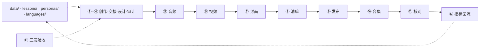

# 参考：结构 · 流程 · 工具 · 不变量

> 交互看 [guide.md](guide.md)；实测数字看 [record.md](record.md)；纪律权威在 [../AGENTS.md](../AGENTS.md)。

## 1 结构

**数据层（唯一事实源）→ 生产层 ①–⑬ → 三大产物 → manifest 门禁 → 四平台 → 指标回流。**

- **一处写、全链读**：片名 / 首句 / 体式只写 `data/`；改稿只改数据，不改编码。
- **依赖固定**：音频 → 视频 → 封面；上游一动全链重走。
- **发布是单向门**：⑧ 清单不绿不进 ⑨；⑪ 只读核对不过，整条当失败。

### 智能体装配

智能体 = dsh 地基（第三方，npm 钉版）+ `@feuille/dsh-plugin`（唯一 Cordis 插件）。
插件只做「feuille → dsh」集成：17 个 `usine_*` 工具（残余参数与 CLI 同口径）、纪律
systemPrompt、审批挂点、11 个技能资产自动加载。`usine_video_generation` 每次强制审批
（fail-closed、单次有效）；`usine_publish` 默认**不注册**——发布不可达是工具面上没有。
入口三挡：`pnpm --filter @feuille/dsh-plugin preflight | ask | ask 自检`。

### 模块归属与门禁

归属只看 [../ownership.json](../ownership.json)：library 16 / infrastructure 10 / skill 专属 13。
目录按域分，不按层分。`@feuille/gate` 三方对账（账本 ↔ 实际模块 ↔ 每个 SKILL.md
「拥有模块」行），改一处不改另一处当场 FAIL；完整模块表见 [../README.md](../README.md)。

`pnpm verify` = `tsc --noEmit` + 全部 vitest（42 文件）。纪律：**反向验证**（每套注入已知
缺陷，凿洞必 FAIL）、**SKIP ≠ PASS**。Edge 系测试单独串行（并发抢浏览器）。

### CLI 路由

`feuille <组> <命令>`；路由是数据（`cli.COMMANDS`），lazy import，叶子只拿残余 argv；
未知命令 → usage + 退出码 2，库层失败 → stderr + 退出码 1。

| 组 | 命令 | 段 |
|---|---|---|
| version | — | 版本 |
| ledger | status | 产物新鲜度 |
| framehash | save / check | ⑬ 逐帧像素基线 |
| cover | make / check | ⑦ 封面 |
| persona | validate | ②③ 人设契约 |
| scene | parse / validate / draft / tts | ②③④ 场景课 |
| lesson | new / doctor | ③④ 开坑 / 七层体检 |
| theme | match | 主题推荐 |
| karaoke | tts / build / verify-sync / scan-blank | ⑤⑥⑬ 单卡片成片 |
| poetry | audio-profile / color-contrast | ⑬ 实拍线诊断 |
| storyteller | render-frames / assemble | ⑥ 多幕评书 |
| poster | fetch-fonts / assemble / render / render-page / audit-charset / fit-diag / verify-colors / check-overlay / make-covers / measure-korean | ⑦ 海报十件 |
| copy | check | ⑧ 发布词自检 |
| bgm | gen | ⑤ BGM 床 |
| publish | login / check-plan / douyin / xhs / bilibili | ⑨⑩ 登录 / 自检 / 发布 |

**RSI**：本树是改进对象；引擎在 `../théâtre`、适配层在 `../../garage`。
Actor 改 seed 快照，候选以 delta 出，`pnpm verify` 全绿才合并；发布红线对 RSI 同样成立。

## 2 工作流 ①–⑬

| 段 | 做什么 | 产物 / 判据 |
|---|---|---|
| ① 内容创作（人工） | 故事、各语种正文（独立创作禁互译）、体式声明、⚑ 注记；事实分级 | 创意包；声明可审计，不确定宁可不写 |
| ② 创意交接 | 机器可读化入 `data/`：`text[]`、注记、选角、时间轴；片名/首句/体式只写这一处 | `data/`；schema 纯函数校验；中译行数一致 |
| ③ 设计 | 七项：台词 / 选角 / 节拍 / 场景 / 转场 / 布局 / 分镜，全部落参数 | 设计只改数据；画幅与基底成对绑定 |
| ④ 内容审计 | 手写拆分 + 算法交叉验证，不一致以算法为准 | 审计报告；声明与实测不符就改正文或撤声明 |
| ⑤ 音频 | TTS（缓存键 `sha256(voiceId\|rate\|pitch\|text)[:16]`）→ 词级时间戳 → 时间轴补齐 | `build/audio/`；预算卡在这一步，超预算放宽预算、不压台词 |
| ⑥ 视频 | Edge headless 截图 → ffmpeg 叠加 / 混音 → loudnorm −14 LUFS | 横竖两版 mp4；`apad` 前置 `loudnorm`，`-t` 控时长，禁 `-shortest` |
| ⑦ 封面 | 预裁底图 → 叠字截图 → 四平台变体 | `build/covers/`；三要素进安全区；换不上封面就不发这条 |
| ⑧ 清单 | 解析 `{plat}-copy.md` → 结构化清单（字数现算） | `build/publish-manifest.json`；视频/封面在盘、条数齐全 |
| ⑨ 发布 | 人工扫码 → 逐条上传 → 封面 → 文案 → 发布 | `build/publish-{plat}-result.json` + 截图；单条失败不影响整批 |
| ⑩ 合集 | 建合集 → 传封面 → 按标题挂作品 | 平台合集；挂完必跑 ⑪ |
| ⑪ 核对 | 管理页截图 → 拼对照图 → 人眼判定 | 只读；脚本自报成功不算 |
| ⑫ 指标 | 人工取数 → 回填 `results.json` → 分组 | 没数据留 null 不填 0；样本 <5 不排名 |
| ⑬ 验收 | 渲染前 / 渲染后 / 发布后三层 | 见 §4；三层全机械可查 |

**三大产物**：音频 `build/audio/`（逐行 mp3 + 词级时间戳）、视频
`build/video/{名}_{宽}x{高}.mp4`、封面 `build/covers/{语种}_{变体}_{宽}x{高}.png`。

**改稿数据流**：①/③ 改 → ④ 审计 → ⑤ 音频 → ⑥ 视频 → ⑦ 封面 → ⑧ 清单 →（⑨ 发布）。

## 3 工具链

| 工具 | 段 | 用途 | 关键口径 |
|---|---|---|---|
| pnpm + Node ≥24 | 全程 | workspace / 运行时 | 不裸跑；锁文件锁版；TS 直跑不构建 |
| Edge（headless） | ⑥⑦ | 渲字 / 封面截图 | 画字唯一正确出路（阿/希/天城文）；`--window-size` ≠ 视口高，先探后补 |
| Chrome + Playwright | ⑨⑩⑪ | 平台自动化 | 系统 Chrome + 持久 profile；登录/风控人工；`import('playwright')` 可选依赖 |
| ffmpeg | ⑥⑬ | 叠加 / 混音 / 逐帧哈希 | `apad` 前置 `loudnorm`；`-t` + 前置 apad/atrim，禁 `-shortest`；哈希必须 `-map 0:v` |
| ffprobe | ⑤⑬ | 时长实测 | `file_dur` 以实测为准（尾部垫静音） |
| magick | ⑦⑪ | 裁切安全 / 拼图 | 上传比例 ≠ 展示比例（小红书 3:4 上下各切 240、B站 4:3 左右各切 240） |
| edge-tts（自复刻） | ⑤ | TTS + 词级时间戳 | `boundary="WordBoundary"`；`NoAudioReceived` 退避重试；需网络 |
| sharp / @napi-rs/canvas | ⑥⑬ | 解码 / 绘制 / 探针 | 不许成像库画字；透明叠加走白/黑双 matte |
| @google/genai | ⑤ | Lyria BGM | 免费层仅 `lyria-realtime-exp`；按出口 IP 判区；判据见 skill `bgm-bed` |
| Hailuo-2.3 / H3 / H3 Max | ⑥ | 实拍母版 | **绝不自动调用**；逐次确认额度、一次成对、生成后冻结；默认 2.3（套餐额度） |

### 平台后台（无 API，只能浏览器操作）

| 平台 | 硬限制 | 要点 |
|---|---|---|
| 抖音 | 标题 ≤30；正文 ≤1000；每作品最多改 5 次 | 封面后补（编辑流程）；封面槽实为 3:4 |
| 小红书 | 标题 ≤**20**；正文 ≤1000 | 发布按钮 DOM 不可见 → 像素探测 `#FF2442`；无合集管理页 |
| B 站 | 标题 ≤80；创作声明 6 值白名单 | 「立即投稿」后二次确认；成功词含「稿件投递成功」；合集需 Lv2 |
| 知乎 | 一篇文章最多 10 个视频 | 唯一自动化路径 =「导入文档」上传 .md；阿拉伯语有违规风险 |

## 4 渲染不变量与验收

| 不变量 | 纪律 |
|---|---|
| 头身几何只从 `face_geo(face)` 派生 | 渲染与探针同源，永不手抄坐标 |
| 声线缓存键含 voiceId/rate/pitch/text | 台词超时只改文本；声线参数动一次全员重合成 |
| 时长预算在 `scene.md` §0 声明 | 超预算回改文本；新值 = 实测 min/max ±2s 取整到 5 |
| 表情 = 数据（`MOOD_FACE`） | 改表全员生效，不给单人文戏 |
| 词轴三用：口型 / 高亮 / 手势 | 换台词自动重对齐 |
| 人物无描边 | 场景道具描边只用 `pal["ink"]` |
| 图层：背景 → 人物 → 文字带 → 名牌 → 语言牌 → 气泡 | 气泡尾在人物层内画，被本体盖住尾根 |
| 封面必须表达主题 | 由该片数据派生，不是抽帧；对比 ≥100、安全区内缩 ≥2%、逐字节幂等 |

**验收三层**：渲染前（schema / 文案字数 / 格律）、渲染后（framehash 逐帧像素、画面探针、
裁切安全拼图、重渲比对）、发布后（管理页截图 + 人眼）。

**高频坑（症状 → 修法）**：

1. 卡拉 OK 整行不动 → edge-tts 默认只发句边界，必须 `WordBoundary`。
2. 时长凭空多 0.5–1.5s → mp3 尾部静音，行时长取 `min(探针, 末词 end+0.2s)`。
3. 成片不足 10s → 时长控制用 `-t` + 前置 apad/atrim，禁 `-shortest`。
4. 文字层底部截断 → Edge 视口比 `--window-size` 小，先探 `viewport_deficit`。
5. `position:absolute/transform` 破坏父盒高度 → 流式布局截图才可靠。
6. 探针假失败 → 采样点从 `face_geo` 算；窄元素用小窗搜索，不钉单点。
7. 幂等抽检误报 → 比逐帧像素哈希，不比 mp4 容器字节。
8. `-map 0:v` 漏写 → 哈希数字不同且不报错。

## 5 发布

**铁律**：宁可整条不发，也不带病发布；发布成功唯一权威判据 = 回列表核验到作品；
脚本自报成功不算成功；无法确认一律当失败；扫码/风控一律人工，绝不自动重试；
批量前确认一次整批，页面刷新/换号/草稿改动后重新确认；每条前回干净投稿页。

**抖音/小红书**：上传 → 设封面（换不上不发）→ 标题/正文/话题 → 发布。小红书话题并在
正文末行；标题按平台字数倒推，不把抖音标题搬过去截断。

**知乎**：Draft.js 只在真实 paste 事件转换；唯一可自动化路径 =「导入」→「导入文档」上传
`.md` → 人工挂视频（≤10 支/篇）→ 发布；主文导览最后发。

**B 站**：上传视频 + `.txt` 字幕 → 封面 → 分区 + 创作声明（以 input 读回值为准）→
立即投稿 → 二次确认。

**取数**：抖音创作中心作品数据 / 小红书笔记数据；没数据留 null 不填 0；
分组样本 <5 不排名（判读基准见 [record.md](record.md)）。

## 6 写作纪律（六条，不可协商）

1. ⚑ 注记先行：语言学断言只出现在 ⚑ 注记里，正文不编造。
2. 独立创作、禁止互译：回译不得逐词对上中文版；骨架可共享，内容不许共享。
3. 事实分级：词典级可断言，口语级写「口语里」，假说级带「据说」；不确定宁可不写。
4. ⚑ 注记自然带出长尾搜索词。
5. 敏感避让：不出现品牌名、不劝酒、不涉酒精。
6. 不在 scene.md 里编造平台数据（CES、完播率、曝光倍数一律不写）。
