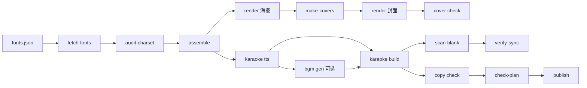

# 一座城，十二种语言：实测记录与操作契约

> 本文是 **2026-10-19 在 Windows 上真跑一遍的逐字记录**（§1–§17），并收编这一轮沉淀下来的
> **A 人机交互契约**（智能体怎么和人交接）与 **B 内部 workflow**（机制与判据）。
> 面向使用者的**交互指南**在 [guide.md](guide.md)——那边回答「怎么跟 feuille 智能体打交道」；
> 本文供核对底层细节、复现证据、给智能体当对照材料用。
>
> 每条命令都实际敲过；每段输出都是从终端粘出来的；每个产物都还在
> [`examples/one-city-12lang/`](../examples/one-city-12lang/) 里。
> 失败的那几次也留着——包括失败原文、诊断过程、修法。**没跑的部分单独列出并写明原因**，
> 不拿"应该可以"冒充"已经通过"。

- 配套工程：[`examples/one-city-12lang/`](../examples/one-city-12lang/)
- 日志原件：[`examples/one-city-12lang/logs/`](../examples/one-city-12lang/logs/)（25 个）
- 诊断留证：[`examples/one-city-12lang/diagnostics/`](../examples/one-city-12lang/diagnostics/)
- 被打回的床：[`examples/one-city-12lang/rejected/`](../examples/one-city-12lang/rejected/)（只归档不删）

---
## A. 人机交互：智能体怎么带人走完这条线

这一节是给**驱动方**（智能体）看的操作契约，不是给人读的教程。只回答一个问题：
**哪些事必须停下来找人，找的时候说什么、要人做什么、之后用什么证明人做的事生效了。**

### A.1 一页结论（第一步先给人这张表）

首跑（无床，2026-10-19 上午）：

| # | 环节 | 命令 | 退出码 | 产物 |
|---|---|---|---|---|
| 1 | 环境自检 | `node/pnpm/ffmpeg/ffprobe` + 浏览器探测 | 0 | — |
| 2 | 字体子集 | `feuille poster fetch-fonts` | 0 | `fonts.css` 181,576 B |
| 3 | 字符门（海报） | `feuille poster audit-charset` | 0 | — |
| 4 | 字符门（视频） | `feuille poster audit-charset` | 0（首跑 **1**） | — |
| 5 | 注入字体 | `feuille poster assemble` | 0 | `index.html` / `video_src.html` |
| 6 | 海报渲染 | `feuille poster render` | 0 | `poster.png` 2480×3508 |
| 7 | 全屏封面 | `feuille poster make-covers` + `render` | 0 | `cover_src.html` / `cover_pt.png` / `cover_lc.png` |
| 8 | 封面契约 | `feuille cover check` | 0 / 0 / **1** | — |
| 9 | 配音 | `feuille karaoke tts` | 0 | 12 `.mp3` + 12 `.json` |
| 10 | 视频合成（横） | `feuille karaoke build --only landscape` | 0 | `one_city_landscape.mp4` 3,175,479 B |
| 11 | 视频合成（竖） | `feuille karaoke build --only portrait` | 0 | `one_city_portrait.mp4` 2,858,350 B |
| 12 | 空帧门 | `feuille karaoke scan-blank` | 0 | — |
| 13 | 同步门（横） | `feuille karaoke verify-sync` | 0 | — |
| 14 | 同步门（竖） | `feuille karaoke verify-sync` | 0 | — |
| 15 | 发布词 | `feuille copy check --facts` | 0 | 3 篇 `publish/*.md` |
| 16 | 发布清单 | `feuille publish check-plan` | 0 | `publish/manifest.json` 24 条 |

补跑（填好 key / 装上库之后，§17）：

| # | 环节 | 命令 | 退出码 | 产物 |
|---|---|---|---|---|
| 17.1 | 发布器依赖 | `pnpm add playwright@1.64.1 --save-optional` | 0 | `packages/publish` 22/22 |
| 17.4a | BGM 床 | `feuille bgm gen` | 0 | `bgm.wav` 14,617,004 B / 76.13 s |
| 17.4b | 挂床重建（横） | `feuille karaoke build ... --only landscape` | 0 | 3,866,529 B |
| 17.4c | 挂床重建（竖） | `feuille karaoke build ... --only portrait` | 0 | 3,516,978 B |

**还没做、也不许写成"通过"的：**

- **真发布**：`publish login` / `publish douyin|xhs|bilibili` 要真账号扫码 + 持久 Chrome profile，
  属于"会产生外部副作用"的动作，本次不执行。`publish check-plan` 是零平台流量的离线自检，所以跑了。
  `playwright` 1.64.1 已装（§17.1），缺的不再是库，而是账号与人工扫码。
- **`feuille cover make`**：只吃文件路径、不支持 `?query`，本项目竖版走 `poster render "...?fmt=P"`；
  两条路等价，选后者（§14 坑 10）。
- **Node 24**：仓库声明 `Node ≥24`，本机是 22.23.0（见 §1.2），`pnpm install` 仍然通过。

### A.2 三条硬规则

1. **证据先于结论**。任何"通过了"都要落到三件东西上：命令、退出码、产物（或判据输出）。
   落不到就先说"没验"，不要说"应该可以"。
2. **外部副作用交给人**。会写到仓库外或平台上的动作——扫码登录、`publish <platform>`、
   系统级升级、删证据——智能体只准备、不执行；执行前必须有一次明确批准。
3. **四种状态不许混**：`PASS`（exit 0 且判据过）、`FAIL`（exit 1/2 或判据 ⚠）、
   `SKIP`（前置缺失，测试没跑）、`NOT RUN`（压根没做）。`SKIP ≠ PASS`。

### A.3 谁做什么

| 只有人能做的 | 智能体做的 | 仓库/工具保证的 |
|---|---|---|
| 提供凭据（`~/.config/feuille/keys.env`） | 给路径 + 示例，验"凭据在不在"，**不回显 key** | 空值视为未设；`#` 注释；环境变量优先 |
| 平台扫码登录 | 备好持久 profile、装库、跑离线 `check-plan` | 真 Chrome + `launchPersistentContext` |
| 审美终判（海报 / 封面 / 听感） | 出图、给尺寸与安全区数据、给电平表 | 契约门 `cover check` 只判可机器判的 |
| 批准对外发布 | 生成文案与清单、逐条自检 | `copy check --facts` / `publish check-plan` |
| 系统级变更（Node 24） | 记录版本偏差与实测影响 | `engines` 声明 |

### A.4 七个交接点

| # | 触发条件 | 智能体该说的 | 人要做的 | 智能体事后验证 | 人不在时 |
|---|---|---|---|---|---|
| H1 | 开工 | 目标 / 语种 / 格式 / 是否发布，一句话确认；列出会产生的副作用 | 定范围 | 写进 `video.json` | 只跑离线段，发布段标 NOT RUN |
| H2 | 环境探测缺件 | 缺什么、装哪个版本、要不要联网 | 批准安装 | 重跑探测 | 换等价路径（系统 Chrome） |
| H3 | 要 key | "填 `<路径>`，等号后直接贴，别加引号" | 填 `keys.env` | `bgm gen --list-providers`（exit 0） | BGM 标 NOT RUN，出无床版 |
| H4 | `audit-charset` 打回 | 缺哪个字、挂在哪个字族类下 | 改文案或改字族栈 | 重跑字符门 | 不跳过（跳过 = 带缺字发布） |
| H5 | 出图后 | 尺寸、安全区、契约门结果 | 看图定稿 | `cover check` | 停在出图，不发布 |
| H6 | 成片出来 | 时长 / 帧数 / 电平表 / 闸门结果 | 听一遍、看一遍 | `scan-blank` + `verify-sync` | 只机器判，标"未人审" |
| H7 | 要发布 | 平台、账号、将写入什么 | 扫码 + 批准 | 平台侧回读 | 一律 NOT RUN |

每一行都对应正文一节：H2→§1、H3→§17.2、H4→§4、H5→§7、H6→§9–§10、H7→§13。

### A.5 每步四拍

**探 → 跑 → 判 → 报**。四拍缺一不可，尤其不能"跑完就往下走"。

汇报模板（真实数据取自 §8）：

```text
步骤 9/16  配音  PASS（exit 0）
  命令  pnpm exec feuille karaoke tts examples\one-city-12lang\video.json
  判据  12/12 语种产出 mp3+json；场景 4.90–5.80s；语音总计 24.675s
  产物  tts/*.mp3 (12) · tts/*.json (12)
  下一步 合成横版（实测 214s）；或先抽听 en-US
```

口头版：**结论 + 退出码 + 一条判据 + 产物路径 + 下一步两个选项**。不要贴整屏日志——日志进 `logs/`。

### A.6 卡住时怎么问

一次只问**一个决策**，给 2–3 个**带代价**的选项，并给建议。模板（按 §17.4 那次 36 s 床的局面写）：

```text
Lyria 出了 36s 床，成片 66.2s——尾部会裸奔。
  A. 重出（wall 约 2.5 min，可能仍短）
  B. 把成片改短到 36s（重排时间轴，约 5 min）
  C. 先不挂床，交付无床版（BGM 标 NOT RUN）
建议 A：先重试；仍短再走 C。
```

那次实际没走到这一步：收流探针一测就确认是客户端缺陷（§17.5c），直接修了——
**能用证据自己拆掉的分叉，不要拿去占用人的决策**。

反例（别这样问）：「BGM 怎么办？」——没有事实、没有选项、没有建议。

### A.7 禁止清单

- 把 `SKIP` 写成 `PASS`；把"打印了警告但 exit 0"当通过（§7.1 那个静默空转就是这么发生的）。
- 在日志、文档、聊天里回显 key；只写路径、长度、前缀（如 `AQ.Ab…`、53 字符）。
- 未经批准执行 `publish *`、`git push`，或删 `rejected/`——被拒的床是阈值回溯的证据，只归档不删。
- 替人宣称"听感 / 观感通过"；机器只能判电平、时长、帧、契约。

---

## B. 内部 workflow：这条线自己怎么转

### B.1 阶段表

| 阶段 | 命令 | 输入 | 产物 | 判据（不过就红） |
|---|---|---|---|---|
| 字体子集 | `poster fetch-fonts` | `fonts.json` | `fonts.css`（内联 woff2） | 7 字族全命中 |
| 字符门 | `poster audit-charset` | 母版 + `fonts.json` | — | 无缺字（视频母版首跑 1） |
| 注入 | `poster assemble` | 母版 + `fonts.css` | `index.html` / `video_src.html` | 内联成功 |
| 海报 | `poster render` | `index.html` | `poster.png` 2480×3508 | 绝对路径 + 视口正确 |
| 封面 | `make-covers` → `render` | `index.html` | `cover_src.html` + 两版 PNG | `cover check` 契约 |
| 配音 | `karaoke tts` | `video.json` + `voices.json` | 12 mp3 + 12 json | 语种配对、时长落盘 |
| 出床（可选） | `bgm gen` | prompts + 旁白 RMS | `bgm.wav` + 边车 | 床 ≥ 成片、频段、拍速 |
| 成片 | `karaoke build` | `video.json` / `video.bgm.json` | 两版 mp4 | 66.20 s / 1986 帧 |
| 空帧门 | `karaoke scan-blank` | mp4 | — | 无空帧 |
| 同步门 | `karaoke verify-sync` | mp4 + seg wav | — | 36 项全 OK |
| 发布词 | `copy check --facts` | `publish/*.md` + facts | — | 无未证事实 |
| 清单 | `publish check-plan` | `manifest.json` | — | 24 条自洽 |
| 发布 | `publish login` / `publish <platform>` | 账号 + profile | 平台内容 | 人工批准（本机 NOT RUN） |

### B.2 依赖图



### B.3 退出码与状态

| 码 | 含义 | 智能体该做 |
|---|---|---|
| 0 | 判据全过 | 报 PASS，进下一步 |
| 1 | 检查类判据不过 | 读判据原文，定位，改，重跑 |
| 2 | 用法错 / 生成类被判据拦截 | 先看是不是参数错；不是就按判据处理 |
| SKIP | 前置缺失，测试没跑 | 补前置再跑；**不许当 PASS** |

还有一条不成文的：**exit 0 不等于做成了**。`make-covers` 曾在 CRLF 源上"成功"退出但文件没变（§7.1）——
所以 A.5 的"判"必须落到产物上，而不只看退出码。

### B.4 三个机制要点

**(1) 时间轴是算出来的**

```text
preroll 0.8 + Σ 12 个场景 + tail 0.8 + intro 2.2 + outro 2.8 = 66.20 s
66.20 × 30 fps = 1986 帧
```

场景起点按 `video.json.locales` 顺序累加——`--locales` 顺序一变，`verify-sync` 全红（§14 坑 11）。

**(2) 帧与字幕**

每语种先出 `frames/<loc>-seg.mp4`（含 `adelay=800ms` 的静音前导），再 concat；字幕染色在 `build` 里
逐词烧进帧，不依赖播放器。

**(3) 混音：床是线性压 16 dB，不是侧链**

```text
gain = 10^((narrationRMS − 16 − bedRMS)/20)
     = 10^((−19.2 − 16 − (−14.0))/20) = 0.0871
afade in/out → volume=gain → amix=inputs=2:duration=first:normalize=0
```

两条必须记住的：

- 升混用 `pan=stereo|c0=c0|c1=c0`；`aformat` 的 mono→stereo 走 swr 矩阵，每声道 **−3.01 dB**（§17.5b）。
- `fade_out` 的锚点是**成片时长**（`vdur − fo`），不是床长——床可以比成片长，多出的部分被 `duration=first` 截掉。

### B.5 证据链

| 目录 | 放什么 | 规则 |
|---|---|---|
| `logs/` | 每步原始 stdout（25 个） | 只追加，不改写 |
| `diagnostics/` | 复现材料（静音占位、收流探针、失败截图） | 能复现某个判据才留 |
| `rejected/` | 被判据打回的生成物 + 边车 | **只归档不删**，阈值回溯要用 |
| `*.wav.json` | 生成边车：prompts / 请求秒数 / 实测频谱 / 建议 gain | 判据变了用 `--recheck` 重推，不手改 |

### B.6 幂等与可复现

- `fetch-fonts` / `assemble` / `make-covers` / `render` 四步重跑，产物 SHA256 一致。
- 生成类（`bgm gen`）默认**不覆盖**，要覆盖得显式 `--force`；同一 prompt 也不保证同一首
  （Lyria 不收 seed），所以床边车必须落盘。
- 成片是确定性的：同一份 `frames/` + `tts/` + 参数，除编码器版本差异外字节级可复现。

---

## 1. 环境

### 1.1 工具链实测

```powershell
PS> node --version
v22.23.0
PS> pnpm --version
11.8.0
PS> ffmpeg -version | Select-Object -First 1
ffmpeg version 8.1-essentials_build-www.gyan.dev Copyright (c) 2000-2026 the FFmpeg developers
PS> ffprobe -version | Select-Object -First 1
ffprobe version 8.1-essentials_build-www.gyan.dev Copyright (c) 2000-2026 the FFmpeg developers
```

浏览器（headless 截图用）：

```powershell
PS> Test-Path "C:\Program Files (x86)\Microsoft\Edge\Application\msedge.exe"
True
PS> Test-Path "C:\Program Files\Google\Chrome\Application\chrome.exe"
True
```

依赖安装（首次，`node_modules` 原本不存在）：

```powershell
PS> pnpm install
Packages: +109
Progress: resolved 109, reused 0, downloaded 109, added 109
Done in 15.8s
```

CLI 自检：

```powershell
PS> pnpm exec feuille version
feuille 0.1.0 (TS 迁移期骨架；权威门禁仍是 Python 21 套)
```

无参调用会打出完整路由表（摘录）：

```text
usage: feuille <group> <command> [...]
  poster   fetch-fonts / assemble / render / make-covers / audit-charset / fit-diag
  karaoke  tts / build / scan-blank / verify-sync
  cover    make / check
  copy     check
  publish  login / check-plan / douyin / xhs / bilibili
```

### 1.2 一处版本偏差（记录，不隐藏）

`package.json` 声明 `engines.node = ">=24"`，本机是 **22.23.0**。
仓库根目录没有 `.npmrc`，因此 `engine-strict` 未开启，`pnpm install` 不拦；实测全流程
（TS 源直跑、sharp、Chrome 截图、ffmpeg 合成）在 22 下均正常。
若开启 `engine-strict=true`，`install` 会直接失败——升级 Node 是更稳的选择。

### 1.3 本机 headless 浏览器契约（重要）

这台 Windows 上 **Edge 的 headless viewport 比 `--window-size` 小 24×93 px**，
Chrome 则是精确的。用 Edge 渲染 1920×1080 时，内容只占 1896×987，剩下的是桌面色。
证据留在 [`diagnostics/edge-content-clipped.png`](../examples/one-city-12lang/diagnostics/edge-content-clipped.png)
与 [`diagnostics/chrome-content-exact.png`](../examples/one-city-12lang/diagnostics/chrome-content-exact.png)。

所以本文所有渲染命令都先钉住 Chrome：

```powershell
$env:FEUILLE_BROWSER = "C:\Program Files\Google\Chrome\Application\chrome.exe"
```

---

## 2. 工程结构

`examples/one-city-12lang/` 是本次从零搭的内容项目（不是复制样例文本）：主题
**长安 / Chang'an**，12 语种各一句「长安是千年古都」。

| 文件 | 作用 |
|---|---|
| `video_src.html` | 12 个 `.scene` 的卡拉 OK 母版；`?lang=&state=&fmt=v` 由引导脚本驱动 |
| `video.json` | 构建配置：语种顺序、preroll/tail/done/intro/outro、两种格式 |
| `voices.json` | TTS 契约：locale / voice / text / tokens |
| `fonts.json` | 7 个字族的字符子集清单（含 `classes` 字族栈映射） |
| `poster_src.html` | A4 海报母版：1240×1754，3×4 共 12 格，`/*__FONTS__*/` 占位 |
| `tts/` | 12 `.mp3` + 12 `.json`（WordBoundary 时间轴） |
| `frames/`、`frames_v/` | 横/竖状态帧 + 分段视频 + 分段音频 |
| `out/` | 两条成片 |
| `publish/` | 发布词、逐语种文案、`manifest.json` |
| `logs/` | 本次 23 条命令的原始输出 |

关键参数（两种格式共用一套时间轴）：

```json
{ "preroll": 0.8, "tail": 0.8, "done": 0.5, "intro": 2.2, "outro": 2.8,
  "desk": "0xe8e2d4", "intro_image": "cover_lc.png" }
```

---

## 3. 字体子集：`poster fetch-fonts`

一个字族只保留"自己用到的字"。`fonts.json` 里每项带 `family / google / text / classes`，
工具把 `text` 去重排序后拼进 Google Fonts 的 `?text=` 参数，抓回 woff2 并 base64 内联。

```powershell
PS> pnpm exec feuille poster fetch-fonts examples\one-city-12lang\fonts.json
OB City SC w600: 3 KB
OB City JP w500: 6 KB
OB City KR w500: 2 KB
OB City Arabic w500: 7 KB
OB City Hebrew w500: 1 KB
OB City Deva w500: 12 KB
OB City West w500: 47 KB
OB City West w700: 47 KB

wrote examples\one-city-12lang\fonts.css (177 KB)
EXIT=0
```

产物：`fonts.css` **181,576 B**（日志里按 KB 取整显示 177 KB）。

**幂等性验证**（把 `fonts.json` 复制到 `diagnostics/fontfetch/` 再抓一次）：

```powershell
live    0998B7E695D249931A60BE32033CF76189A7BC42DF05C8C3ECCEEE1FFADD4CFA
refetch 0998B7E695D249931A60BE32033CF76189A7BC42DF05C8C3ECCEEE1FFADD4CFA
identical=True
```

同样的输入 → 逐字节相同的 `fonts.css`。这条很重要：后面所有渲染都以它为唯一字体源，
一旦不幂等，"重跑一次就变样"会污染整条链路。

---

## 4. 字符门：`poster audit-charset`

这是 **tofu 防线**。它按 CSS 字族栈遍历 DOM：只有 `fonts.json` 的 `classes` 里列出的类
才会开启一个字族；文字落在哪个字族栈顶，就必须出现在那个字族的子集里。

### 4.1 海报母版：一次通过

```powershell
PS> pnpm exec feuille poster audit-charset examples\one-city-12lang\poster_src.html examples\one-city-12lang\fonts.json
charset audit: all chars covered
  OB City Arabic: 12 distinct chars checked
  OB City Deva: 11 distinct chars checked
  OB City Hebrew: 12 distinct chars checked
  OB City JP: 5 distinct chars checked
  OB City KR: 5 distinct chars checked
  OB City SC: 4 distinct chars checked
  OB City West: 65 distinct chars checked
  patch rules: every .ksyl glyph wears the rule of its own codepoint
EXIT=0
```

### 4.2 视频母版：首跑被打回（exit 1）

第一次跑 `video_src.html` 时 **exit 1**，报的是一串拉丁大写被算进中/日/韩/阿/希字族。
根因不是字体，是标记结构：语种标签写成了

```html
<span class="langlabel f-sc">汉语<small>CHINESE</small></span>
```

`<small>CHINESE</small>` 在 `f-sc` 的子树里，于是那 7 个拉丁字母被要求出现在
`OB City SC` 的字符子集里——子集里当然没有，门就红了。

> 原始那次输出已随修复消失。为了留下可复现的证据，这里放一个**最小复现**
> （[`diagnostics/charset-fail.html`](../examples/one-city-12lang/diagnostics/charset-fail.html)，
> 故意把拉丁塞进中文字族、把 `·` 塞进阿拉伯字族），输出形态与原报错一致：

```powershell
PS> pnpm exec feuille poster audit-charset examples\one-city-12lang\diagnostics\charset-fail.html examples\one-city-12lang\fonts.json
MISSING from subsets:
  OB City Arabic: 'A' 0x41
  OB City Arabic: 'B' 0x42
  OB City Arabic: 'C' 0x43
  OB City Arabic: 'I' 0x49
  OB City Arabic: 'R' 0x52
  OB City Arabic: '·' 0xb7
  OB City SC: 'C' 0x43
  OB City SC: 'E' 0x45
  OB City SC: 'H' 0x48
  OB City SC: 'I' 0x49
  OB City SC: 'N' 0x4e
  OB City SC: 'S' 0x53
EXIT=1
```

修法：**把字族类挪到内层 span**，让拉丁文不属于任何字族栈；顺手去掉 `中文`/`かな漢字`
里的间隔号（`·` 在中文字族栈里同样会被要求子集覆盖）。

```html
<span class="langlabel"><span class="f-sc">汉语</span><small>CHINESE</small></span>
```

修完后：

```powershell
PS> pnpm exec feuille poster audit-charset examples\one-city-12lang\video_src.html examples\one-city-12lang\fonts.json
charset audit: all chars covered
  OB City Arabic: 19 distinct chars checked
  OB City Deva: 22 distinct chars checked
  OB City Hebrew: 18 distinct chars checked
  OB City JP: 18 distinct chars checked
  OB City KR: 17 distinct chars checked
  OB City SC: 14 distinct chars checked
  OB City West: 32 distinct chars checked
  patch rules: every .ksyl glyph wears the rule of its own codepoint
EXIT=0
```

**这道门是承重的**：它拦下的不是"字体没下全"，而是"标记嵌套把不该管字符的元素划进了字族"。
这种缺陷肉眼看不出来（浏览器会用回退字体画出来，页面"看着正常"），只有门能抓。

---

## 5. 注入字体：`poster assemble`

把 `fonts.css` 填进模板的 `/*__FONTS__*/`。**`fonts.css` 从源文件所在目录找**，
输出路径按 `cwd` 解析。

```powershell
PS> pnpm exec feuille poster assemble examples\one-city-12lang\poster_src.html examples\one-city-12lang\index.html
wrote D:\coding\personal\explorateur\usine\examples\one-city-12lang\index.html (186 KB)
EXIT=0

PS> pnpm exec feuille poster assemble examples\one-city-12lang\video_src.html examples\one-city-12lang\video_src.html
wrote D:\coding\personal\explorateur\usine\examples\one-city-12lang\video_src.html (193 KB)
EXIT=0
```

产物：

| 文件 | 大小 |
|---|---|
| `index.html` | 191,048 B |
| `video_src.html` | 198,589 B（原地注入） |

**为什么要先注入视频母版？** `karaoke build` 会写一个 `video_build.html`，
但状态帧截图的 URL 用的是**原始 `cfg.src`**——`fonts_css` 只是被读进来写进那个没人用的文件。
所以字体必须提前注进 `video_src.html` 本身。（`video_build.html` 198,589 B，与源同尺寸，纯副产物。）

幂等验证（对已注入的文件再跑一次 assemble）：

```powershell
EE6C633105EFCEF7 examples\one-city-12lang\index.html      # 前后一致
5E5E02814E8E795F examples\one-city-12lang\video_src.html  # 前后一致
```

标记已被消费，第二次写回的是同一份字节。

---

## 6. 海报渲染：`poster render`

默认 1240×1754（A4 @96dpi）、`scale=2`，所以出图 2480×3508。

### 6.1 失败一：相对输出路径

第一次写成 `poster render index.html poster.png`，退出码 1：

```text
[14716:47192:...:ERROR:components\headless\command_handler\headless_command_handler.cc:265]
  Failed to write file examples\one-city-12lang\relpath-test.png: 系统找不到指定的路径。 (0x3)
浏览器退出 0 但没有写出 examples\one-city-12lang\relpath-test.png——大概率被已开着的桌面浏览器抢占（singleton 移交）。
关掉桌面浏览器后重试。
EXIT=1
```

**这句 "singleton 移交" 是误导**：真实原因是 Chrome 的 `--screenshot` 拿到的是相对路径，
它不按调用方的 `cwd` 解析，于是写不出去；feuille 只在"文件没出现"这个现象上猜原因。

修法：**输出给绝对路径**。

### 6.2 失败二：Edge 把画面裁掉一块

钉住 Edge 时出图尺寸是对的（2480×3508），但**第 4 行整行是空白**，第 4 行的转写（translit）全丢。
像素探针显示：纸色到 y≈3330 就没了，也就是渲染时"海报只有 1665 高"，而不是 1754。

诊断三步，结论只有最后一步有用：

1. `poster render-page dump "index.html?verify=1" diag.txt 1264 1847` + `poster fit-diag diag.txt`
   → `fit diag: OK`（每格都没溢出）。**门没报错，因为它只看格内溢出，不看 viewport。**
2. 注入 `getBoundingClientRect` 探针再 dump → `{"vh":1661,"vw":1216,"scrollH":1754,
   "poster":"0,0,1240,1754",...}`。
   **布局完全正确**（poster 就是 1240×1754），只是**视口比窗口小**。
3. 控制实验：同一帧用 Edge / Chrome 各截一次 1920×1080。
   Edge 的内容只到 1896×987，剩下是桌面色；Chrome 精确到边。

证据图：[`diagnostics/edge-content-clipped.png`](../examples/one-city-12lang/diagnostics/edge-content-clipped.png)、
[`diagnostics/chrome-content-exact.png`](../examples/one-city-12lang/diagnostics/chrome-content-exact.png)、
[`diagnostics/poster-row4-clipped.png`](../examples/one-city-12lang/diagnostics/poster-row4-clipped.png)。

修法不是改 CSS（改 `minmax(0,1fr)` / `overflow:hidden` 都无效——布局本来就是对的），
而是**换浏览器**：`$env:FEUILLE_BROWSER = chrome.exe`。

> `karaoke build` 为什么不受这个坑影响？因为它走 `core` 的 `edgeScreenshot`，
> 里面先用 `viewportDeficit()` 补窗口边框差、再 `cropTo()` 裁到精确尺寸。
> `poster render` 是直连 Chrome 的 `--screenshot`，没有这层补偿。

### 6.3 通过

```powershell
PS> $env:FEUILLE_BROWSER = "C:\Program Files\Google\Chrome\Application\chrome.exe"
PS> $out = "D:\coding\personal\explorateur\usine\examples\one-city-12lang\poster.png"
PS> pnpm exec feuille poster render examples\one-city-12lang\index.html $out
[25580:40936:...:ERROR:chrome\browser\extensions\external_registry_loader_win.cc:147] Missing value path for key Software\Google\Chrome\Extensions\dngcpimnedloihjnnfngkgjoidhnaolf.
[25580:40936:...:ERROR:chrome\browser\extensions\external_registry_loader_win.cc:147] Missing value path for key Software\Google\Chrome\Extensions\fcoeoabgfenejglbffodgkkbkcdhcgfn.
[25580:40936:...:ERROR:chrome\browser\extensions\external_registry_loader_win.cc:161] File C:\ProgramData\Tencent\QQPCMgr\TAVWfsDB\extension.crx for key ... does not exist or is not readable.
309926 bytes written to file D:\coding\personal\explorateur\usine\examples\one-city-12lang\poster.png
wrote D:\coding\personal\explorateur\usine\examples\one-city-12lang\poster.png (2480x3508)
EXIT=0
```

那三行 `external_registry_loader_win` 是本机 Chrome 装的企业扩展登记项，**与渲染无关**，
可以忽略；判断成功的依据是最后两行。

产物：`poster.png` **309,926 B / 2480×3508**，四行十二格齐全，转写行不丢。
重跑一次 hash 不变（`BD600809659742DF`）——渲染是确定的。

---

## 7. 全屏封面：`make-covers` → `render` → `cover check`

海报是 A4，平台要 9:16 / 16:9。`make-covers` 在同一个 HTML 里**再注入两个版式开关**
（`.poster.pt` 1080×1920 3×4、`.poster.lc` 1920×1080 4×3）和一段逐格自适应脚本。

### 7.1 第一次是静默空转

第一次跑完，`cover_src.html` 只比输入大 1 KB，里面既没有覆盖样式也没有引导脚本。
原因是 **`make-covers` 用字面量匹配两个锚点**：

- `ruby rt { font-weight: 500; }\n</style>`
- `<script>\n// per-cell auto-fit`

而 Windows 上的 `poster_src.html` 是 **CRLF**，`\n` 一个都匹配不上，于是它既不报错也不干活。

修法：把两个源文件统一成 LF。

```powershell
PS> $p = "...\poster_src.html"
PS> $t = [System.IO.File]::ReadAllText($p).Replace("`r`n", "`n")
PS> [System.IO.File]::WriteAllText($p, $t, [System.Text.UTF8Encoding]::new($false))
```

修完后：

```powershell
PS> pnpm exec feuille poster make-covers examples\one-city-12lang\index.html examples\one-city-12lang\cover_src.html
wrote D:\coding\personal\explorateur\usine\examples\one-city-12lang\cover_src.html (187 KB)
EXIT=0
```

校验（不是看大小，是看内容里真的有两样东西）：

```text
examples\one-city-12lang\cover_src.html:140:body:has(.poster.pt) .poster { border: 8px solid #FFFFFF; }
examples\one-city-12lang\cover_src.html:159:.poster.pt { width: 1080px; height: 1920px; padding: 60px 52px 48px; }
examples\one-city-12lang\cover_src.html:160:.poster.pt .grid { grid-template-columns: repeat(3, 1fr); grid-template-rows: repeat(4, 1fr); ...
```

### 7.2 为什么要加那两行边框

`cover check` 的判据是：**采样最外圈 2px，取众数色，与平台契约底色逐通道比（容差 >8 判失败）**。
一张铺满纸色的封面，外圈一定是纸色 `#f7f2e6`，不可能等于小红书的 `#FFFFFF`。
所以母版里给两个版式各戴一圈 8px 的"平台色边框"（在 `ruby rt` 标记之前）：

```css
body:has(.poster.pt) .poster { border: 8px solid #FFFFFF; }
body:has(.poster.lc) .poster { border: 8px solid #FB7299; }
```

### 7.3 渲染两版

`cover make` 只吃文件路径（不吃 `?query`），所以竖版要走 `poster render "...?fmt=P"`：

```powershell
PS> $base = "D:\coding\personal\explorateur\usine\examples\one-city-12lang"
PS> pnpm exec feuille poster render "examples\one-city-12lang\cover_src.html?fmt=P" "$base\cover_pt.png" 1080 1920 1
147287 bytes written to file D:\...\cover_pt.png
wrote D:\...\cover_pt.png (1080x1920)
EXIT=0

PS> pnpm exec feuille poster render examples\one-city-12lang\cover_src.html "$base\cover_lc.png" 1920 1080 1
165783 bytes written to file D:\...\cover_lc.png
wrote D:\...\cover_lc.png (1920x1080)
EXIT=0
```

### 7.4 契约门

```powershell
PS> pnpm exec feuille cover check examples\one-city-12lang\cover_pt.png xiaohongshu
OK
EXIT=0

PS> pnpm exec feuille cover check examples\one-city-12lang\cover_lc.png bilibili
OK
EXIT=0

PS> pnpm exec feuille cover check examples\one-city-12lang\cover_pt.png douyin
  - cover_pt.png: 外圈众数色 (255, 255, 255) ≠ 契约底色 #000000（通道差 >8）
FAIL：1 项问题
EXIT=1
```

第三个 **不是 bug，是真实的平台矩阵缺口**：抖音 9:16 封面要求黑底，小红书 9:16 要求白底。
**同一张竖版 PNG 不可能同时满足两家**——要投抖音就得单独出一张黑底版（或改用 `douyin34`
1080×1440 的 3:4 封面）。这条留在这里，别把它当噪声关掉。

---

## 8. 配音：`karaoke tts`

```powershell
PS> pnpm exec feuille karaoke tts examples\one-city-12lang\voices.json examples\one-city-12lang\tts
zh-CN: 长安 0.10-0.59 | 是 0.61-0.80 | 千年 0.81-1.21 | 古都 1.23-1.70
en-US: Chang'an 0.10-0.53 | is 0.54-0.69 | a 0.70-0.75 | thousand-year capital 0.76-1.96
...（逐语种一行，共 12 行）
EXIT=0
```

`tts` 走 edge-tts 原生协议，只取 WordBoundary 事件；token 契约是**文本的连续字符区间**，
所以 `tokens` 拼起来必须等于 `text` 去掉空格。产物是每个 locale 一对文件：

| 文件 | 大小 |
|---|---|
| `<locale>.mp3` | 13,680 – 22,320 B |
| `<locale>.json` | 647 – 835 B |

### 8.1 时间轴实测（12 个语种全表）

- `mp3` 列 = `ffprobe` 实测音频时长
- `末 token 末` = JSON 里最后一个 token 的 `end`
- `场景` 列 = `karaoke build` 打印的场景时长（含 preroll / tail / done）

| locale | voice | mp3 (s) | 末 token 末 (s) | 场景 (s) |
|---|---|---|---|---|
| zh-CN | zh-CN-XiaoxiaoNeural | 2.28 | 1.700 | 4.33 |
| en-US | en-US-JennyNeural | 2.83 | 1.962 | 4.90 |
| de-DE | de-DE-ConradNeural | 3.31 | 2.312 | 5.37 |
| fr-FR | fr-FR-HenriNeural | 2.83 | 1.950 | 4.90 |
| es-ES | es-ES-ElviraNeural | 2.83 | 1.837 | 4.90 |
| ru-RU | ru-RU-SvetlanaNeural | 3.58 | 2.650 | 5.67 |
| el-GR | el-GR-NestorasNeural | 3.05 | 2.213 | 5.10 |
| hi-IN | hi-IN-MadhurNeural | 3.29 | 2.263 | 5.33 |
| ar-SA | ar-SA-HamedNeural | 3.72 | 2.837 | 5.80 |
| he-IL | he-IL-HilaNeural | 2.86 | 2.013 | 4.93 |
| ja-JP | ja-JP-KeitaNeural | 2.93 | 2.100 | 5.00 |
| ko-KR | ko-KR-SunHiNeural | 2.90 | 2.037 | 4.97 |

校验：12 个 JSON **全部 4 个 token、0 个 null start**，首 token 起点都是 0.1s。
`zh-CN.json` 全文（权威样本）：

```json
{"locale":"zh-CN","persona":"林小满","latin":"Lín Xiǎomǎn","gender":"f",
 "text":"长安是千年古都",
 "words":[{"w":"长安","t":0.1,"d":0.4875},{"w":"是","t":0.6125,"d":0.1875},
          {"w":"千年","t":0.8125,"d":0.4},{"w":"古都","t":1.225,"d":0.475}],
 "tokens":[{"text":"长安","start":0.1,"end":0.5875},{"text":"是","start":0.6125,"end":0.8},
           {"text":"千年","start":0.8125,"end":1.2125},{"text":"古都","start":1.225,"end":1.7000000000000002}]}
```

### 8.2 时间线语义（来自 `build_video.ts` 注释）

```text
每场景 preroll（全暗）| 每 token 一帧（在下一 token 的 start 切换）
| 末词撑到音频结束 + tail | done 帧
所有时长吸附 30fps 网格、按精确帧数编码（concat 漂移的解法）
```

也就是说：`token 区间` 决定字什么时候变色，**音频实际时长**决定末词撑多久，
`tail` 是给最后一句话留的呼吸，`done` 是整句唱完后的定格。四者都进 `-seg.wav` 的 `-t`，
所以音频和帧数天生对齐。

---

## 9. 视频合成：`karaoke build`

两种格式各跑一次；`--only` 的值取自 `video.json` 的 `formats[].name`。

### 9.1 横版 1920×1080

```powershell
PS> $env:FEUILLE_BROWSER = "C:\Program Files\Google\Chrome\Application\chrome.exe"
PS> pnpm exec feuille karaoke build examples\one-city-12lang\video.json --only landscape
format: landscape (1920x1080)
  zh-CN: 4 tokens, scene 4.33s
  en-US: 4 tokens, scene 4.90s
  de-DE: 4 tokens, scene 5.37s
  fr-FR: 4 tokens, scene 4.90s
  es-ES: 4 tokens, scene 4.90s
  ru-RU: 4 tokens, scene 5.67s
  el-GR: 4 tokens, scene 5.10s
  hi-IN: 4 tokens, scene 5.33s
  ar-SA: 4 tokens, scene 5.80s
  he-IL: 4 tokens, scene 4.93s
  ja-JP: 4 tokens, scene 5.00s
  ko-KR: 4 tokens, scene 4.97s
  wrote D:\coding\personal\explorateur\usine\examples\one-city-12lang\out\one_city_landscape.mp4
EXIT=0
```

### 9.2 竖版 1080×1920

```powershell
PS> pnpm exec feuille karaoke build examples\one-city-12lang\video.json --only portrait
format: portrait (1080x1920)
  zh-CN: 4 tokens, scene 4.33s
  en-US: 4 tokens, scene 4.90s
  de-DE: 4 tokens, scene 5.37s
  fr-FR: 4 tokens, scene 4.90s
  es-ES: 4 tokens, scene 4.90s
  ru-RU: 4 tokens, scene 5.67s
  el-GR: 4 tokens, scene 5.10s
  hi-IN: 4 tokens, scene 5.33s
  ar-SA: 4 tokens, scene 5.80s
  he-IL: 4 tokens, scene 4.93s
  ja-JP: 4 tokens, scene 5.00s
  ko-KR: 4 tokens, scene 4.97s
  wrote D:\coding\personal\explorateur\usine\examples\one-city-12lang\out\one_city_portrait.mp4
EXIT=0
```

两种格式的场景时长完全一致——因为**共用一套 TTS 时间轴**，只是换了 `fmt=v` 和画布。

### 9.3 成片实测

```text
PS> ffprobe -v error -show_entries format=duration,size,bit_rate -show_entries stream=... out\one_city_landscape.mp4
（下面按音视频两轨合并摘录 key=value）
codec_name=h264      codec_type=video      width=1920   height=1080
r_frame_rate=30/1    nb_frames=1986
codec_name=aac       codec_type=audio      sample_rate=24000   channels=1
nb_frames=1553       duration=66.200000   size=3175479   bit_rate=383743
```

| 格式 | 分辨率 | 帧率 | 帧数 | 音频 | 时长 | 大小 |
|---|---|---|---|---|---|---|
| landscape | 1920×1080 | 30 | 1986 | 24 kHz 单声道 AAC | 66.20 s | 3,175,479 B |
| portrait | 1080×1920 | 30 | 1986 | 24 kHz 单声道 AAC | 66.20 s | 2,858,350 B |

**时长对账**（必须闭合）：

```text
intro 2.20 + Σ(12 scenes) 61.20 + outro 2.80 = 66.20 s
66.20 × 30 fps = 1986 帧（与 nb_frames 一致，无丢帧/补帧）
```

### 9.4 中间产物

`frames/`（横）一次构建产生：

| 类型 | 数量 | 说明 |
|---|---|---|
| `.png` | 74 | 12 locale × 6 状态帧（pre / 0–3 / done）+ intro + outro |
| `.mp4` | 74 | **每个状态帧一段**（`_vseg000..073`），按精确帧数编码，最后 concat |
| `.wav` | 14 | 12 段 `<locale>-seg.wav`（audio + adelay preroll + apad）+ 2 段静音 |

`frames_v/`（竖）多一张 `_vs.png`（竖版白页哨兵），共 75 PNG。
分段编码再 concat 是这套管线对付"漂移"的办法：每段帧数在编码前就定死，
拼接不会让音画越跑越偏。

> `video_build.html` 是副产物：`build` 确实写了它，但截图 URL 用的是**原始**
> `cfg['src']`，所以它不参与渲染。想让字体进画面，必须先 `poster assemble`
> 注入 `video_src.html` 本身（见 §5）。

---

## 10. 两道闸门

### 10.1 空帧门：`scan-blank`

按 1 fps 抽样，统计"接近纯白/纯空"的帧占比，超过 `--max-white`（默认 0.75）就失败。

```powershell
PS> pnpm exec feuille karaoke scan-blank examples\one-city-12lang\out\one_city_landscape.mp4 examples\one-city-12lang\out\one_city_portrait.mp4
examples\one-city-12lang\out\one_city_landscape.mp4: 66 frames sampled, blank/white: none  [ok]
examples\one-city-12lang\out\one_city_portrait.mp4: 66 frames sampled, blank/white: none  [ok]
EXIT=0
```

66 帧对应 66.2 秒，抽样密度与成片长度自洽。

### 10.2 同步门：`verify-sync`

做法：从 `-seg.wav` 的实际时长累加出每个场景的起点，然后在三个位置各抽一帧，
与**渲染时的状态帧**逐像素比（`diffGray` 统计 |Δ|≥12 的像素数），超过 `--threshold`
（默认 40000）判 `MISMATCH`。

- `pre` 取 `s + 0.4`
- `word0` 取 `s + preroll + (t1.start - t0.start)/2`
- `done` 取 `s + done_total - done/2`

**第一次跑，被 PowerShell 拦住了（exit 1）：**

```powershell
PS> pnpm exec feuille karaoke verify-sync ... --locales zh-CN,en-US,de-DE,...
EXIT=1
Error: Command failed: ffprobe ... examples\one-city-12lang\frames\zh-CN en-US de-DE fr-FR es-ES ru-RU el-GR hi-IN ar-SA he-IL ja-JP ko-KR-seg.wav
...: No such file or directory
```

原因不在 feuille：**PowerShell 把逗号当数组分隔符**，`--locales a,b,c` 到了进程里变成
一个用空格拼起来的参数 `"a b c"`，于是 `split(',')` 只得到一个元素，文件名自然找不到。

修法：**整个值加引号**。

```powershell
--locales "zh-CN,en-US,de-DE,fr-FR,es-ES,ru-RU,el-GR,hi-IN,ar-SA,he-IL,ja-JP,ko-KR"
```

> 顺序必须与 `video.json` 的 `locales` 一致——场景起点是按这个顺序累加的。

### 10.3 横版：36 项全 OK

```powershell
PS> pnpm exec feuille karaoke verify-sync --video examples/one-city-12lang/out/one_city_landscape.mp4 --frames examples/one-city-12lang/frames --tts examples/one-city-12lang/tts --locales "zh-CN,en-US,de-DE,fr-FR,es-ES,ru-RU,el-GR,hi-IN,ar-SA,he-IL,ja-JP,ko-KR" --preroll 0.8 --done 0.5 --intro 2.2
zh-CN    pre    t=   2.60 diff=      35  OK
zh-CN    word0  t=   3.26 diff=      74  OK
zh-CN    done   t=   6.28 diff=     608  OK
en-US    pre    t=   6.93 diff=      30  OK
en-US    word0  t=   7.55 diff=      84  OK
en-US    done   t=  11.18 diff=     221  OK
de-DE    pre    t=  11.83 diff=      34  OK
de-DE    word0  t=  12.50 diff=      80  OK
de-DE    done   t=  16.55 diff=     251  OK
fr-FR    pre    t=  17.20 diff=      23  OK
fr-FR    word0  t=  17.84 diff=      85  OK
fr-FR    done   t=  21.45 diff=     202  OK
es-ES    pre    t=  22.10 diff=      40  OK
es-ES    word0  t=  22.68 diff=     144  OK
es-ES    done   t=  26.35 diff=     173  OK
ru-RU    pre    t=  27.00 diff=      38  OK
ru-RU    word0  t=  27.70 diff=      64  OK
ru-RU    done   t=  32.02 diff=     189  OK
el-GR    pre    t=  32.67 diff=      48  OK
el-GR    word0  t=  33.34 diff=      75  OK
el-GR    done   t=  37.12 diff=     212  OK
hi-IN    pre    t=  37.77 diff=      21  OK
hi-IN    word0  t=  38.44 diff=      47  OK
hi-IN    done   t=  42.45 diff=     161  OK
ar-SA    pre    t=  43.10 diff=      12  OK
ar-SA    word0  t=  43.82 diff=      34  OK
ar-SA    done   t=  48.25 diff=     163  OK
he-IL    pre    t=  48.90 diff=      19  OK
he-IL    word0  t=  49.57 diff=      40  OK
he-IL    done   t=  53.18 diff=     118  OK
ja-JP    pre    t=  53.83 diff=      20  OK
ja-JP    word0  t=  54.46 diff=      57  OK
ja-JP    done   t=  58.18 diff=     159  OK
ko-KR    pre    t=  58.83 diff=      26  OK
ko-KR    word0  t=  59.53 diff=      38  OK
ko-KR    done   t=  63.15 diff=     107  OK
all scenes in sync
EXIT=0
```

阈值 40000，最大实测 608——**余量 66 倍**。这说明合成链路没有累积漂移；
如果哪天某个 `diff` 跳到几万，优先怀疑帧数和音频时长对不上，而不是"颜色画错了"。

### 10.4 竖版：同样 36 项全 OK

```text
zh-CN    pre    t=   2.60 diff=      62  OK
zh-CN    word0  t=   3.26 diff=      81  OK
zh-CN    done   t=   6.28 diff=     211  OK
en-US    pre    t=   6.93 diff=      24  OK
...（12 语种 × 3 项，最大值 211）
ko-KR    done   t=  63.15 diff=     112  OK
all scenes in sync
EXIT=0
```

完整 36 行在 [`logs/verify-sync-portrait.log`](../examples/one-city-12lang/logs/verify-sync-portrait.log)。
竖版 diff 普遍更小，因为画布小、同样的像素偏移占比更低。

---

## 11. 发布词：`copy check`

三篇 `publish/{xiaohongshu,douyin,bilibili}.md`，每篇必须凑齐平台要求的 H2。
判据是机检的七项 + 可选的一项数字溯源：

```powershell
PS> pnpm exec feuille copy check examples\one-city-12lang\publish --facts examples\one-city-12lang\publish\facts.json

=== xiaohongshu（xiaohongshu.md）===
  ✅ 必需 H2 段落齐全
  ✅ 标题字数
  ✅ 话题末尾尾随空格
  ✅ 互动钩短语
  ✅ 置顶话术
  ✅ no-hard-wrap 零违规
  ✅ AI 指纹零命中
  ✅ 数字溯源（读者面数字全部对上事实表）
  ℹ️  标题实测 12/20 字

=== douyin（douyin.md）===
  ✅ 必需 H2 段落齐全
  ✅ 标题字数
  ✅ 话题末尾尾随空格
  ✅ 互动钩短语
  ✅ 置顶话术
  ✅ no-hard-wrap 零违规
  ✅ AI 指纹零命中
  ✅ 数字溯源（读者面数字全部对上事实表）
  ℹ️  标题实测 12/30 字

=== bilibili（bilibili.md）===
  ✅ 必需 H2 段落齐全
  ✅ 标题字数
  ✅ 话题末尾尾随空格
  ✅ 互动钩短语
  ✅ 置顶话术
  ✅ no-hard-wrap 零违规
  ✅ AI 指纹零命中
  ✅ 数字溯源（读者面数字全部对上事实表）
  ℹ️  标题实测 17/80 字

✅ 全部通过
EXIT=0
```

几个容易踩的判据，写的时候就得照顾到：

- **抖音没有 `## 标题` 段**：`## 文案` 的第一行就是标题（投稿表单只有一个输入框）。
- **尾随空格**：小红书/抖音的话题末行必须带一个空格（Slate 联想面板会吃掉末段话题）；B 站标签是空格分隔，免检。
- **no-hard-wrap**：段内不换行。正文每段写成一整行，段落之间空一行。
- **数字溯源**：读者面出现的每个数字都要能在 `facts.json` 里找到出处，否则判 FAIL。

### 11.1 SKIP 不是 PASS

不给 `--facts` 时，同一套文件仍然全绿，但数字溯源那行会明确写 SKIP：

```text
  ⏭️  数字溯源：SKIP（未给 --facts——没验，不是 PASS）
```

这是刻意的：把"没验"显示成"通过"就是假绿灯。

另外，`publish/` 里除了三篇平台文案，还有逐语种的 `copy-xiaohongshu.md` / `copy-bilibili.md`（给清单用的）。
`copy check` 会把它们列在「其它文件（WARN：不在三平台硬约定里）」下，不参与退出码——**WARN 不是 FAIL**。

---

## 12. 发布清单：`buildManifest` → `check-plan`

`build_manifest` **没有 CLI 叶子**——它吃的是带闭包的 `plans`（`video`/`cover` 是函数），
只能从项目脚本调用。清单把"语种 → 素材路径"这条规则固定在一处。

```powershell
PS> pnpm exec tsx examples\one-city-12lang\publish\make_manifest.mjs
entries: xiaohongshu=12 bilibili=12
wrote D:\coding\personal\explorateur\usine\examples\one-city-12lang\publish\manifest.json
EXIT=0
```

脚本先按 `{plat}-copy.md` 体例写出逐语种文案：每支以 `### 序号 · 语种` 起头，
下面跟标题 / 正文 / 话题三个围栏块；再由 `buildManifest` 解析，并把素材存在性当场验一遍。

离线自检：

```powershell
PS> pnpm exec feuille publish check-plan examples\one-city-12lang\publish\manifest.json --root examples\one-city-12lang

=== xiaohongshu（12 条，标题上限 20）===
  素材在盘：12/12
  标题合规：12/12　最长 15 字

=== bilibili（12 条，标题上限 80）===
  素材在盘：12/12
  标题合规：12/12　最长 22 字

✅ 横竖配对：2 平台语种集合一致（各 12 语种 / 12 条）

  ℹ️  xiaohongshu 封面 1080×1920（0.56）与平台原生 0.75 差 25%，确认裁切框内文字是否在安全区
  ℹ️  bilibili 封面 1920×1080（1.78）与平台原生 1.33 差 33%，确认裁切框内文字是否在安全区

✅ 清单齐：24 条，无阻塞问题
   提醒：分区/创作声明/合集/可见性属责任项，须用户拍板，不替用户勾。
EXIT=0
```

那两条 ℹ️ 是**预期内**的：我们交的是 9:16 / 16:9 全屏封面，平台原生比例是 3:4 / 4:3。
`check-plan` 只把它们当提示（不判 FAIL），因为真正的问题是"裁切框里文字还在不在安全区"，
这得人眼确认。

---

## 13. 没跑的部分（及原因）

| 命令 | 为什么没跑 |
|---|---|
| `feuille publish login` | 要真账号扫码 + 持久 Chrome profile。`playwright` 1.64.1 已装（§17.1），现在只差人工扫码 |
| `feuille publish douyin/xhs/bilibili` | 同上；会向平台写入真实内容，属于不可撤回的外部副作用 |
| `feuille cover make` | 只吃文件路径、不支持 `?query`，本项目竖版走 `poster render "...?fmt=P"`；两条路等价，选后者 |

`publish check-plan` 之所以能跑，是因为它**零平台流量**：只读本地文件和清单。

> `feuille bgm gen` 原本在这张表里（当时本机无 key）；填了 `keys.env` 之后已经跑通，
> 实际结果与途中踩的坑见 §17.4–§17.5c。

---

## 14. 坑位表

| # | 现象 | 根因 | 修法 |
|---|---|---|---|
| 1 | `poster render` 报"被桌面浏览器抢占（singleton 移交）"，退出 1 | 输出给的是**相对路径**，Chrome `--screenshot` 不按 cwd 解析 | 输出传**绝对路径** |
| 2 | 海报最后一整行空白、转写丢失 | Edge headless 的 viewport 比 `--window-size` 小 24×93 | `$env:FEUILLE_BROWSER` 指向 **Chrome** |
| 3 | `fit-diag` 说 OK，但图就是缺一块 | 它只看**格内溢出**，不看 viewport | 用 `getBoundingClientRect` 探针看 `innerHeight` |
| 4 | `make-covers` 跑完退出 0，但文件几乎没变 | 源文件是 **CRLF**，两个字面 `\n` 锚点匹配不上 | 源文件转 **LF** 后重跑 |
| 5 | `audit-charset` 把拉丁大写算成中文缺字 | `<small>` 嵌在 `class="f-sc"` 的子树里，被算进字族栈 | 字族类挪到**内层 span** |
| 6 | `pnpm --dir ..\..` 后路径全错 | `--dir` 只换包目录，进程 **cwd 仍是仓库根** | 一律从仓库根写相对路径 |
| 7 | `verify-sync` 找不到 `zh-CN en-US ...-seg.wav` | PowerShell 把逗号当数组分隔符，值被空格拼成一个 | `--locales "a,b,c"` **加引号** |
| 8 | 同一张竖版封面，小红书过、抖音不过 | 平台契约底色不同（白 vs 黑） | 按平台各出一张，或改用 3:4 版 |
| 9 | 视频里字体没生效 | `build` 写了 `video_build.html` 但截图用原始 `src` | 先 `poster assemble` 注入 `video_src.html` |
| 10 | `cover make` 传 `?fmt=P` 无效 | 它只接受文件路径 | 竖版走 `poster render "...?fmt=P"` |
| 11 | `--locales` 顺序错了，`diff` 全红 | 场景起点按该顺序累加 | 与 `video.json` 的 `locales` 严格一致 |
| 12 | `pnpm install` 在 Node 22 上居然过了 | 没有 `.npmrc`，`engine-strict` 未开 | 要么升 Node ≥24，要么显式关掉引擎检查 |
| 13 | 加 `bgm` 块后整条旁白小 3 dB | `aformat` 的 mono→stereo 走 swr 矩阵，每声道 −3.01 dB | 显式 `pan=stereo\|c0=c0\|c1=c0`（已修 `build_video.ts`） |
| 14 | 装上 playwright 后，发布测试突然红了 | `launchPersistentContext` 的目录是**第一个位置参数**，写进 options 就报 `"path" argument must be a string`；没装库时这条测试一直 SKIP，测不出来 | `launchPersistentContext(userDataDir, {...})`（已修 `base.ts`） |
| 15 | `bgm gen` 请求 76.1s 只得到 36s，床长判据 ⚠ | `oneSession` 里按「1 s wall 收 1 s 音频」睡，实测到账 0.5–0.6× 实时 | 改成凑够音频字节再关（§17.5c，已修 `gen_bgm.ts`） |

---

## 15. 产物清单

`examples/one-city-12lang/`：

| 路径 | 大小 | 说明 |
|---|---|---|
| `video_src.html` | 198,589 B | 已注入字体的 12 场景母版 |
| `video.json` | 846 B | 构建配置（12 语种 / 两种格式 / 无 BGM） |
| `video.bgm.json` | 941 B | 同上 + `bgm` 块（`gain` 0.0871，fade 1.5→3.0） |
| `voices.json` | 3,290 B | TTS 契约 |
| `fonts.json` | 2,240 B | 7 字族子集清单 |
| `fonts.css` | 181,576 B | base64 内联 woff2，SHA256 `0998B7E6…` |
| `poster_src.html` | 9,485 B | A4 海报模板（LF） |
| `index.html` | 191,048 B | 已注入字体的海报 |
| `poster.png` | 309,926 B | 2480×3508 |
| `cover_src.html` | 192,449 B | 含 `.pt`/`.lc` 覆盖与逐格自适应 |
| `cover_pt.png` | 147,287 B | 1080×1920 |
| `cover_lc.png` | 165,783 B | 1920×1080 |
| `tts/` | 24 文件 | 12 `.mp3` + 12 `.json` |
| `frames/` | 162 文件 | 74 PNG + 74 MP4 + 14 WAV |
| `frames_v/` | 163 文件 | 75 PNG + 74 MP4 + 14 WAV |
| `bgm.wav` | 14,617,004 B | Lyria 床，48 kHz / 16-bit / 立体声，76.13 s，RMS −14.0 dBFS |
| `bgm.wav.json` | 1,055 B | 床边车（prompts / 请求秒数 / 频段 / 建议 gain） |
| `out/one_city_landscape.mp4` | 3,866,529 B | 1920×1080 / 30fps / 66.20s / **含床** |
| `out/one_city_portrait.mp4` | 3,516,978 B | 1080×1920 / 30fps / 66.20s / **含床** |
| `rejected/take-36s-20261019.wav` | 6,912,044 B | 被判据打回的第一版床（36 s）+ 边车，只归档不删 |
| `publish/manifest.json` | 11,025 B | 2 平台 × 12 语种 |
| `logs/` | 25 文件 | 每步的原始输出（含 `build-bgm-plumbing.log` / `verify-repo.log`） |

**可复现性**：在输入不变的前提下，`fetch-fonts` / `assemble` / `make-covers` / `render`
四步重跑后产物 SHA256 全部一致（`poster.png` = `BD600809…`，`cover_pt.png` = `603670BE…`，
`cover_lc.png` = `D785B7F1…`）。

---

## 16. 一次跑完

从仓库根目录（PowerShell）：

```powershell
$ErrorActionPreference = "Stop"
$env:FEUILLE_BROWSER = "C:\Program Files\Google\Chrome\Application\chrome.exe"
$P   = "examples\one-city-12lang"
$ABS = "D:\coding\personal\explorateur\usine\examples\one-city-12lang"
$LOC = "zh-CN,en-US,de-DE,fr-FR,es-ES,ru-RU,el-GR,hi-IN,ar-SA,he-IL,ja-JP,ko-KR"

# 1 字体 + 字符门
pnpm exec feuille poster fetch-fonts $P\fonts.json
pnpm exec feuille poster audit-charset $P\poster_src.html $P\fonts.json
pnpm exec feuille poster audit-charset $P\video_src.html  $P\fonts.json

# 2 注入 + 海报 + 封面
pnpm exec feuille poster assemble $P\poster_src.html $P\index.html
pnpm exec feuille poster assemble $P\video_src.html  $P\video_src.html
pnpm exec feuille poster render $P\index.html "$ABS\poster.png"
pnpm exec feuille poster make-covers $P\index.html $P\cover_src.html
pnpm exec feuille poster render "$P\cover_src.html?fmt=P" "$ABS\cover_pt.png" 1080 1920 1
pnpm exec feuille poster render $P\cover_src.html "$ABS\cover_lc.png" 1920 1080 1
pnpm exec feuille cover check $P\cover_pt.png xiaohongshu
pnpm exec feuille cover check $P\cover_lc.png bilibili

# 3 配音 + 合成
pnpm exec feuille karaoke tts $P\voices.json $P\tts
pnpm exec feuille karaoke build $P\video.json --only landscape
pnpm exec feuille karaoke build $P\video.json --only portrait

# 4 闸门
pnpm exec feuille karaoke scan-blank $P\out\one_city_landscape.mp4 $P\out\one_city_portrait.mp4
pnpm exec feuille karaoke verify-sync --video $P/out/one_city_landscape.mp4 --frames $P/frames --tts $P/tts --locales "$LOC" --preroll 0.8 --done 0.5 --intro 2.2
pnpm exec feuille karaoke verify-sync --video $P/out/one_city_portrait.mp4  --frames $P/frames_v --tts $P/tts --locales "$LOC" --preroll 0.8 --done 0.5 --intro 2.2

# 5 发布侧
pnpm exec feuille copy check $P\publish --facts $P\publish\facts.json
pnpm exec tsx $P\publish\make_manifest.mjs
pnpm exec feuille publish check-plan $P\publish\manifest.json --root $P

# 6 可选：填好 ~/.config/feuille/keys.env 之后（§17）
pnpm exec feuille bgm gen --out $P\bgm.wav --prompt "felt piano chords" --prompt "warm acoustic guitar" --duration 66.2 --bpm 72 --density 0.6 --brightness 0.5 --narration-rms-db -19.2
# 把命令打印的 gain 换进 video.bgm.json 的 bgm.gain，再：
pnpm exec feuille karaoke build $P\video.bgm.json --only landscape
pnpm exec feuille karaoke build $P\video.bgm.json --only portrait
```

跑完后按这个顺序自查：`EXIT=0` 全部为 0 → 两条 mp4 的 `nb_frames` 都等于 `时长×30` →
`verify-sync` 最大值远小于 40000 → `copy check` 没有 SKIP → `check-plan` 没有阻塞项。
任何一步红，先看 §14 的坑位表。

---

## 17. 收尾：把"缺的东西"补齐

§13 的两处阻塞（Lyria key、发布器库）已经处理到"只差人工动作"，过程中还揪出并修掉两个
**只在库真的装上之后**才会暴露的缺陷。

### 17.1 发布器：`playwright` 1.64.1

```powershell
$env:PLAYWRIGHT_SKIP_BROWSER_DOWNLOAD = "1"
pnpm add playwright@1.64.1 --filter @feuille/publish --save-optional
```

- 落在 `packages/publish/package.json` 的 `optionalDependencies`：保留"没装也能 import 本包"的契约。
- **装的是 `playwright` 本身，不是 `@playwright/test`**：代码写的是 `import('playwright')`，
  pnpm 不会把 `@playwright/test` 的传递依赖链到 `packages/publish/node_modules`。
  `docs/architecture.md` 里那句 `@playwright/test` 已同步改正。
- `PLAYWRIGHT_SKIP_BROWSER_DOWNLOAD=1`：发布器走系统 Chrome + 持久 profile（`resolveChrome()`），
  自带 Chromium 既没登录态也没用。

验证（不启动浏览器，只证明解析与 API 到位）：

```text
playwright 1.64.1 | launchPersistentContext: function
```

### 17.2 统一凭据文件：`keys.env`（唯一）

```text
C:\Users\feuye\.config\feuille\keys.env
```

**全仓只有这一个凭据文件**：以后新增供应商的 key 也加在这里，不再新建第二个。
`key=value` 行；`#` 注释、空值视为未设、环境变量优先于文件。文件已经建好，本次已填入真 key
（不回显；写入时等号后直接贴，别加引号）。换 key 时照 `GEMINI_API_KEY=<你的 key>` 这一行改，
key 从 <https://aistudio.google.com/api-keys> 取，免费层 `lyria-realtime-exp` 实测 $0 可用（出口 IP 判区）。
换路径用 `BGM_BED_ENV`。
旧名 `~/.config/feuille/bgm-bed.env` 仍会读：只补 `keys.env` 缺的键（填哪个都能跑，推荐前者）——
首次跑时建的那份已改写成一行提示（在仓库外，IDE 删不掉，可手动删）。

**填 key 前，这些就是"本机没有 key"时查过的位置**（`feuille bgm gen --list-providers` 的判定；
表中"本机状态"是 2026-10-19 填 key 前的快照）：

| # | 位置 | 本机状态 |
|---|---|---|
| 1 | 环境变量 `GEMINI_API_KEY` | 未设 |
| 2 | `keys.env`（本文件） | 存在，`GEMINI_API_KEY=` 为空 |
| 3 | `~/.gemini_api_key`（Lyria 旧位） | 不存在 |
| 4 | `BGM_BED_ENV` 指向的文件 | 未设 |

优先级：已设的环境变量 > `keys.env` > `bgm-bed.env`（旧名兜底）> `~/.gemini_api_key`（文件只补缺，不覆盖环境变量）。

探测命令（不动网络，只看凭据在不在）：

```powershell
pnpm exec feuille bgm gen --list-providers
```

用 dummy 值验证过这个路径确实被读到（随后已还原为空）：

| 文件内容 | 输出 | 退出码 |
|---|---|---|
| `GEMINI_API_KEY=`（空） | `Lyria 没有可用凭据` + `key 文件：…keys.env（不存在或没可解析行）` | 1 |
| `GEMINI_API_KEY=dummy-verify-only` | `lyria ✓ GEMINI_API_KEY / ~/.gemini_api_key` + `key 文件已加载：…keys.env` | 0 |

填入真 key 后的实测：`--list-providers` 仍是 `lyria ✓ …` + `key 文件已加载：…keys.env`（exit 0），
但 `bgm gen` 会直接出曲（§17.4）；`packages/bgm` 单测 34 过 / 1 跳（跳过的是"无 key"那条）。

### 17.3 旁白电平：`--narration-rms-db -19.2`

BGM 的 `gain` 由"床比旁白低 N dB"反推，所以旁白电平只量**真实语音区间**
（`tokens[0].start` → 末 token `end`），不含 preroll/tail 的静音——量整条会偏低，gain 就会偏大。

在 `frames/<locale>-seg.wav` 上的窗口是 `[0.8 + t0.start, 0.8 + last.end]`（0.8 = preroll 延迟）：

| 语种 | 语音窗 (s) | RMS (dBFS) |
|---|---|---|
| zh-CN | 1.60 | −18.60 |
| en-US | 1.86 | −21.20 |
| de-DE | 2.21 | −19.40 |
| fr-FR | 1.85 | −21.40 |
| es-ES | 1.74 | −20.40 |
| ru-RU | 2.55 | −19.70 |
| el-GR | 2.11 | −20.10 |
| hi-IN | 2.16 | −16.30 |
| ar-SA | 2.74 | −20.10 |
| he-IL | 1.91 | −19.70 |
| ja-JP | 2.00 | −19.70 |
| ko-KR | 1.94 | −16.70 |

按能量加权合并（不是 dB 直接平均）：**−19.16 dBFS**，语音总长 24.675 s。生成时传 `-19.2`。

### 17.4 出床 → 挂床（已实跑）

```powershell
pnpm exec feuille bgm gen --out examples\one-city-12lang\bgm.wav `
  --prompt "felt piano chords" --prompt "pizzicato string melody" --prompt "warm acoustic guitar" `
  --duration 66.2 --bpm 72 --density 0.6 --brightness 0.5 --narration-rms-db -19.2

pnpm exec feuille karaoke build examples\one-city-12lang\video.bgm.json --only landscape
pnpm exec feuille karaoke build examples\one-city-12lang\video.bgm.json --only portrait
```

出床实际输出（exit 0）：

```text
[lyria] lyria-realtime-exp 目标 66.2s · 请求 76.13s（已垫 1.15×；到账约 0.6× 实时，wall 约 137s）
        · felt piano chords(1.0) + pizzicato string melody(0.9) + warm acoustic guitar(0.8)

  bgm.wav  [lyria]  76.13s  RMS -14.0 dBFS  峰值 -2.2 dBFS
  拍速反查：inconclusive：实测 194.0 BPM 离请求 72 远，也套不上 48k↔44.1k 的换算比
  频段分布：<100 0.39%  100-400 79.14%  400-1k 20.3%  1k-3k 0.11%  >3k 0.07%
  配器判据：ok（400 Hz–3 kHz 共 20.4%，>3 kHz 0.07%）
  床长判据：ok（76.13s ≥ 目标 66.2s）
  → video.json 写 "gain": 0.0871（旁白 -19.2 dBFS − 目标 16 dB − 床 -14 dBFS）
```

| 命令 | 退出码 | 耗时 | 产物 |
|---|---|---|---|
| `build --only landscape` | 0 | 214.3 s | `one_city_landscape.mp4` 3,866,529 B |
| `build --only portrait` | 0 | — | `one_city_portrait.mp4` 3,516,978 B |

挂真床后的电平核对（床只在片头 0.4–2.0 s 单独出现）：

| 文件 | 全片 mean | 全片 max | 片头（只有床） |
|---|---|---|---|
| `one_city_landscape.mp4` | −23.2 dB | −2.4 dB | −36.3 dB |
| `one_city_portrait.mp4` | −23.2 dB | −2.4 dB | −36.3 dB |
| 挂床前（无床，横） | −23.5 dB | −2.6 dB | — |

床落在旁白下 16 dB（−36.3 vs 语音 −19.2，考虑 1.5 s 淡入还会低一截）；全片均值只抬 0.3 dB、
峰值不变——证明 §17.5b 的 `pan` 修法在真床上也成立。

两条不影响交付但要写下来的事实：

- **拍速对不上**（实测 194 vs 请求 72）：Lyria RealTime 把 bpm 当软提示，且这种稀疏钢琴织体上
  自相关容易落到倍频。判据是 `inconclusive`（不拦）——床是垫底用的，不踩点。要严格踩点
  得换付费的 `--model lyria-3.5` HTTP 线。
- **频谱偏暗**（79% 能量在 100–400 Hz，>3 kHz 只有 0.07%）：旁白可懂度区在 400 Hz–3 kHz，
  床让开这段是对的。人耳觉得闷就调高 `--brightness` 重出，别手调 EQ。

`video.bgm.json` 与 `video.json` 只差一个 `bgm` 块，输出文件名相同（带床版覆盖无床版），
`publish/manifest.json` 不用改。

### 17.5 拿到真 key / 装库之后才暴露的三个缺陷

**(a) `launchPersistentContext` 签名错了**——没装 playwright 时这条测试是 `skipIf` 跳过的，
库一装上立刻红：

```text
TypeError: The "path" argument must be of type string. Received an instance of Object
 ❯ BrowserType2.launchPersistentContext playwright-core/lib/coreBundle.js
 ❯ Module.launch packages/publish/src/base.ts:165
```

JS API 是 `launchPersistentContext(userDataDir, options)`：目录是**第一个位置参数**。
原代码把 `userDataDir` 写进了 options（那是 Python 的关键字传参写法）。改完后
`packages/publish` **22/22 通过**，其中"真 Chrome + file:// 本地 mock"这条以前一直是 SKIP。

**(b) 有床分支把旁白压了 3 dB**——静音占位跑通后做电平核对：

| 文件 | mean | max |
|---|---|---|
| `out/one_city_landscape.mp4`（无床） | −23.5 dB | −2.6 dB |
| `diagnostics/_bgmtest.mp4`（有床，床是静音） | −26.5 dB | −5.6 dB |

差恰好 3.01 dB。定位到 `[1:a]aformat=sample_rates=48000:channel_layouts=stereo`：mono→stereo
走 swr 重混矩阵，每声道乘 1/√2。单段实测：

```text
(no filter)                                        mean=-22.9 max=-5.9
aformat=...:channel_layouts=stereo                 mean=-26.0 max=-8.9
aformat=...,pan=stereo|c0=c0|c1=c0                 mean=-22.9 max=-5.9
```

`packages/karaoke/src/build_video.ts` 改成显式 `pan` 复制后，重跑同一个静音占位：

```text
diagnostics\_bgmtest.mp4    mean=-23.5 dB  max=-2.5 dB   (1986 帧 / 66.200 s)
out\one_city_landscape.mp4  mean=-23.5 dB  max=-2.6 dB
```

"静音床对旁白零影响"重新成立（0.1 dB 是 AAC 160k 重编码的量化差）。这次只证明混音链路与
电平原样，**不代表有音乐**；真床复测见 §17.5c。

**(c) 收流按"1× 实时"睡，床永远只有一半**——真 key 第一次跑就现形：请求 76.13 s，实得 36.0 s，
`床长判据 ⚠` → exit 2。三次不同请求长度的实测：

| 请求 | 实得 | 比例 |
|---|---|---|
| 76.13 s | 36.0 s | 47% |
| 69.00 s | 42.0 s | 61% |
| 23.00 s | 20.0 s | 87% |

比例随长度下滑，不像固定上限。写了个临时探针直接数「每秒到账多少音频秒」：

```text
wall 30s  audio 28.0s
wall 60s  audio 52.0s
wall 90s  audio 62.0s
wall 120s audio 76.0s
wall 150s audio 88.0s   ← 流一直在出，只是到账约 0.59× 实时，中间还成段停 5–10s
```

根因在 `oneSession()`：`session.play()` 后 `await sleep(seconds * 1000)`，假设 1 s wall 收 1 s 音频。
实际 0.5–0.6×，于是 76 s 的窗口只等到 36 s 就被 `session.close()` 掐掉——**不是后端短供，
是客户端提前收工**。修法：把"睡够 wall 时间"换成"凑够音频字节数"——
`want = seconds × 48000 × 2 × 2`，每 250 ms 查一次，wall 上限 `2.5 × 请求秒 + 30 s`，
另设 20 s 无新数据即判流断；多收的尾巴截掉。

修完同一命令：`76.13s / exit 0`。`PAD_FACTOR` 保留 1.15，但语义改成「给收流判据留余量」，
原先记的「实时后端短约 10%」其实是这个缺陷造成的假象。

### 17.6 仍然只剩人工的两件事

1. `feuille publish login douyin` 等扫码——平台名是位置参数；库与 profile 目录已就位，扫码只能人来。
2. Node 22.23.0 未动（§1.2）：仓库要 ≥24，但本机 Node 22 实测能跑完整条流水线；
   升 Node 24 是系统级变更，本次没替你做。

BGM 已经不在这张表里：`keys.env` 填好后 §17.4 三条命令已跑通。注意那个文件**不要**提交进仓库
（它只在仓库外的用户目录）。

仓库级 `pnpm verify` 目前的红灯全部来自一个**预存在**的外部 checkout 缺失：
`packages/dsh-plugin` 的 `@deepseek-ai/cordis` / `@deepseek-ai/dsh-tools` 指向
`d:\coding\deepseek-harness\...`（`link:` 依赖，该目录不存在），报 **15** 条 TS 错误。
与本次改动无关；受影响的 `@feuille/karaoke`（15/15）与 `@feuille/publish`（22/22）单测全绿。

> `diagnostics/_bgmtest.mp4` 与 `_silence_66s.wav` 是 §17.5 的复现材料（静音占位）。
> IDE 的删除接口对二进制文件失败，先留着当证据；不需要时手动删。
